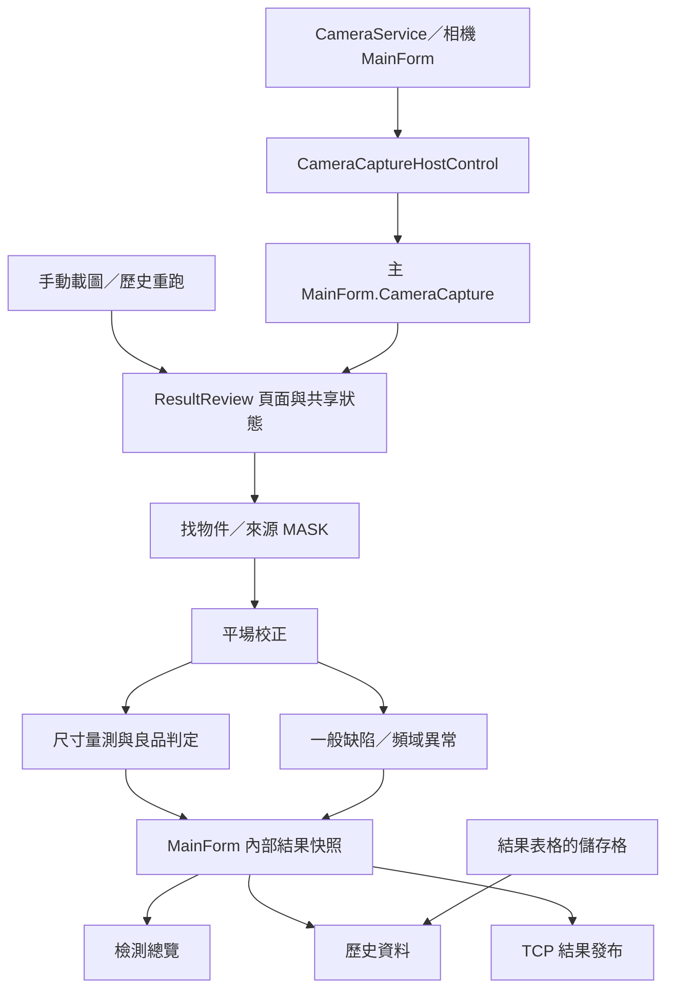

# 程式架構與維護性檢視

檢視日期：2026-10-29（Asia/Taipei）

程式基準：`c16070f` 加上目前工作目錄中尚未提交的角色選擇／設定保存修改。

目的：評估既有程式的責任分工、生命週期、相依關係及拆分順序。本次新增評估文件，未實作重構。

## 1. 範圍與整體判斷

已對兩個專案的全部自有 C# 原始檔做結構掃描，盤點類別、方法、長方法、平行工作、重複方法和專案 Compile 清單；並沿取像、找物件、MASK、平場、尺寸、一般缺陷、頻域、整合、結果快照、Recipe、歷史與 TCP 的主路徑深入追讀。Designer、設定模型、P/Invoke 宣告及輔助視窗也納入檔案盤點。排除第三方 `packages`、建置輸出 `bin`／`obj`。

這是靜態架構檢視，不等於所有分支的執行驗證；本次沒有執行建置、相機／米輪、GUI、連續運轉或公司影像的檢出率測試。以下會區分可由程式確認的結構與依路徑推導、尚待實機重現的風險。

| 項目 | 目前數值 |
|---|---:|
| C# 原始檔 | 107 檔 |
| C# 總行數（含註解、空行、Designer） | 84,908 行 |
| 主程式 | 66 檔／70,606 行 |
| 相機模組 | 41 檔／14,302 行 |
| 主程式 MainForm partial | 44 檔／58,301 行 |
| 兩個 csproj 的 Compile 項目 | 66＋41；未發現缺檔、重複列入或未列入的自有 C# 檔 |

目前功能已形成完整的檢測應用流程，且具備幾個可延續的邊界：相機模組是獨立專案、OpenCV 門檻／邊緣已有服務、MASK／灰階已有快取類別、Recipe／設備設定分開保存、歷史 DB 與 TCP transport 已有獨立類別。

主要維護負擔集中在 MainForm：44 個 partial 在編譯後仍是同一個類別，約占全部 C# 行數的 69%。畫面控制項、當前參數、運算狀態、影像所有權與結果保存經常直接互相存取。繼續增加 partial 可以改善找檔案的速度，但還需要抽出獨立類別，才能縮小修改會影響的範圍。

不需要推倒重寫，也不需要立即改框架或拆成多支服務。建議先在現有 solution 中逐步建立可單獨呼叫的計算、結果與執行階段元件。

## 2. 目前的主要相依關係



相機輸入已使用 Mono8 記憶體影像，存圖與檢測也已分路。需要改善的是：相機與歷史重跑仍借用結果確認頁執行檢測；歷史的一部分資料又從畫面表格取回。這些依賴讓頁面生命週期影響到檢測與保存。

## 3. 優先注意的具體問題

### F01｜高：離開總覽可能保留檢測模式，卻中斷新影格的檢測轉送

依目前程式路徑，在本機持續檢測已啟動、沒有遠端取像模式接手時，離開總覽會：

1. 保留 `isInspectionOverviewInspectionModeActive`。
2. 將 `OverviewCaptureForwardingEnabled` 設為 false，並移除總覽事件訂閱。
3. 因為檢測模式仍在，將 `SuppressAutomaticInspectionForwarding` 保持 true。

Host 的一般檢測轉送因此被抑制，總覽轉送也已關閉。相機可能繼續取像，但離開期間的新影格沒有進入本機檢測；回到總覽才重新掛回路徑。這是靜態追讀可以推導出的觸發條件，尚未用相機重現。

依據：[MainForm.InspectionOverview.cs:216](<C:/Users/falcomu/Documents/Codex/程式撰寫 專案資料夾/整合式影像處理軟件/my-app-4/IntegratedImageProcessingApp/Forms/MainForm.InspectionOverview.cs:216>)、[MainForm.InspectionOverview.cs:1282](<C:/Users/falcomu/Documents/Codex/程式撰寫 專案資料夾/整合式影像處理軟件/my-app-4/IntegratedImageProcessingApp/Forms/MainForm.InspectionOverview.cs:1282>)、[CameraCaptureHostControl.cs:339](<C:/Users/falcomu/Documents/Codex/程式撰寫 專案資料夾/整合式影像處理軟件/my-app-4/IntegratedImageProcessingApp/Controls/CameraCaptureHostControl.cs:339>)。

建議先修正轉送規則，再把「持續取像／持續檢測／停止」移到與頁面無關的 `StationInspectionRuntime`。頁面開關只決定是否更新畫面，執行模式由 runtime 管理。

### F02｜高：TCP 舊連線清理可能移除同站點的新連線

`ReadLoopAsync` 結束時會呼叫 `RemovePeer(peer)`；目前清理只依 `peer.Key` 移除字典內容，沒有確認字典中的物件仍是正在清理的那條連線。

快速斷線重連，或兩個連線嘗試重疊時，可能發生：舊 peer 被關閉、新 peer 已用相同 `station:{id}` key 註冊、舊讀取迴圈稍後進入 finally，再把新 peer 的字典項目移除。這可能造成連線燈號或傳送狀態不穩定。

依據：[InspectionTcpTransport.cs:250](<C:/Users/falcomu/Documents/Codex/程式撰寫 專案資料夾/整合式影像處理軟件/my-app-4/IntegratedImageProcessingApp/Services/InspectionTcpTransport.cs:250>)、[InspectionTcpTransport.cs:439](<C:/Users/falcomu/Documents/Codex/程式撰寫 專案資料夾/整合式影像處理軟件/my-app-4/IntegratedImageProcessingApp/Services/InspectionTcpTransport.cs:439>)、[InspectionTcpTransport.cs:528](<C:/Users/falcomu/Documents/Codex/程式撰寫 專案資料夾/整合式影像處理軟件/my-app-4/IntegratedImageProcessingApp/Services/InspectionTcpTransport.cs:528>)。

建議清理時比對 connection instance 或獨立 ConnectionId，並讓同站點連線嘗試有單一進行中的工作。這是正確性修正，適合先於大型拆分處理；本次尚未做重連壓力測試。

### F03｜中高：檢測引擎仍依賴結果確認頁存在

相機流程會先初始化結果確認頁，從其 ComboBox 取得參數，再呼叫結果確認執行方法。執行途中也檢查 UI 是否可用；平場校正準備需要 Label、影像控制項等物件。

依據：[MainForm.CameraCapture.cs:66](<C:/Users/falcomu/Documents/Codex/程式撰寫 專案資料夾/整合式影像處理軟件/my-app-4/IntegratedImageProcessingApp/Forms/MainForm.CameraCapture.cs:66>)、[MainForm.DetectionParameter.ResultReview.cs:1014](<C:/Users/falcomu/Documents/Codex/程式撰寫 專案資料夾/整合式影像處理軟件/my-app-4/IntegratedImageProcessingApp/Forms/MainForm.DetectionParameter.ResultReview.cs:1014>)、[MainForm.FlatFieldCalibration.Correction.cs:141](<C:/Users/falcomu/Documents/Codex/程式撰寫 專案資料夾/整合式影像處理軟件/my-app-4/IntegratedImageProcessingApp/Forms/MainForm.FlatFieldCalibration.Correction.cs:141>)。

`RunObjectDetectionResultReviewAsync` 約 590 行，同時處理輸入驗證、物件搜尋等待、平場、尺寸／缺陷排程、畫面選頁、計時、快照、歷史與 TCP。它回傳 `Task`，失敗多透過 Label／共享旗標表達；呼叫端還要再檢查共享快照是否完成。

建議建立明確的 `InspectionRequest`／`InspectionResult`，讓執行者回傳完成、取消、失敗或待確認狀態。結果確認頁、總覽、相機與歷史重跑使用同一個執行者。

### F04｜中高：歷史明細依賴表格欄位順序

歷史紀錄的尺寸明細會從 `objectDetectionResultReviewMeasurementsGrid.Rows` 讀取，以第 0、1、2、6、7、8、9、10 欄取出物件、名稱、數值與單位。調整顯示欄位就可能影響保存；有數值也已先格式化成字串。

依據：[MainForm.InspectionHistory.cs:816](<C:/Users/falcomu/Documents/Codex/程式撰寫 專案資料夾/整合式影像處理軟件/my-app-4/IntegratedImageProcessingApp/Forms/MainForm.InspectionHistory.cs:816>)，尤其 [MainForm.InspectionHistory.cs:861](<C:/Users/falcomu/Documents/Codex/程式撰寫 專案資料夾/整合式影像處理軟件/my-app-4/IntegratedImageProcessingApp/Forms/MainForm.InspectionHistory.cs:861>)。

建議執行結果直接保存逐片、逐量測的原始數值、單位、條件結果與錯誤；表格及歷史 mapper 都讀同一份結果。`InspectionHistoryStore` 已將 SQL 與 UI 分開，這個界線應保留。

### F05｜中：平行與背景工作缺少共同資源預算

目前有尺寸物件平行、一般缺陷 ROI 平行、每 ROI 內核心平行、頻域 ROI 平行，外層還可同時執行一般缺陷及兩組頻域。部分上限直接使用 ROI 數或核心數；尺寸量測另有最多 4 物件／單線路徑最多 8 的規則。

依據：[MainForm.DetectionParameter.ResultReview.cs:1778](<C:/Users/falcomu/Documents/Codex/程式撰寫 專案資料夾/整合式影像處理軟件/my-app-4/IntegratedImageProcessingApp/Forms/MainForm.DetectionParameter.ResultReview.cs:1778>)、[MainForm.DetectionParameter.DefectProcessing.cs:709](<C:/Users/falcomu/Documents/Codex/程式撰寫 專案資料夾/整合式影像處理軟件/my-app-4/IntegratedImageProcessingApp/Forms/MainForm.DetectionParameter.DefectProcessing.cs:709>)、[MainForm.DetectionParameter.DefectProcessing.cs:1326](<C:/Users/falcomu/Documents/Codex/程式撰寫 專案資料夾/整合式影像處理軟件/my-app-4/IntegratedImageProcessingApp/Forms/MainForm.DetectionParameter.DefectProcessing.cs:1326>)、[MainForm.DetectionParameter.DefectFrequency.cs:2291](<C:/Users/falcomu/Documents/Codex/程式撰寫 專案資料夾/整合式影像處理軟件/my-app-4/IntegratedImageProcessingApp/Forms/MainForm.DetectionParameter.DefectFrequency.cs:2291>)。

這些是邏輯工作數，不能當成固定的 OS 執行緒數。CPU、OpenCV 內部工作、原圖存檔與預覽仍會競爭資源。單張影像的 in-flight gate 能限制同時檢測張數，不能限制所有背景存圖工作。

主程式原圖與歷史保存均使用未集中追蹤的 `Task.Run`。相機模組自己的 snapshot 保存已有 SemaphoreSlim，兩條保存路徑的管理方式不同。

依據：[MainForm.CameraCapture.cs:424](<C:/Users/falcomu/Documents/Codex/程式撰寫 專案資料夾/整合式影像處理軟件/my-app-4/IntegratedImageProcessingApp/Forms/MainForm.CameraCapture.cs:424>)、[MainForm.InspectionHistory.cs:999](<C:/Users/falcomu/Documents/Codex/程式撰寫 專案資料夾/整合式影像處理軟件/my-app-4/IntegratedImageProcessingApp/Forms/MainForm.InspectionHistory.cs:999>)、[MainForm.cs:689](<C:/Users/falcomu/Documents/Codex/程式撰寫 專案資料夾/整合式影像處理軟件/my-app-4/CameraCaptureModule/Forms/MainForm.cs:689>)。

建議保留使用者的平行開關，改由共同排程器配置 CPU 工作及大圖記憶體預算；存圖另用有容量限制、可查詢完成／失敗、關閉時可等待的 worker。檢測仍直接使用記憶體影像；是否存圖及歷史圖片關聯由明確結果表示。

### F06｜中：複製、設定簽章與快照有多套機制

目前包含手寫缺陷設定 clone、反射深層 clone、透過暫存 INI Save／Load 正規化的 Recipe／歷史快照，以及各功能自己的字串簽章。

依據：[MainForm.DetectionParameter.DefectProcessing.cs:1001](<C:/Users/falcomu/Documents/Codex/程式撰寫 專案資料夾/整合式影像處理軟件/my-app-4/IntegratedImageProcessingApp/Forms/MainForm.DetectionParameter.DefectProcessing.cs:1001>)、[MainForm.DetectionParameter.ResultReview.cs:2712](<C:/Users/falcomu/Documents/Codex/程式撰寫 專案資料夾/整合式影像處理軟件/my-app-4/IntegratedImageProcessingApp/Forms/MainForm.DetectionParameter.ResultReview.cs:2712>)、[MainForm.DetectionParameter.ResultReview.cs:2801](<C:/Users/falcomu/Documents/Codex/程式撰寫 專案資料夾/整合式影像處理軟件/my-app-4/IntegratedImageProcessingApp/Forms/MainForm.DetectionParameter.ResultReview.cs:2801>)、[DetectionRecipeCatalogService.cs:477](<C:/Users/falcomu/Documents/Codex/程式撰寫 專案資料夾/整合式影像處理軟件/my-app-4/IntegratedImageProcessingApp/Services/DetectionRecipeCatalogService.cs:477>)、[InspectionHistoryStore.cs:96](<C:/Users/falcomu/Documents/Codex/程式撰寫 專案資料夾/整合式影像處理軟件/my-app-4/IntegratedImageProcessingApp/Services/InspectionHistoryStore.cs:96>)。

手寫 clone 容易漏新增欄位；反射 clone／簽章又會隨模型屬性改變。結果確認的整體簽章讀取所有公開屬性，包含顯示選項；單一核心簽章則只列計算欄位，兩者失效規則不一致。

歷史 Recipe 檔已有雜湊去重，能減少重複檔案；每次保存仍會做參數複製、暫存 INI 往返和 hash。可在參數修訂號固定時共用正規化快照及其雜湊。

建議統一 `RecipeSnapshotFactory`、計算用設定修訂與序列化 codec；運算開始固定一份設定，顯示選項放入獨立 ViewState。不要在運算中反覆讀取可變的編輯中全域設定。

### F07｜中：歷史 Recipe 快照不足以重現當時的 mm 換算

歷史保存 `SystemParameterSettings`，設備精度則在獨立的 `CameraDeviceSettings`。目前歷史批次模型沒有保存當時 X/Y mm-per-pixel 或換算開關；歷史重跑會替換 Recipe，但量測仍讀取當下全域精度。

依據：[InspectionHistoryStore.cs:44](<C:/Users/falcomu/Documents/Codex/程式撰寫 專案資料夾/整合式影像處理軟件/my-app-4/IntegratedImageProcessingApp/Services/InspectionHistoryStore.cs:44>)、[InspectionHistoryStore.cs:96](<C:/Users/falcomu/Documents/Codex/程式撰寫 專案資料夾/整合式影像處理軟件/my-app-4/IntegratedImageProcessingApp/Services/InspectionHistoryStore.cs:96>)、[MainForm.InspectionHistory.cs:1091](<C:/Users/falcomu/Documents/Codex/程式撰寫 專案資料夾/整合式影像處理軟件/my-app-4/IntegratedImageProcessingApp/Forms/MainForm.InspectionHistory.cs:1091>)、[MainForm.DetectionParameter.MeasurementCalculation.cs:469](<C:/Users/falcomu/Documents/Codex/程式撰寫 專案資料夾/整合式影像處理軟件/my-app-4/IntegratedImageProcessingApp/Forms/MainForm.DetectionParameter.MeasurementCalculation.cs:469>)、[MainForm.GlobalSettings.cs:27](<C:/Users/falcomu/Documents/Codex/程式撰寫 專案資料夾/整合式影像處理軟件/my-app-4/IntegratedImageProcessingApp/Forms/MainForm.GlobalSettings.cs:27>)。

若日後全域標定改過，舊圖即使用當時 Recipe，也可能得到不同的 mm 結果；以 mm 設定的缺陷寬高篩選也有同樣的追溯需求。建議在歷史執行紀錄另存 `DeviceCalibrationSnapshot`／校正版本、站點 ID 與程式版本；歷史重跑以執行階段快照使用當時校正值。設備設定仍跟軟體保存，不需要把它重新放回 Recipe。

### F08｜中：影像／MASK 所有權與快取失效分散

有的 API 回傳 Clone、有的回傳 Mat view，有的 LargeImageSource 需要 AddReference／ReleaseReference；結果確認快照會從主視窗字典接走一般缺陷、頻域及 MASK 的所有權。這些做法各有用途，但規則依靠呼叫端記住。

依據：[ProcessedBinaryMaskCache.cs:13](<C:/Users/falcomu/Documents/Codex/程式撰寫 專案資料夾/整合式影像處理軟件/my-app-4/IntegratedImageProcessingApp/Services/ProcessedBinaryMaskCache.cs:13>)、[LargeImageMaskCache.cs:136](<C:/Users/falcomu/Documents/Codex/程式撰寫 專案資料夾/整合式影像處理軟件/my-app-4/IntegratedImageProcessingApp/Services/LargeImageMaskCache.cs:136>)、[LargeImageSource.cs:254](<C:/Users/falcomu/Documents/Codex/程式撰寫 專案資料夾/整合式影像處理軟件/my-app-4/IntegratedImageProcessingApp/Controls/LargeImageSource.cs:254>)、[MainForm.DetectionParameter.ResultReview.cs:2882](<C:/Users/falcomu/Documents/Codex/程式撰寫 專案資料夾/整合式影像處理軟件/my-app-4/IntegratedImageProcessingApp/Forms/MainForm.DetectionParameter.ResultReview.cs:2882>)。

來源 MASK 解析也分布在 DetectionParameter.MaskSource、ObjectDefinitionMaskSources、ObjectJudgementProcessing 與 LargeImageProcessing。不能直接認定這些都是重複運算；部分已在共用快取。建議先抽共同來源描述與 `MaskRepository`，明訂唯讀 view／可修改 clone 的介面，再讓量測、物件定義和平場共用查詢。各消費者自己的組合規則保留。

相機模組與主程式各有 LargeImageSource。結構掃描找到多個相同方法，例如 PrefetchNeighborhood、GetGrayAt、AddTileToCacheUnsafe；但主程式多了記憶體／虛擬來源與參照計數，不能直接用其中一份覆蓋另一份。共享解碼與 tile-cache 核心適合放在後期處理。

### F09｜中：公式輸入驗證與執行解析分開維護

設定頁使用 regex／括號計數驗證，執行頁另外使用 expression parser。例：`1+*2` 的字元與括號符合設定頁檢查，但執行 parser 會拒絕；此例是依程式邏輯判讀，未啟動 GUI 測試。

依據：[MainForm.DetectionParameter.GoodCondition.cs:915](<C:/Users/falcomu/Documents/Codex/程式撰寫 專案資料夾/整合式影像處理軟件/my-app-4/IntegratedImageProcessingApp/Forms/MainForm.DetectionParameter.GoodCondition.cs:915>)、[MainForm.DetectionParameter.ResultReview.cs:3319](<C:/Users/falcomu/Documents/Codex/程式撰寫 專案資料夾/整合式影像處理軟件/my-app-4/IntegratedImageProcessingApp/Forms/MainForm.DetectionParameter.ResultReview.cs:3319>)。

這是很適合先抽離的責任：同一個 parser 提供語法檢查與運算，另外驗證量測編號是否存在、單線／平行的適用規則。保留 `(1)`、`MIN(1)`、`AVG(1)`、`MAX(1)` 和既有舊語法的意思。

### F10｜中：頁面建構、版面與導航集中在共享主視窗

尺寸設定的 UI 建構方法約 767 行；平場設定約 642 行；內部參數頁約 546 行；頻域頁約 446 行。常用固定 GroupBox 高度、絕對列高和 Location，內容增減時必須同步改多個數字，容易重現文字被壓住的問題。

依據：[MainForm.DetectionParameter.Measurement.cs:267](<C:/Users/falcomu/Documents/Codex/程式撰寫 專案資料夾/整合式影像處理軟件/my-app-4/IntegratedImageProcessingApp/Forms/MainForm.DetectionParameter.Measurement.cs:267>)、[MainForm.FlatFieldCalibration.cs:722](<C:/Users/falcomu/Documents/Codex/程式撰寫 專案資料夾/整合式影像處理軟件/my-app-4/IntegratedImageProcessingApp/Forms/MainForm.FlatFieldCalibration.cs:722>)、[MainForm.GlobalSettings.cs:177](<C:/Users/falcomu/Documents/Codex/程式撰寫 專案資料夾/整合式影像處理軟件/my-app-4/IntegratedImageProcessingApp/Forms/MainForm.GlobalSettings.cs:177>)、[MainForm.DetectionParameter.DefectCores.cs:646](<C:/Users/falcomu/Documents/Codex/程式撰寫 專案資料夾/整合式影像處理軟件/my-app-4/IntegratedImageProcessingApp/Forms/MainForm.DetectionParameter.DefectCores.cs:646>)。

全域設定、歷史、總覽、總控各自保存／還原主視窗欄寬與可見狀態；導航重設又會逐一呼叫各頁 Exit 方法。角色切換保存 ListBox.Items 快照，而動態選單另有依索引建立的映射表。建議以固定功能 ID／導覽節點建立選單，角色只過濾節點，再由單一頁面容器控制右側版面。

依據：[MainForm.Navigation.cs:87](<C:/Users/falcomu/Documents/Codex/程式撰寫 專案資料夾/整合式影像處理軟件/my-app-4/IntegratedImageProcessingApp/Forms/MainForm.Navigation.cs:87>)、[MainForm.Navigation.cs:812](<C:/Users/falcomu/Documents/Codex/程式撰寫 專案資料夾/整合式影像處理軟件/my-app-4/IntegratedImageProcessingApp/Forms/MainForm.Navigation.cs:812>)、[MainForm.GlobalSettings.cs:46](<C:/Users/falcomu/Documents/Codex/程式撰寫 專案資料夾/整合式影像處理軟件/my-app-4/IntegratedImageProcessingApp/Forms/MainForm.GlobalSettings.cs:46>)。

## 4. 拆分候選與實際邊界

以下是建議新增的類別／檔案名稱，尚未建立。優先順序兼顧收益、可隔離程度與回歸風險。

| 順序 | 現有位置 | 建議抽出 | 頁面保留什麼 | 風險 |
|---|---|---|---|---|
| 1 | ResultReview 的 expression parser＋GoodCondition 驗證 | MeasurementStatistics、MeasurementExpressionParser、SpecificationEvaluator | 輸入文字與顯示錯誤 | 低至中；要保留舊語法 |
| 2 | DefectRegion（3,044 行）＋MeasurementDrawing 的座標模型 | DefectRoiGroupResolver、ObjectCoordinateFrame、RoiGeometry | 清單、命名、拖曳、繪框 | 中；需鎖定旋轉／比例／邊界規則 |
| 3 | DefectFrequency（3,399 行） | FrequencyAnalysisSettings／Result、FrequencyScanWorkspace、FrequencyAnomalyAnalyzer | 設定 UI、運算按鈕、進度、繪圖 | 中高；能量／掃描落點不可順便更改 |
| 4 | DefectProcessing（2,130 行） | DefectCoreAnalyzer、DefectPreprocessor、DefectCoreResult | 套用草稿、結果顯示 | 中高；輸入先固定成快照 |
| 5 | ObjectDefinitionComponents（676 行）、ObjectJudgementProcessing（2,315 行） | ObjectComponentAnalyzer、ObjectMaskProcessor | 選取與流程編輯 | 中；先抽結果型別 |
| 6 | SystemParameterSettings（975 行）、SystemParameterIniService（2,897 行） | 按功能分模型；IniDocument、DetectionParameterCodec、ObjectFlowCodec、LegacyMigration | 原 Load／Save 外部介面維持 | 中高；保留鍵名、ID 與舊檔預設 |
| 7 | ResultReview（3,559 行）＋CameraCapture | InspectionRequest／Result、InspectionSession、InspectionRunner、StationInspectionRuntime | 頁面輸入、綁定、視圖保存 | 高；應分多次完成 |
| 8 | InspectionHistory（1,411 行） | HistoryRecordMapper、HistoryRecorder、HistoryReplayCoordinator、HistoryPageControl | 日期／篩選／表格互動 | 中；結果模型先穩定 |
| 9 | ConnectionController（1,847 行） | ControllerRuntime、StationStatusMapper／Publisher、ControllerPageControl | 站點卡片與操作 | 中高；先修 F02，再分責任 |
| 10 | GlobalSettings（1,301 行）、DefectCores、Measurement 等 UI | 個別設定 UserControl，共用小型表單列／套用列 | 主視窗只掛載頁面 | 中；須檢查 DPI 與縮放 |
| 11 | CameraService（3,736 行）＋相機 MainForm（1,705 行） | SaperaDiagnosticsExporter、SaperaFeatureGateway、AcquisitionSession、MeterWheelTriggerCoordinator | 相機 UI 與操作轉發 | 高；必須有實機驗證 |
| 12 | ImageDisplayControl（2,409 行）與兩份 LargeImageSource | ViewportController、TileRenderer、OverlayRenderer、共用影像來源核心 | Control 對外事件與介面 | 高；排在後期 |

### 頻域檔的具體拆法

目前可辨識出以下責任，不宜只依每 500 行切一個 partial：

- 資料與工作區：Cell、Result、Workspace，包含 Hanning window、有效 MASK 查詢與暫存陣列。
- 設定：頻域一／二的 UI 與草稿套用／取消。
- 計算：ScanRegions、CreateScanStarts、TryFindWindow、TryCalculateEnergy、統計尺度。
- 鄰格比較：應把一般缺陷候選當作輸入，避免在 analyzer 中查 MainForm 結果字典。
- 呈現：熱圖、異常框、座標轉換後的 overlay。
- 協調：固定來源／設定、取消、結果發布與過期結果丟棄。

第一輪只抽模型、Workspace 與純計算。保留座標系、視窗尺寸、最後一格往回補齊、完整 MASK 限制、垂直縮放、能量公式與門檻尺度。

### 設定模型需要收斂的地方

頻域一的欄位放在 ObjectDetectionParameterSettings 上，頻域二則使用 ObjectDetectionFrequencySettings；頁面另外手寫兩邊欄位轉換。建議內部逐步改成相同的設定型別／集合，舊 INI 格式由 adapter 兼容。

依據：[SystemParameterSettings.cs:464](<C:/Users/falcomu/Documents/Codex/程式撰寫 專案資料夾/整合式影像處理軟件/my-app-4/IntegratedImageProcessingApp/Services/SystemParameterSettings.cs:464>)、[SystemParameterSettings.cs:806](<C:/Users/falcomu/Documents/Codex/程式撰寫 專案資料夾/整合式影像處理軟件/my-app-4/IntegratedImageProcessingApp/Services/SystemParameterSettings.cs:806>)、[MainForm.DetectionParameter.DefectFrequency.cs:542](<C:/Users/falcomu/Documents/Codex/程式撰寫 專案資料夾/整合式影像處理軟件/my-app-4/IntegratedImageProcessingApp/Forms/MainForm.DetectionParameter.DefectFrequency.cs:542>)。

第一階段可按「找物件」「物件定義」「檢測條件」「ROI」「尺寸」拆模型檔，但先維持既有 namespace 與序列化鍵。每個資料類別都拆成極小檔案沒有必要。

### 相機檔需要保守處理

CameraService 不只有 SDK connect／disconnect，還包含裝置探索、不同硬體設定途徑、CCF 設定、feature reflection、報表輸出、灰階影格轉交與清理。先抽報表文字建構及明確的 feature 存取，最後才動 SDK 生命週期與觸發。

相機 UI 的取像、米輪、存圖與波形本來就分成不同視窗；這些小視窗不需要為縮短行數再拆。可先將米輪觸發協調與存圖 worker 從相機 MainForm 移到專用類別。

另外，ShowCameraImage 關閉後目前仍可先建立預覽 Bitmap、交 FrameRecorder clone，之後才跳過顯示。這可能是保留 recorder／存圖功能的需要，但大圖情況下值得用 frame sink 分流，讓不需要預覽／Bitmap 的路徑不建立完整副本。需用實際影像量測，不可僅靠分檔宣稱加速。

依據：[CameraService.cs:879](<C:/Users/falcomu/Documents/Codex/程式撰寫 專案資料夾/整合式影像處理軟件/my-app-4/CameraCaptureModule/Services/CameraService.cs:879>)、[MainForm.cs:916](<C:/Users/falcomu/Documents/Codex/程式撰寫 專案資料夾/整合式影像處理軟件/my-app-4/CameraCaptureModule/Forms/MainForm.cs:916>)、[FrameRecorder.cs:19](<C:/Users/falcomu/Documents/Codex/程式撰寫 專案資料夾/整合式影像處理軟件/my-app-4/CameraCaptureModule/Services/FrameRecorder.cs:19>)。

## 5. 建議的共同執行模型

```text
InspectionRequest
  RunId、FrameId、取像時間
  灰階影像的唯讀 lease
  RecipeSnapshot／Revision、ParameterId
  DeviceCalibrationSnapshot
  執行模式與記錄選項

InspectionResult
  同一個 RunId／FrameId／RecipeRevision／ParameterId
  完成／失敗／取消／影像規格不符的狀態及原因
  各片的格位、尺寸數值、A/B/NG/待確認
  一般缺陷／頻域／整合候選與逐片判定
  各階段累計與牆鐘時間

InspectionDisplayAssets
  原圖／平場／條件處理圖／MASK 的影像參照
  明確 Dispose／所有權

ReviewViewState
  選片、表格選取、顯示開關、各分頁縮放與平移
```

數值與判定結果不必持有 WinForms 控制項。大圖資源與可變的畫面選取狀態也不應塞進同一個結果物件。執行者處理相依順序；資料準備好後，尺寸、一般缺陷與頻域可依資源預算平行，鄰格比較等待其需要的一般缺陷結果。

相機、手動確認與歷史重跑各自建立 Request；歷史重跑使用當時快照，不必暫時替換整個主視窗的 `systemParameters`。總覽、歷史、TCP 均讀同一份 Result，逐片 NG 邏輯繼續保留。

執行模式應與頁面分開：Idle／ContinuousCapture／ContinuousInspection 等模式，加上單張忙碌狀態及拒收原因；切換頁面不改變模式。仍維持目前「忙碌時略過新圖、不排隊檢測」的需求。

## 6. 分階段實作與驗收條件

### 第 0 階段：先處理已有明確風險的路徑

- 修正總覽離頁轉送與持續檢測旗標不一致。
- 修正 TCP 清理只依站點 key、未檢查 connection identity。
- 明確呈現存圖／歷史保存失敗，並記錄對應 RunId。

### 第 1 階段：建立可重用的資料和低耦合計算

- 抽 MeasurementStatistics、公式 parser、規格比較。
- 抽物件座標框與 ROI group resolver。
- 抽共同逐片結果模型；歷史 mapper 停止讀 Grid.Cells。

### 第 2 階段：抽檢測運算

- 依序抽頻域 analyzer、一般缺陷 analyzer、物件元件／MASK 運算。
- 統一設定快照與快取 key 的構成。
- 加入共同工作預算；保留平行開關與結果一致性。

### 第 3 階段：抽執行階段與頁面

- 相機／手動／歷史共用 InspectionRunner。
- 頁面改為專用 UserControl；MainForm 負責主視窗組裝與導航。
- TCP／歷史／圖片保存由完成事件及 Result 驅動，追蹤工作結束與關閉。

### 第 4 階段：再處理硬體和影像控制項共用

- 拆相機 feature／診斷／SDK session；每步做實機取像驗收。
- 逐步共用兩份 LargeImageSource 的解碼與 tile-cache 能力。
- 視需要再將純核心移成獨立 class library；不必一開始增加許多專案。

每次只改一個責任並提交一個可回退的變更。新 C# 檔須加入對應 csproj Compile 清單。重構時不要同步更改演算法、門檻、Recipe 鍵名、顯示色彩和資料庫格式，除非該次工作已明確包含這些需求。

重構驗收至少涵蓋：

| 範圍 | 應固定的行為 |
|---|---|
| ROI | 同一定義套全部物件；改名不改 ID；組內重疊區只判一次；未指定組不運算 |
| 頻域 | 不超出有效 ROI／MASK；邊格保持掃描尺寸並往內移；縮放與格位座標不變 |
| 尺寸 | 指定 MASK 重用；不同 X/Y 精度；單線／多線；min/avg/max；逐片 A→B→NG／待確認 |
| 一般缺陷 | 七核心啟用、對比／前處理、暗亮門檻、E/D、大小篩選、暗亮不同顏色 |
| 整合 | 暗合併／亮合併／亮暗合併／兩頻域；逐片歸屬；雙擊聚焦 |
| 非同步 | 中途換圖／換 Recipe 的舊結果不發布；忙碌丟圖；離頁持續檢測；停止模式完成當前工作 |
| 結果 | 頁面切換不清結果；同一選項不重建；縮放平移維持；歷史與 TCP 判定相同 |
| 歷史 | 精確 ParameterId、當時快照／校正、跨日 DB、無大圖提示、保存失敗、查詢不阻塞 UI |
| TCP | 快速斷線重連、同站點重複連線、舊 cleanup 不移除新 peer、命令 ack 與模式一致 |

這些是後續重構的驗收建議，本次沒有新增測試程式或執行以上案例。

## 7. 保留的設計與不急著拆的檔案

- 保留相機模組獨立專案與 Mono8 記憶體傳遞方式。
- 保留 Recipe、設備內參、總控設定的不同保存範圍。
- 保留穩定 ID 與名稱分離、ROI 群組及逐片判定。
- 保留 OpenCvThresholdService、OpenCvEdgeDetectionService、既有快取服務的職責；先改善使用介面與所有權。
- ConnectionControllerSettingsService、Lsi8181Native、CameraSettings 等小型且職責清楚的檔案可維持。
- Designer 行數大通常是版面宣告，不能單憑行數列為最先重構的運算檔。
- 本次不建議為了分檔同步升級 .NET、換 SQLite provider、換 UI 框架或重寫相機觸發。

設定檔寫入策略可在專門一輪整理：DeviceSettings 已採暫存檔替換；SystemParameters、總控 XML、captureSetting 仍有直接覆寫。應共用安全寫入方式、明確舊檔版本及遷移，避免中斷寫入造成設定損壞；不要只因缺少新欄位就重置整份現場設定。

## 8. 本次檢視的界限與交付

本次完成全檔案結構／專案列入檢查、主要流程追讀與架構風險整理；未據此宣稱檢出率、實機連續模式、斷線復原或重構後效能已驗收。分檔本身不會讓演算法變快；減少重複資料準備、管理平行與大圖副本才可能改善耗時，仍須量測。

README／PROJECT_HANDOFF 內先前的部分大檔行數和未提交狀態描述已落後現況，後續更新應以本次盤點及當時 Git 狀態重新核對。下方逐檔表提供這次的完整盤點，並註明各檔的拆分建議。

交付檢查：107 個原始檔在檢視前後的內容雜湊相同；報告 170 個檔案／行號連結均存在，107 檔全部列入下方盤點。既有未提交程式的 `git diff --check` 另指出 MainForm.Designer.cs 第 367 行的空白註解有行尾空白；本次維持程式碼原狀，這不屬於功能或架構問題。


## 9. 全部 C# 檔案盤點

行數包含空行、註解與 Designer。下表是結構及責任盤點；「維持」表示目前不需為了行數額外拆分。

### IntegratedImageProcessingApp

| 檔案 | 行數 | 目前職責 | 建議 |
|---|---:|---|---|
| [Controls/BufferedRenderPanel.cs](<C:/Users/falcomu/Documents/Codex/程式撰寫 專案資料夾/整合式影像處理軟件/my-app-4/IntegratedImageProcessingApp/Controls/BufferedRenderPanel.cs>) | 13 | 雙緩衝面板 | 小型明確，維持 |
| [Controls/CameraCaptureHostControl.cs](<C:/Users/falcomu/Documents/Codex/程式撰寫 專案資料夾/整合式影像處理軟件/my-app-4/IntegratedImageProcessingApp/Controls/CameraCaptureHostControl.cs>) | 395 | 嵌入相機視窗、操作轉發與三條影格轉送開關 | 相機生命週期獨立於頁面，事件路由交 runtime |
| [Controls/ImageDisplayControl.cs](<C:/Users/falcomu/Documents/Codex/程式撰寫 專案資料夾/整合式影像處理軟件/my-app-4/IntegratedImageProcessingApp/Controls/ImageDisplayControl.cs>) | 2409 | 一般大圖 viewer、ROI 互動、tile／overlay 與視圖狀態 | 後期分 viewport／renderer／ROI interaction |
| [Controls/ImageDisplayControl.Designer.cs](<C:/Users/falcomu/Documents/Codex/程式撰寫 專案資料夾/整合式影像處理軟件/my-app-4/IntegratedImageProcessingApp/Controls/ImageDisplayControl.Designer.cs>) | 147 | 對應控制項／視窗的 Designer 版面與資源釋放 | 隨父頁面／控制項拆分；不按行數拆生成碼 |
| [Controls/LargeImageSource.cs](<C:/Users/falcomu/Documents/Codex/程式撰寫 專案資料夾/整合式影像處理軟件/my-app-4/IntegratedImageProcessingApp/Controls/LargeImageSource.cs>) | 1580 | 檔案／Mat／相機記憶體／虛擬來源、參照計數及 tile cache | 抽影像來源核心及所有權契約，先保留現有介面 |
| [Forms/DetectionRecipeDialogs.cs](<C:/Users/falcomu/Documents/Codex/程式撰寫 專案資料夾/整合式影像處理軟件/my-app-4/IntegratedImageProcessingApp/Forms/DetectionRecipeDialogs.cs>) | 516 | Recipe 選擇、說明、刪除、排序與套用視窗 | 目前範圍可接受；資料管理維持在 service |
| [Forms/MainForm.CameraCapture.cs](<C:/Users/falcomu/Documents/Codex/程式撰寫 專案資料夾/整合式影像處理軟件/my-app-4/IntegratedImageProcessingApp/Forms/MainForm.CameraCapture.cs>) | 599 | 相機記憶體影格接收、忙碌丟圖、檢測啟動及原圖保存 | 抽 runtime／圖片保存 worker，解除結果確認 UI 依賴 |
| [Forms/MainForm.ConnectionController.cs](<C:/Users/falcomu/Documents/Codex/程式撰寫 專案資料夾/整合式影像處理軟件/my-app-4/IntegratedImageProcessingApp/Forms/MainForm.ConnectionController.cs>) | 1847 | 站點卡片、命令、重連、遠端相機模式與本機狀態發布 | 分 ControllerRuntime、StationStatusMapper 與頁面 |
| [Forms/MainForm.cs](<C:/Users/falcomu/Documents/Codex/程式撰寫 專案資料夾/整合式影像處理軟件/my-app-4/IntegratedImageProcessingApp/Forms/MainForm.cs>) | 2799 | 主視窗組裝、共用影像處理 helper、載圖、計時、設定保存、選單繪製 | 分開視窗組裝、影像輸入、計時／狀態及影像處理入口 |
| [Forms/MainForm.Designer.cs](<C:/Users/falcomu/Documents/Codex/程式撰寫 專案資料夾/整合式影像處理軟件/my-app-4/IntegratedImageProcessingApp/Forms/MainForm.Designer.cs>) | 1541 | 對應控制項／視窗的 Designer 版面與資源釋放 | 隨父頁面／控制項拆分；不按行數拆生成碼 |
| [Forms/MainForm.DetectionParameter.cs](<C:/Users/falcomu/Documents/Codex/程式撰寫 專案資料夾/整合式影像處理軟件/my-app-4/IntegratedImageProcessingApp/Forms/MainForm.DetectionParameter.cs>) | 1390 | 檢測參數主頁、物件序號、數量與來源狀態、量測資料型別 | 抽共用結果／幾何模型，保留頁面協調 |
| [Forms/MainForm.DetectionParameter.DefectCores.cs](<C:/Users/falcomu/Documents/Codex/程式撰寫 專案資料夾/整合式影像處理軟件/my-app-4/IntegratedImageProcessingApp/Forms/MainForm.DetectionParameter.DefectCores.cs>) | 1291 | 七組一般缺陷設定、草稿套用／取消與版面 | 改成可重用 DefectConditionEditorControl |
| [Forms/MainForm.DetectionParameter.DefectDisplay.cs](<C:/Users/falcomu/Documents/Codex/程式撰寫 專案資料夾/整合式影像處理軟件/my-app-4/IntegratedImageProcessingApp/Forms/MainForm.DetectionParameter.DefectDisplay.cs>) | 533 | 缺陷影像分頁、顯示索引、啟用可見性與底圖 | 保留專用顯示協調，改讀獨立 Result／DisplayAssets |
| [Forms/MainForm.DetectionParameter.DefectFrequency.cs](<C:/Users/falcomu/Documents/Codex/程式撰寫 專案資料夾/整合式影像處理軟件/my-app-4/IntegratedImageProcessingApp/Forms/MainForm.DetectionParameter.DefectFrequency.cs>) | 3399 | 頻域設定、Workspace、掃描、能量、鄰格比較、結果與繪圖 | 優先抽模型／Workspace／Analyzer；UI 另封裝 |
| [Forms/MainForm.DetectionParameter.DefectIntegration.cs](<C:/Users/falcomu/Documents/Codex/程式撰寫 專案資料夾/整合式影像處理軟件/my-app-4/IntegratedImageProcessingApp/Forms/MainForm.DetectionParameter.DefectIntegration.cs>) | 887 | 候選收集、距離合併、暗亮規則、表格與雙擊聚焦 | 抽純 DefectResultIntegrator，頁面保留選取與繪圖 |
| [Forms/MainForm.DetectionParameter.DefectProcessing.cs](<C:/Users/falcomu/Documents/Codex/程式撰寫 專案資料夾/整合式影像處理軟件/my-app-4/IntegratedImageProcessingApp/Forms/MainForm.DetectionParameter.DefectProcessing.cs>) | 2130 | 一般缺陷排程、ROI／核心運算、前處理、候選與結果資源 | 抽 DefectCoreAnalyzer；共用工作預算 |
| [Forms/MainForm.DetectionParameter.DefectRegion.cs](<C:/Users/falcomu/Documents/Codex/程式撰寫 專案資料夾/整合式影像處理軟件/my-app-4/IntegratedImageProcessingApp/Forms/MainForm.DetectionParameter.DefectRegion.cs>) | 3044 | 獨立 ROI／範圍組管理、驗證、解析、拖曳與顯示 | 先抽 resolver／幾何，再拆範圍編輯控制項 |
| [Forms/MainForm.DetectionParameter.GoodCondition.cs](<C:/Users/falcomu/Documents/Codex/程式撰寫 專案資料夾/整合式影像處理軟件/my-app-4/IntegratedImageProcessingApp/Forms/MainForm.DetectionParameter.GoodCondition.cs>) | 1052 | 良品條件編輯、公式／規格輸入驗證與說明 | 驗證共用 parser；UI 封裝為條件編輯器 |
| [Forms/MainForm.DetectionParameter.Management.cs](<C:/Users/falcomu/Documents/Codex/程式撰寫 專案資料夾/整合式影像處理軟件/my-app-4/IntegratedImageProcessingApp/Forms/MainForm.DetectionParameter.Management.cs>) | 872 | 檢測參數新增／分組／匯出／匯入及大量狀態清理 | 抽 RecipeApplicationSession／設定套用協調 |
| [Forms/MainForm.DetectionParameter.MaskSource.cs](<C:/Users/falcomu/Documents/Codex/程式撰寫 專案資料夾/整合式影像處理軟件/my-app-4/IntegratedImageProcessingApp/Forms/MainForm.DetectionParameter.MaskSource.cs>) | 2270 | 量測／平場等來源 MASK 解析、快取、選擇器及 overlay | 共同 MaskRepository；選擇器與 overlay 留呈現層 |
| [Forms/MainForm.DetectionParameter.Measurement.cs](<C:/Users/falcomu/Documents/Codex/程式撰寫 專案資料夾/整合式影像處理軟件/my-app-4/IntegratedImageProcessingApp/Forms/MainForm.DetectionParameter.Measurement.cs>) | 1038 | 量測顯示初始化、幾何草稿與尺寸設定 UI | 抽 MeasurementEditorControl |
| [Forms/MainForm.DetectionParameter.MeasurementCalculation.cs](<C:/Users/falcomu/Documents/Codex/程式撰寫 專案資料夾/整合式影像處理軟件/my-app-4/IntegratedImageProcessingApp/Forms/MainForm.DetectionParameter.MeasurementCalculation.cs>) | 834 | 量測快取、指定 MASK 取樣、連續／忽略空隙與 mm 換算 | 抽 MeasurementAnalyzer；校正值以參數傳入 |
| [Forms/MainForm.DetectionParameter.MeasurementDrawing.cs](<C:/Users/falcomu/Documents/Codex/程式撰寫 專案資料夾/整合式影像處理軟件/my-app-4/IntegratedImageProcessingApp/Forms/MainForm.DetectionParameter.MeasurementDrawing.cs>) | 1547 | 量測畫線、物件座標框、render cache 與 overlay | 先抽 ObjectCoordinateFrame；輸入互動和 renderer 分工 |
| [Forms/MainForm.DetectionParameter.MeasurementRecords.cs](<C:/Users/falcomu/Documents/Codex/程式撰寫 專案資料夾/整合式影像處理軟件/my-app-4/IntegratedImageProcessingApp/Forms/MainForm.DetectionParameter.MeasurementRecords.cs>) | 617 | 量測記錄新增／修改／選取／保存及顯示高亮 | 跟量測編輯器移動；不需獨立成多個微小服務 |
| [Forms/MainForm.DetectionParameter.Recipes.cs](<C:/Users/falcomu/Documents/Codex/程式撰寫 專案資料夾/整合式影像處理軟件/my-app-4/IntegratedImageProcessingApp/Forms/MainForm.DetectionParameter.Recipes.cs>) | 827 | Recipe 新建／選用／更新／另存、套用後重跑與世代檢查 | 保留工作流入口；重跑使用共同 Runner |
| [Forms/MainForm.DetectionParameter.ResultReview.cs](<C:/Users/falcomu/Documents/Codex/程式撰寫 專案資料夾/整合式影像處理軟件/my-app-4/IntegratedImageProcessingApp/Forms/MainForm.DetectionParameter.ResultReview.cs>) | 3559 | 結果確認 UI、執行協調、計時、深複製、快照與公式解析 | 拆 parser、Result／Session、Runner、PageControl |
| [Forms/MainForm.DetectionParameter.ResultReview.GoodJudgement.cs](<C:/Users/falcomu/Documents/Codex/程式撰寫 專案資料夾/整合式影像處理軟件/my-app-4/IntegratedImageProcessingApp/Forms/MainForm.DetectionParameter.ResultReview.GoodJudgement.cs>) | 853 | 逐片 A/B/NG 判定、格位與條件結果顯示 | 抽 GradeEvaluator／ObjectGridLayout；頁面只呈現 |
| [Forms/MainForm.FlatFieldCalibration.Correction.cs](<C:/Users/falcomu/Documents/Codex/程式撰寫 專案資料夾/整合式影像處理軟件/my-app-4/IntegratedImageProcessingApp/Forms/MainForm.FlatFieldCalibration.Correction.cs>) | 631 | 保存校正值套用、大圖分塊校正、預覽與世代檢查 | 抽 FlatFieldCorrector；取消／輸入由 Session 提供 |
| [Forms/MainForm.FlatFieldCalibration.cs](<C:/Users/falcomu/Documents/Codex/程式撰寫 專案資料夾/整合式影像處理軟件/my-app-4/IntegratedImageProcessingApp/Forms/MainForm.FlatFieldCalibration.cs>) | 1367 | 平場取樣互動、曲線繪圖、校正執行與設定 UI | 抽 FlatFieldEditorControl／校正協調 |
| [Forms/MainForm.FlatFieldCalibration.Masks.cs](<C:/Users/falcomu/Documents/Codex/程式撰寫 專案資料夾/整合式影像處理軟件/my-app-4/IntegratedImageProcessingApp/Forms/MainForm.FlatFieldCalibration.Masks.cs>) | 908 | 平場來源／使用位置 MASK、套用與 overlay | 共同 MASK 來源層＋專用顯示資料 |
| [Forms/MainForm.FlatFieldCalibration.Profile.cs](<C:/Users/falcomu/Documents/Codex/程式撰寫 專案資料夾/整合式影像處理軟件/my-app-4/IntegratedImageProcessingApp/Forms/MainForm.FlatFieldCalibration.Profile.cs>) | 496 | 取樣曲線、平滑／補值、Profile 編碼及設定簽章 | 抽 FlatFieldProfileCalculator／Codec |
| [Forms/MainForm.FunctionTree.cs](<C:/Users/falcomu/Documents/Codex/程式撰寫 專案資料夾/整合式影像處理軟件/my-app-4/IntegratedImageProcessingApp/Forms/MainForm.FunctionTree.cs>) | 1086 | ROI／影像處理樹的群組、排序、刪除與動態選單映射 | 逐步改為型別化導覽節點；保留穩定 ID |
| [Forms/MainForm.GlobalSettings.cs](<C:/Users/falcomu/Documents/Codex/程式撰寫 專案資料夾/整合式影像處理軟件/my-app-4/IntegratedImageProcessingApp/Forms/MainForm.GlobalSettings.cs>) | 1301 | 設備精度、程式名稱、網路／歷史／規格限制與相機頁容器 | 改為 GlobalSettingsControl；服務管理已套用設定 |
| [Forms/MainForm.ImageProcessing.cs](<C:/Users/falcomu/Documents/Codex/程式撰寫 專案資料夾/整合式影像處理軟件/my-app-4/IntegratedImageProcessingApp/Forms/MainForm.ImageProcessing.cs>) | 906 | 二值 MASK 快取入口、影像處理流程 UI 與數值控制項 | 運算移服務，編輯器移控制項 |
| [Forms/MainForm.ImageRelations.cs](<C:/Users/falcomu/Documents/Codex/程式撰寫 專案資料夾/整合式影像處理軟件/my-app-4/IntegratedImageProcessingApp/Forms/MainForm.ImageRelations.cs>) | 487 | 影像關聯項目管理、選擇與來源切換 | 關聯解析抽服務；編輯工作留頁面 |
| [Forms/MainForm.ImageView.cs](<C:/Users/falcomu/Documents/Codex/程式撰寫 專案資料夾/整合式影像處理軟件/my-app-4/IntegratedImageProcessingApp/Forms/MainForm.ImageView.cs>) | 734 | 跨圖分頁的縮放、平移、最大化及視圖還原 | 抽 ImageViewSynchronizer，保持座標／事件行為 |
| [Forms/MainForm.InspectionHistory.cs](<C:/Users/falcomu/Documents/Codex/程式撰寫 專案資料夾/整合式影像處理軟件/my-app-4/IntegratedImageProcessingApp/Forms/MainForm.InspectionHistory.cs>) | 1411 | 歷史 UI、紀錄組裝、背景保存與當時參數重跑 | 優先移除 Grid 資料來源，再拆 mapper／recorder／replay |
| [Forms/MainForm.InspectionOverview.cs](<C:/Users/falcomu/Documents/Codex/程式撰寫 專案資料夾/整合式影像處理軟件/my-app-4/IntegratedImageProcessingApp/Forms/MainForm.InspectionOverview.cs>) | 1848 | 逐片矩陣、原圖、連線狀態及本機持續模式 | 模式移 runtime；畫面移 OverviewPageControl |
| [Forms/MainForm.LargeImageProcessing.cs](<C:/Users/falcomu/Documents/Codex/程式撰寫 專案資料夾/整合式影像處理軟件/my-app-4/IntegratedImageProcessingApp/Forms/MainForm.LargeImageProcessing.cs>) | 1689 | 大圖灰階／MASK 建立、背景 tile、overlay 快取與計時 | 抽 MaskBuildCoordinator／OverlayRenderer；統一所有權 |
| [Forms/MainForm.Navigation.cs](<C:/Users/falcomu/Documents/Codex/程式撰寫 專案資料夾/整合式影像處理軟件/my-app-4/IntegratedImageProcessingApp/Forms/MainForm.Navigation.cs>) | 1424 | 角色切換、功能導覽、鍵盤／滑鼠動作、右側頁面重設 | 抽 NavigationController／頁面容器；獨立角色狀態 |
| [Forms/MainForm.ObjectDefinition.cs](<C:/Users/falcomu/Documents/Codex/程式撰寫 專案資料夾/整合式影像處理軟件/my-app-4/IntegratedImageProcessingApp/Forms/MainForm.ObjectDefinition.cs>) | 1156 | 物件定義選單、設定頁、步驟與來源選取 | 保留設定 UI；用獨立服務執行物件定義 |
| [Forms/MainForm.ObjectDefinitionComponents.cs](<C:/Users/falcomu/Documents/Codex/程式撰寫 專案資料夾/整合式影像處理軟件/my-app-4/IntegratedImageProcessingApp/Forms/MainForm.ObjectDefinitionComponents.cs>) | 676 | 連通元件、面積篩選、輪廓、旋轉幾何、排序與合併 | 抽 ObjectComponentAnalyzer，結果型別先移出 MainForm |
| [Forms/MainForm.ObjectDefinitionDisplay.cs](<C:/Users/falcomu/Documents/Codex/程式撰寫 專案資料夾/整合式影像處理軟件/my-app-4/IntegratedImageProcessingApp/Forms/MainForm.ObjectDefinitionDisplay.cs>) | 551 | 物件定義結果、原圖註記、overlay 與計時 MEMO | 呈現／計時分工；不需要拆每個繪圖 helper |
| [Forms/MainForm.ObjectDefinitionMaskSources.cs](<C:/Users/falcomu/Documents/Codex/程式撰寫 專案資料夾/整合式影像處理軟件/my-app-4/IntegratedImageProcessingApp/Forms/MainForm.ObjectDefinitionMaskSources.cs>) | 1426 | 物件定義的來源 MASK、關聯／區塊組合與快取 | 跟共同 MaskRepository 收斂低層來源查詢 |
| [Forms/MainForm.ObjectDefinitionProcessing.cs](<C:/Users/falcomu/Documents/Codex/程式撰寫 專案資料夾/整合式影像處理軟件/my-app-4/IntegratedImageProcessingApp/Forms/MainForm.ObjectDefinitionProcessing.cs>) | 1127 | 物件搜尋背景排程、來源相依、簽章與結果世代 | 執行移 Runner；純結果模型獨立 |
| [Forms/MainForm.ObjectJudgement.cs](<C:/Users/falcomu/Documents/Codex/程式撰寫 專案資料夾/整合式影像處理軟件/my-app-4/IntegratedImageProcessingApp/Forms/MainForm.ObjectJudgement.cs>) | 1424 | 整合成區塊的樹、群組、管理與設定頁 | 以型別化流程樹／專用編輯器整理 |
| [Forms/MainForm.ObjectJudgementProcessing.cs](<C:/Users/falcomu/Documents/Codex/程式撰寫 專案資料夾/整合式影像處理軟件/my-app-4/IntegratedImageProcessingApp/Forms/MainForm.ObjectJudgementProcessing.cs>) | 2315 | 區塊處理設定、工作排程、形態學／填孔／重建與快取 | 抽 ObjectMaskProcessor，協調與 UI 分開 |
| [Forms/MainForm.Preprocessing.cs](<C:/Users/falcomu/Documents/Codex/程式撰寫 專案資料夾/整合式影像處理軟件/my-app-4/IntegratedImageProcessingApp/Forms/MainForm.Preprocessing.cs>) | 1408 | 前處理流程管理、灰階準備、OpenCV 處理與 UI | 抽 PreprocessingPipeline，群組編輯使用導覽模型 |
| [Forms/MainForm.Relation.cs](<C:/Users/falcomu/Documents/Codex/程式撰寫 專案資料夾/整合式影像處理軟件/my-app-4/IntegratedImageProcessingApp/Forms/MainForm.Relation.cs>) | 859 | 影像關聯群組、來源解析、大圖合併及來源快取 | 抽 RelationResolver／SourceCache；保留群組操作 |
| [Forms/MainForm.RoiEditing.cs](<C:/Users/falcomu/Documents/Codex/程式撰寫 專案資料夾/整合式影像處理軟件/my-app-4/IntegratedImageProcessingApp/Forms/MainForm.RoiEditing.cs>) | 142 | 指定 ROI 的啟動編輯、來源畫面與套用 | 範圍已小；隨導覽／ROI 編輯器移動即可 |
| [Program.cs](<C:/Users/falcomu/Documents/Codex/程式撰寫 專案資料夾/整合式影像處理軟件/my-app-4/IntegratedImageProcessingApp/Program.cs>) | 17 | WinForms 啟動入口 | 維持；可逐步作為依賴組裝入口 |
| [Services/CameraDeviceSettingsIniService.cs](<C:/Users/falcomu/Documents/Codex/程式撰寫 專案資料夾/整合式影像處理軟件/my-app-4/IntegratedImageProcessingApp/Services/CameraDeviceSettingsIniService.cs>) | 316 | 設備內參／名稱／網路／歷史／規格限制／角色狀態保存 | 目前職責可接受；模型可獨立，保留安全替換寫入 |
| [Services/ConnectionControllerSettingsService.cs](<C:/Users/falcomu/Documents/Codex/程式撰寫 專案資料夾/整合式影像處理軟件/my-app-4/IntegratedImageProcessingApp/Services/ConnectionControllerSettingsService.cs>) | 113 | 總控設定／站點清單 XML 讀寫與模型 | 維持小服務；統一安全寫入 |
| [Services/DetectionRecipeCatalogService.cs](<C:/Users/falcomu/Documents/Codex/程式撰寫 專案資料夾/整合式影像處理軟件/my-app-4/IntegratedImageProcessingApp/Services/DetectionRecipeCatalogService.cs>) | 516 | Recipe 清單／檔案加入、更新、排序、刪除與快照 | 保留服務；快照 clone／codec 與歷史共用 |
| [Services/InspectionHistoryStore.cs](<C:/Users/falcomu/Documents/Codex/程式撰寫 專案資料夾/整合式影像處理軟件/my-app-4/IntegratedImageProcessingApp/Services/InspectionHistoryStore.cs>) | 543 | 每日 SQLite、交易、模型、參數快照及原生 DB wrapper | 抽模型／快照倉庫；NativeSqlite wrapper 可獨立檔 |
| [Services/InspectionTcpTransport.cs](<C:/Users/falcomu/Documents/Codex/程式撰寫 專案資料夾/整合式影像處理軟件/my-app-4/IntegratedImageProcessingApp/Services/InspectionTcpTransport.cs>) | 588 | TCP peer、listener／client、心跳、JSON 傳送與事件 | 先修 peer identity；可拆 protocol DTO，transport 保持單一 |
| [Services/LargeImageGrayscaleDecoder.cs](<C:/Users/falcomu/Documents/Codex/程式撰寫 專案資料夾/整合式影像處理軟件/my-app-4/IntegratedImageProcessingApp/Services/LargeImageGrayscaleDecoder.cs>) | 96 | OpenCV／WIC 大圖灰階解碼 | 保留專用服務 |
| [Services/LargeImageMaskCache.cs](<C:/Users/falcomu/Documents/Codex/程式撰寫 專案資料夾/整合式影像處理軟件/my-app-4/IntegratedImageProcessingApp/Services/LargeImageMaskCache.cs>) | 258 | 大型 MASK 快取、建置世代及 native／managed 結果 | 保留；訂明回傳 view／所有權與容量策略 |
| [Services/LargeRoiGrayscaleCache.cs](<C:/Users/falcomu/Documents/Codex/程式撰寫 專案資料夾/整合式影像處理軟件/my-app-4/IntegratedImageProcessingApp/Services/LargeRoiGrayscaleCache.cs>) | 141 | 來源灰階／ROI 灰階快取與 Mat view | 保留；跟 Session 生命週期綁定 |
| [Services/LargeRoiMaskBuilder.cs](<C:/Users/falcomu/Documents/Codex/程式撰寫 專案資料夾/整合式影像處理軟件/my-app-4/IntegratedImageProcessingApp/Services/LargeRoiMaskBuilder.cs>) | 210 | 含邊界 padding 的大 ROI 分塊 MASK 建立 | 保留；輸入可逐步型別化 |
| [Services/OpenCvEdgeDetectionService.cs](<C:/Users/falcomu/Documents/Codex/程式撰寫 專案資料夾/整合式影像處理軟件/my-app-4/IntegratedImageProcessingApp/Services/OpenCvEdgeDetectionService.cs>) | 195 | Canny／Sobel／Polarity 邊緣 MASK | 職責清楚，維持 |
| [Services/OpenCvImageProcessingService.cs](<C:/Users/falcomu/Documents/Codex/程式撰寫 專案資料夾/整合式影像處理軟件/my-app-4/IntegratedImageProcessingApp/Services/OpenCvImageProcessingService.cs>) | 129 | 門檻／邊緣方法選擇及參數轉送 | 保留；共用參數讀取／驗證可整理 |
| [Services/OpenCvThresholdService.cs](<C:/Users/falcomu/Documents/Codex/程式撰寫 專案資料夾/整合式影像處理軟件/my-app-4/IntegratedImageProcessingApp/Services/OpenCvThresholdService.cs>) | 137 | 全域／自適應／Otsu 二值化 | 職責清楚，維持 |
| [Services/ProcessedBinaryMaskCache.cs](<C:/Users/falcomu/Documents/Codex/程式撰寫 專案資料夾/整合式影像處理軟件/my-app-4/IntegratedImageProcessingApp/Services/ProcessedBinaryMaskCache.cs>) | 114 | 已處理二值 MASK 的建立、Clone 與清除 | 保留；共同 CacheKey 與容量策略 |
| [Services/SystemParameterIniService.cs](<C:/Users/falcomu/Documents/Codex/程式撰寫 專案資料夾/整合式影像處理軟件/my-app-4/IntegratedImageProcessingApp/Services/SystemParameterIniService.cs>) | 2897 | INI 讀寫、預設／ID／引用修復與舊欄位遷移 | 抽 IniDocument、功能 codec 與 migration，保留 facade |
| [Services/SystemParameterSettings.cs](<C:/Users/falcomu/Documents/Codex/程式撰寫 專案資料夾/整合式影像處理軟件/my-app-4/IntegratedImageProcessingApp/Services/SystemParameterSettings.cs>) | 975 | 找物件、定義、ROI、量測、缺陷及頻域參數模型 | 按功能群拆模型檔；統一頻域設定型別 |

### CameraCaptureModule

| 檔案 | 行數 | 目前職責 | 建議 |
|---|---:|---|---|
| [Controls/BufferedRenderPanel.cs](<C:/Users/falcomu/Documents/Codex/程式撰寫 專案資料夾/整合式影像處理軟件/my-app-4/CameraCaptureModule/Controls/BufferedRenderPanel.cs>) | 13 | 雙緩衝顯示面板 | 小型明確，維持 |
| [Controls/CameraDisplayControl.cs](<C:/Users/falcomu/Documents/Codex/程式撰寫 專案資料夾/整合式影像處理軟件/my-app-4/CameraCaptureModule/Controls/CameraDisplayControl.cs>) | 1416 | 相機影像、滾動預覽、tile、縮放平移及灰階取樣互動 | 後期拆 viewport／renderer；不急著跟主 viewer 合併 |
| [Controls/CameraDisplayControl.Designer.cs](<C:/Users/falcomu/Documents/Codex/程式撰寫 專案資料夾/整合式影像處理軟件/my-app-4/CameraCaptureModule/Controls/CameraDisplayControl.Designer.cs>) | 174 | 對應控制項／視窗的 Designer 版面與資源釋放 | 隨父頁面／控制項拆分；不按行數拆生成碼 |
| [Controls/LargeImageSource.cs](<C:/Users/falcomu/Documents/Codex/程式撰寫 專案資料夾/整合式影像處理軟件/my-app-4/CameraCaptureModule/Controls/LargeImageSource.cs>) | 673 | 相機模組的檔案大圖、預覽與 tile cache | 後期共用解碼／cache 核心；目前保留功能差異 |
| [Forms/CameraSettingsForm.cs](<C:/Users/falcomu/Documents/Codex/程式撰寫 專案資料夾/整合式影像處理軟件/my-app-4/CameraCaptureModule/Forms/CameraSettingsForm.cs>) | 544 | 相機參數、CCF、觸發、影像保存／轉送設定 UI | 維持專用視窗；共用設定驗證 |
| [Forms/CameraSettingsForm.Designer.cs](<C:/Users/falcomu/Documents/Codex/程式撰寫 專案資料夾/整合式影像處理軟件/my-app-4/CameraCaptureModule/Forms/CameraSettingsForm.Designer.cs>) | 655 | 對應控制項／視窗的 Designer 版面與資源釋放 | 隨父頁面／控制項拆分；不按行數拆生成碼 |
| [Forms/GrayScaleWaveformForm.cs](<C:/Users/falcomu/Documents/Codex/程式撰寫 專案資料夾/整合式影像處理軟件/my-app-4/CameraCaptureModule/Forms/GrayScaleWaveformForm.cs>) | 384 | 灰階波形繪圖、取樣、縮放與選取 | 維持專用視窗 |
| [Forms/GrayScaleWaveformForm.Designer.cs](<C:/Users/falcomu/Documents/Codex/程式撰寫 專案資料夾/整合式影像處理軟件/my-app-4/CameraCaptureModule/Forms/GrayScaleWaveformForm.Designer.cs>) | 106 | 對應控制項／視窗的 Designer 版面與資源釋放 | 隨父頁面／控制項拆分；不按行數拆生成碼 |
| [Forms/GrayScaleWaveformSelectForm.cs](<C:/Users/falcomu/Documents/Codex/程式撰寫 專案資料夾/整合式影像處理軟件/my-app-4/CameraCaptureModule/Forms/GrayScaleWaveformSelectForm.cs>) | 236 | 取樣線位置選擇及座標轉換 | 維持；線段幾何共用可後續處理 |
| [Forms/GrayScaleWaveformSelectForm.Designer.cs](<C:/Users/falcomu/Documents/Codex/程式撰寫 專案資料夾/整合式影像處理軟件/my-app-4/CameraCaptureModule/Forms/GrayScaleWaveformSelectForm.Designer.cs>) | 117 | 對應控制項／視窗的 Designer 版面與資源釋放 | 隨父頁面／控制項拆分；不按行數拆生成碼 |
| [Forms/GrayWaveformConfirmForm.cs](<C:/Users/falcomu/Documents/Codex/程式撰寫 專案資料夾/整合式影像處理軟件/my-app-4/CameraCaptureModule/Forms/GrayWaveformConfirmForm.cs>) | 38 | 灰階波形選擇確認 | 小型明確，維持 |
| [Forms/GrayWaveformConfirmForm.Designer.cs](<C:/Users/falcomu/Documents/Codex/程式撰寫 專案資料夾/整合式影像處理軟件/my-app-4/CameraCaptureModule/Forms/GrayWaveformConfirmForm.Designer.cs>) | 102 | 對應控制項／視窗的 Designer 版面與資源釋放 | 隨父頁面／控制項拆分；不按行數拆生成碼 |
| [Forms/MainForm.cs](<C:/Users/falcomu/Documents/Codex/程式撰寫 專案資料夾/整合式影像處理軟件/my-app-4/CameraCaptureModule/Forms/MainForm.cs>) | 1705 | 相機 UI、米輪、自動觸發、預覽佇列、影格轉交與存圖 | 抽 TriggerCoordinator／SaveWorker；保留視窗操作 |
| [Forms/MainForm.Designer.cs](<C:/Users/falcomu/Documents/Codex/程式撰寫 專案資料夾/整合式影像處理軟件/my-app-4/CameraCaptureModule/Forms/MainForm.Designer.cs>) | 338 | 對應控制項／視窗的 Designer 版面與資源釋放 | 隨父頁面／控制項拆分；不按行數拆生成碼 |
| [Forms/MeterWheelControlForm.cs](<C:/Users/falcomu/Documents/Codex/程式撰寫 專案資料夾/整合式影像處理軟件/my-app-4/CameraCaptureModule/Forms/MeterWheelControlForm.cs>) | 493 | 米輪 encoder／compare／倍率／方向與一般設定 | 維持專用視窗；硬體操作走 service |
| [Forms/MeterWheelControlForm.Designer.cs](<C:/Users/falcomu/Documents/Codex/程式撰寫 專案資料夾/整合式影像處理軟件/my-app-4/CameraCaptureModule/Forms/MeterWheelControlForm.Designer.cs>) | 466 | 對應控制項／視窗的 Designer 版面與資源釋放 | 隨父頁面／控制項拆分；不按行數拆生成碼 |
| [Forms/MeterWheelExtensionCompareForm.cs](<C:/Users/falcomu/Documents/Codex/程式撰寫 專案資料夾/整合式影像處理軟件/my-app-4/CameraCaptureModule/Forms/MeterWheelExtensionCompareForm.cs>) | 221 | 米輪多通道 compare 輸出設定與狀態 | 維持專用視窗 |
| [Forms/MeterWheelExtensionCompareForm.Designer.cs](<C:/Users/falcomu/Documents/Codex/程式撰寫 專案資料夾/整合式影像處理軟件/my-app-4/CameraCaptureModule/Forms/MeterWheelExtensionCompareForm.Designer.cs>) | 398 | 對應控制項／視窗的 Designer 版面與資源釋放 | 隨父頁面／控制項拆分；不按行數拆生成碼 |
| [Forms/SaveProgressForm.cs](<C:/Users/falcomu/Documents/Codex/程式撰寫 專案資料夾/整合式影像處理軟件/my-app-4/CameraCaptureModule/Forms/SaveProgressForm.cs>) | 109 | 影像保存進度及剩餘筆數顯示 | 小型明確，維持 |
| [Models/CameraSettings.cs](<C:/Users/falcomu/Documents/Codex/程式撰寫 專案資料夾/整合式影像處理軟件/my-app-4/CameraCaptureModule/Models/CameraSettings.cs>) | 146 | 相機、觸發、保存、顯示與米輪設定及 Clone | 保留模型；驗證與複製需同步新增欄位 |
| [Models/CameraStatus.cs](<C:/Users/falcomu/Documents/Codex/程式撰寫 專案資料夾/整合式影像處理軟件/my-app-4/CameraCaptureModule/Models/CameraStatus.cs>) | 29 | 相機連線／預覽／取像與錯誤狀態 | 保留；runtime 對外提供一致快照 |
| [Models/ImageSaveFormat.cs](<C:/Users/falcomu/Documents/Codex/程式撰寫 專案資料夾/整合式影像處理軟件/my-app-4/CameraCaptureModule/Models/ImageSaveFormat.cs>) | 9 | 影像保存格式列舉 | 維持 |
| [Models/RollingCaptureDirection.cs](<C:/Users/falcomu/Documents/Codex/程式撰寫 專案資料夾/整合式影像處理軟件/my-app-4/CameraCaptureModule/Models/RollingCaptureDirection.cs>) | 8 | 滾動影像方向列舉 | 維持 |
| [Models/TriggerMode.cs](<C:/Users/falcomu/Documents/Codex/程式撰寫 專案資料夾/整合式影像處理軟件/my-app-4/CameraCaptureModule/Models/TriggerMode.cs>) | 10 | 相機觸發模式列舉 | 維持 |
| [Native/Lsi8181Native.cs](<C:/Users/falcomu/Documents/Codex/程式撰寫 專案資料夾/整合式影像處理軟件/my-app-4/CameraCaptureModule/Native/Lsi8181Native.cs>) | 99 | LSI8181 native API 與資料結構 | 維持單一硬體宣告邊界 |
| [Properties/AssemblyInfo.cs](<C:/Users/falcomu/Documents/Codex/程式撰寫 專案資料夾/整合式影像處理軟件/my-app-4/CameraCaptureModule/Properties/AssemblyInfo.cs>) | 15 | 相機模組組件中繼資料 | 維持 |
| [Sapera/AcqConfigDlg.cs](<C:/Users/falcomu/Documents/Codex/程式撰寫 專案資料夾/整合式影像處理軟件/my-app-4/CameraCaptureModule/Sapera/AcqConfigDlg.cs>) | 449 | Sapera 伺服器／資源／CCF 選擇及設定 | SDK 相依 UI，保守維護 |
| [Sapera/AcqConfigDlg.Designer.cs](<C:/Users/falcomu/Documents/Codex/程式撰寫 專案資料夾/整合式影像處理軟件/my-app-4/CameraCaptureModule/Sapera/AcqConfigDlg.Designer.cs>) | 269 | 對應控制項／視窗的 Designer 版面與資源釋放 | 隨父頁面／控制項拆分；不按行數拆生成碼 |
| [Services/AppLogger.cs](<C:/Users/falcomu/Documents/Codex/程式撰寫 專案資料夾/整合式影像處理軟件/my-app-4/CameraCaptureModule/Services/AppLogger.cs>) | 44 | 相機文字日誌與路徑 | 維持；未來加入 RunId／站點關聯 |
| [Services/CameraFrameEventArgs.cs](<C:/Users/falcomu/Documents/Codex/程式撰寫 專案資料夾/整合式影像處理軟件/my-app-4/CameraCaptureModule/Services/CameraFrameEventArgs.cs>) | 15 | 預覽 Bitmap 事件資料 | 維持；註明 Bitmap 所有權 |
| [Services/CameraImageAcquiredEventArgs.cs](<C:/Users/falcomu/Documents/Codex/程式撰寫 專案資料夾/整合式影像處理軟件/my-app-4/CameraCaptureModule/Services/CameraImageAcquiredEventArgs.cs>) | 117 | Mono8 frame、stride、序號、時間與 Bitmap 副本 | 保留灰階 frame；獨立影像生命週期契約 |
| [Services/CameraService.cs](<C:/Users/falcomu/Documents/Codex/程式撰寫 專案資料夾/整合式影像處理軟件/my-app-4/CameraCaptureModule/Services/CameraService.cs>) | 3736 | Sapera 生命週期、取像、設定／feature、探索與診斷 | 先抽診斷與 feature gateway，再抽 SDK session |
| [Services/FrameRecorder.cs](<C:/Users/falcomu/Documents/Codex/程式撰寫 專案資料夾/整合式影像處理軟件/my-app-4/CameraCaptureModule/Services/FrameRecorder.cs>) | 464 | 最新／滾動影格、影像合成與保存 | 拆影格持有／格式寫入需依效能需求，先減少多餘副本 |
| [Services/GrayWaveformSelectionEventArgs.cs](<C:/Users/falcomu/Documents/Codex/程式撰寫 專案資料夾/整合式影像處理軟件/my-app-4/CameraCaptureModule/Services/GrayWaveformSelectionEventArgs.cs>) | 25 | 灰階取樣選取事件資料 | 維持 |
| [Services/ICameraImageSource.cs](<C:/Users/falcomu/Documents/Codex/程式撰寫 專案資料夾/整合式影像處理軟件/my-app-4/CameraCaptureModule/Services/ICameraImageSource.cs>) | 17 | 完整影格來源事件介面 | 保留取像與檢測的介面邊界 |
| [Services/ICameraService.cs](<C:/Users/falcomu/Documents/Codex/程式撰寫 專案資料夾/整合式影像處理軟件/my-app-4/CameraCaptureModule/Services/ICameraService.cs>) | 39 | 相機操作、狀態、SDK 設定視窗與事件契約 | 後期分開純取像操作與 SDK 設定 UI |
| [Services/IGrayPixelSource.cs](<C:/Users/falcomu/Documents/Codex/程式撰寫 專案資料夾/整合式影像處理軟件/my-app-4/CameraCaptureModule/Services/IGrayPixelSource.cs>) | 16 | 灰階像素／取樣來源介面 | 小型明確，維持 |
| [Services/ISettingsService.cs](<C:/Users/falcomu/Documents/Codex/程式撰寫 專案資料夾/整合式影像處理軟件/my-app-4/CameraCaptureModule/Services/ISettingsService.cs>) | 11 | 相機設定讀寫介面 | 維持 |
| [Services/Lsi8181MeterWheelService.cs](<C:/Users/falcomu/Documents/Codex/程式撰寫 專案資料夾/整合式影像處理軟件/my-app-4/CameraCaptureModule/Services/Lsi8181MeterWheelService.cs>) | 312 | 米輪硬體生命週期、encoder／compare／輸出封裝 | 維持；需實機驗收，避免盲拆 |
| [Services/SettingsService.cs](<C:/Users/falcomu/Documents/Codex/程式撰寫 專案資料夾/整合式影像處理軟件/my-app-4/CameraCaptureModule/Services/SettingsService.cs>) | 239 | captureSetting.ini 與舊檔遷移 | 維持；改安全寫入與共用驗證 |
| [Services/UiExceptionHandler.cs](<C:/Users/falcomu/Documents/Codex/程式撰寫 專案資料夾/整合式影像處理軟件/my-app-4/CameraCaptureModule/Services/UiExceptionHandler.cs>) | 45 | 相機模組 UI／未處理例外記錄與提示 | 維持；確認主程式與模組註冊責任 |

## 10. 結構掃描的長方法摘錄

以下行數用原始碼方法範圍估算，作為責任集中程度的線索；分支多寡與資源生命週期仍比單純行數重要。Designer 初始化不列入此表。

| 方法 | 約行數 | 所在位置 |
|---|---:|---|
| Load | 886 | [SystemParameterIniService.cs](<C:/Users/falcomu/Documents/Codex/程式撰寫 專案資料夾/整合式影像處理軟件/my-app-4/IntegratedImageProcessingApp/Services/SystemParameterIniService.cs:29>) |
| BuildObjectDetectionSizeMeasurementTab | 767 | [MainForm.DetectionParameter.Measurement.cs](<C:/Users/falcomu/Documents/Codex/程式撰寫 專案資料夾/整合式影像處理軟件/my-app-4/IntegratedImageProcessingApp/Forms/MainForm.DetectionParameter.Measurement.cs:267>) |
| BuildObjectDetectionFlatFieldTab | 642 | [MainForm.FlatFieldCalibration.cs](<C:/Users/falcomu/Documents/Codex/程式撰寫 專案資料夾/整合式影像處理軟件/my-app-4/IntegratedImageProcessingApp/Forms/MainForm.FlatFieldCalibration.cs:722>) |
| RunObjectDetectionResultReviewAsync | 590 | [MainForm.DetectionParameter.ResultReview.cs](<C:/Users/falcomu/Documents/Codex/程式撰寫 專案資料夾/整合式影像處理軟件/my-app-4/IntegratedImageProcessingApp/Forms/MainForm.DetectionParameter.ResultReview.cs:1014>) |
| RunObjectDetectionDefectProcessingCoreAsync | 584 | [MainForm.DetectionParameter.DefectProcessing.cs](<C:/Users/falcomu/Documents/Codex/程式撰寫 專案資料夾/整合式影像處理軟件/my-app-4/IntegratedImageProcessingApp/Forms/MainForm.DetectionParameter.DefectProcessing.cs:331>) |
| CreateInternalParametersPanel | 546 | [MainForm.GlobalSettings.cs](<C:/Users/falcomu/Documents/Codex/程式撰寫 專案資料夾/整合式影像處理軟件/my-app-4/IntegratedImageProcessingApp/Forms/MainForm.GlobalSettings.cs:177>) |
| Save | 485 | [SystemParameterIniService.cs](<C:/Users/falcomu/Documents/Codex/程式撰寫 專案資料夾/整合式影像處理軟件/my-app-4/IntegratedImageProcessingApp/Services/SystemParameterIniService.cs:916>) |
| BuildObjectDetectionDefectFrequencyTab | 446 | [MainForm.DetectionParameter.DefectFrequency.cs](<C:/Users/falcomu/Documents/Codex/程式撰寫 專案資料夾/整合式影像處理軟件/my-app-4/IntegratedImageProcessingApp/Forms/MainForm.DetectionParameter.DefectFrequency.cs:623>) |
| ShowObjectDefinitionParameterPanel | 442 | [MainForm.ObjectDefinition.cs](<C:/Users/falcomu/Documents/Codex/程式撰寫 專案資料夾/整合式影像處理軟件/my-app-4/IntegratedImageProcessingApp/Forms/MainForm.ObjectDefinition.cs:586>) |
| CreateConnectionControllerSettingsPanel | 402 | [MainForm.GlobalSettings.cs](<C:/Users/falcomu/Documents/Codex/程式撰寫 專案資料夾/整合式影像處理軟件/my-app-4/IntegratedImageProcessingApp/Forms/MainForm.GlobalSettings.cs:724>) |
| RunObjectDetectionFrequencyAnalysisAsync | 377 | [MainForm.DetectionParameter.DefectFrequency.cs](<C:/Users/falcomu/Documents/Codex/程式撰寫 專案資料夾/整合式影像處理軟件/my-app-4/IntegratedImageProcessingApp/Forms/MainForm.DetectionParameter.DefectFrequency.cs:1612>) |
| ScanObjectDetectionFrequencyRegions | 351 | [MainForm.DetectionParameter.DefectFrequency.cs](<C:/Users/falcomu/Documents/Codex/程式撰寫 專案資料夾/整合式影像處理軟件/my-app-4/IntegratedImageProcessingApp/Forms/MainForm.DetectionParameter.DefectFrequency.cs:2052>) |
| CreateInspectionOverviewPanel | 348 | [MainForm.InspectionOverview.cs](<C:/Users/falcomu/Documents/Codex/程式撰寫 專案資料夾/整合式影像處理軟件/my-app-4/IntegratedImageProcessingApp/Forms/MainForm.InspectionOverview.cs:283>) |
| ObjectDetectionMeasurementDisplayControl_ImageOverlayPaint | 344 | [MainForm.DetectionParameter.MeasurementDrawing.cs](<C:/Users/falcomu/Documents/Codex/程式撰寫 專案資料夾/整合式影像處理軟件/my-app-4/IntegratedImageProcessingApp/Forms/MainForm.DetectionParameter.MeasurementDrawing.cs:483>) |
| FunctionListBox_SelectedIndexChanged | 339 | [MainForm.Navigation.cs](<C:/Users/falcomu/Documents/Codex/程式撰寫 專案資料夾/整合式影像處理軟件/my-app-4/IntegratedImageProcessingApp/Forms/MainForm.Navigation.cs:379>) |
| StartObjectDefinitionProcessingCore | 314 | [MainForm.ObjectDefinitionProcessing.cs](<C:/Users/falcomu/Documents/Codex/程式撰寫 專案資料夾/整合式影像處理軟件/my-app-4/IntegratedImageProcessingApp/Forms/MainForm.ObjectDefinitionProcessing.cs:224>) |
