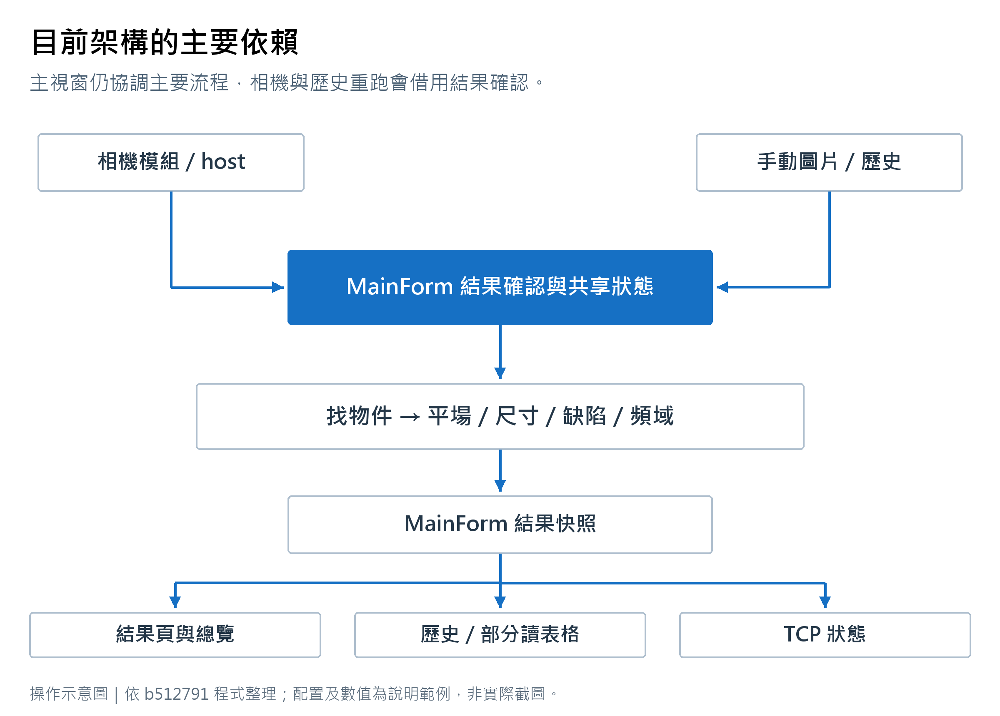

# 整合式影像處理軟體目前架構

文件版本 1.1　核對日期 2026-10-30　程式基準 b512791

本程式的功能流程符合單攝影機檢測應用的方向。維護負擔集中在主視窗：操作頁、檢測排程、影像資源及結果保存共用大量欄位。現有專案可以漸進整理，應先處理會影響連續運轉的問題。

## 1 系統範圍與部署

單一程式執行個體控制一台線掃描攝影機，使用本機 Recipe 進行逐片尺寸、缺陷與綜合判定。程式同時含多站 TCP/IP 總控頁；目前總控與被控功能仍在同一套軟體，尚未拆成獨立產品。

| 專案 | 形式 | 職責 |
|---|---|---|
| IntegratedImageProcessingApp | WinForms 執行檔 | 找物件、Recipe、量測、缺陷、總覽、歷史及 TCP/IP |
| CameraCaptureModule | 類別庫 | Sapera 相機、取像設定、預覽、米輪及相關彈出視窗 |

兩個專案的目標為 .NET Framework 4.7.2，實際平台是 x64。方案名稱顯示 Any CPU，不表示可部署為 32 位元。主程式依賴 OpenCvSharp、其原生元件、Sapera SDK、LSI 米輪原生 DLL 與 Windows SQLite runtime。

既有結構盤點為 107 個自有 C# 檔、約 84,908 行；主 MainForm 有 44 個 partial、約 58,301 行。數值包含註解、空行及 Designer，排除套件和建置輸出。partial 雖分檔，編譯後仍是一個類別。

## 2 現有模組與依賴

<!-- illustration:19_current_architecture -->

圖示呈現現有依賴，並非重構完成狀態。
<!-- /illustration -->

~~~mermaid
flowchart TD
    SDK[Sapera 相機與米輪] --> Camera[CameraCaptureModule]
    Camera --> Host[CameraCaptureHostControl]
    Host --> Intake[MainForm 相機影格入口]
    Files[手動圖片與歷史圖片] --> Review[MainForm 結果確認與共享欄位]
    Intake --> Review
    Recipe[Recipe 與 SystemParameters] --> Review
    Device[設備全域設定] --> Review
    Review --> Objects[找物件與 MASK]
    Objects --> Flat[平場校正]
    Objects --> Size[尺寸計算與良品判定]
    Flat --> Defect[七個一般缺陷核心與兩個頻域分析]
    Size --> Result[MainForm 結果快照]
    Defect --> Result
    Result --> UI[結果確認與檢測總覽]
    Result --> History[歷史紀錄]
    Grid[量測表格內容] --> History
    Result --> TCP[TCP 站點狀態]
~~~

相機資料已經透過 Mono8 記憶體影格直接進入檢測。主程式背景存 TIFF 是另一條工作，不需完成存檔才能開始檢測。

主要耦合在於相機與歷史重跑借用結果確認頁的執行方法；部分處理仍要求控制項存在。結果也包含大量 MainForm 內部型別，歷史尺寸明細又讀取表格儲存格，尚未形成完全獨立的執行引擎。

## 3 主要檔案責任

| 現有檔案或區域 | 目前責任 |
|---|---|
| MainForm.cs、Navigation、FunctionTree | 主視窗、選單、角色、頁面建立／還原與共用狀態 |
| MainForm.ImageView、LargeImageProcessing | 圖片載入、來源與大圖處理協調 |
| Preprocessing、ImageProcessing、ImageRelations | 搜尋物件前的處理流程及來源關聯 |
| ObjectJudgement、ObjectJudgementProcessing | 區塊整合與 MASK 運算 |
| ObjectDefinition 及相關 partial | 物件篩選、排列、編號、旋轉幾何與來源 MASK |
| DetectionParameter、Management、Recipes | 檢測參數、分組、Recipe 管理 |
| Measurement、Calculation、Drawing、Records | 量測 UI、幾何、取樣、繪線與資料紀錄 |
| GoodCondition、ResultReview.GoodJudgement | A/B 條件編輯、運算式與逐片良品評估 |
| FlatFieldCalibration 相關 partial | 位置 MASK、灰階曲線、保存資料及校正影像 |
| DefectRegion | 共用 ROI 定義、群組、選片、畫框和排程入口 |
| DefectCores、DefectProcessing、DefectEnhancement | 一般核心 UI、前處理、增強、門檻與連通元件 |
| DefectFrequency | 兩組頻域設定、掃描、能量、鄰格比較、快取與顯示 |
| DefectIntegration、DefectDisplay | 候選合併、結果表、熱圖、框與處理圖 |
| ResultReview | 一次完整確認、計時、平行排程及結果快照 |
| InspectionOverview、CameraCapture | 相機入口、模式、總覽、影像背景保存 |
| InspectionHistory | 查詢 UI、記錄映射、圖片保存與歷史重跑 |
| ConnectionController | 總控卡片、命令、重連及站點狀態組裝 |
| GlobalSettings | 設備與總控設定 UI、相機頁掛載 |
| Services 下設定與儲存類別 | INI、Recipe catalog、每日 DB、XML 與 TCP transport |
| Controls 下大圖與 MASK 快取 | 影像來源、分塊、預覽、顯示及部分來源重用 |
| CameraCaptureModule 的 CameraService | SDK 連線、feature、取像、診斷和釋放 |

完整 107 檔清單沿用根目錄 ARCHITECTURE_REVIEW.md；上述是責任摘要，並非新增類別。

## 4 一張影像的執行流程

1. 影像由檔案或相機 Mono8 buffer 進入；相機入口檢查全域 Y 高度限制，手動確認另檢查參數參考寬高。
2. 依目前作用中的設定重建／取得找物件結果、物件排序及必要 MASK。
3. 依保存的平場設定準備校正來源；尺寸依自己指定的來源 MASK 工作。
4. 尺寸工作與缺陷工作同時啟動。尺寸可依物件平行；缺陷可依啟用條件與 ROI 排程。
5. 一般缺陷先做對比、前處理及增強，再做暗／亮門檻、形態處理和篩選。
6. 頻域一／二使用各自設定掃描。若啟用鄰格比較，最後的參考格排除需等待一般缺陷結果。
7. 結果整合及逐片判定完成後，保存工作階段快照、更新顯示，按路徑記錄歷史及發布 TCP 狀態。

這些工作以 Task／Parallel 協調，不等於固定為每片每條件建立一條專用 OS 執行緒。排程仍受 CPU、影像存取與共用資源影響。

## 5 影像所有權與快取

主 LargeImageSource 可代表檔案、記憶體與虛擬來源，透過 AddReference／ReleaseReference 延長資源生命週期。相機灰階 buffer 固定後可形成 OpenCV Mat view。存檔工作另外持有來源參照，於 finally 釋放。

大圖顯示採預覽層級與分塊，overlay 另行繪製。MASK／灰階已有快取；不同 API 分別回傳 clone 或原生 view，使用端必須知道能否修改、何時釋放。結果快照會接管部分字典、MASK、影像參照及檢視狀態。

相機模組也有自己的 LargeImageSource。兩份來源雖有重複程式，但能力與生命週期不同，不能只因同名就直接合併。完整缺陷 patch、預覽、MASK 和背景保存可能同時佔用記憶體。

## 6 設定與資料邊界

Recipe 包含找物件流程、檢測參數、來源關聯、量測、平場、缺陷 ROI、條件與整合設定。相機精度、程式名稱、站點與連線、歷史選項、影像高度限制和上次角色屬於設備設定。

| 資料 | 保存位置 | 生命週期 |
|---|---|---|
| 目前編輯內容 | SystemParameters.ini | 程式工作設定 |
| Recipe 目錄與快照 | recipe/parameterList.json、recipe/{ID}.ini | 使用者命名保存 |
| 設備參數 | config/device-settings.ini | 隨軟體站點保存 |
| 總控站點設定 | config/connection-controller-settings.xml | 隨總控執行個體保存 |
| 相機與米輪設定 | captureSetting.ini | 取像模組設定 |
| 原始相機大圖 | CameraCapture/yyyyMMdd | 背景寫入 TIFF |
| 手動確認圖片副本 | snapshot/yyyyMMdd | 受圖片保留選項控制 |
| 歷史判定 | history/yyyyMMdd.db | 每日 SQLite |
| 歷史參數 | history/recipe-snapshots/{hash}.ini | SHA-256 去重 |
| 結果與各頁視圖 | 記憶體快照 | 關閉程式後消失 |

## 7 目前可用邊界與風險

以下為靜態程式路徑觀察，未經這次文件工作修正。詳見驗收清單 L01 至 L10。

- 離開檢測總覽時，模式旗標可能保留，但本機影格轉送會被關閉。持續運行尚未完全脫離頁面。
- TCP 同站點重連時，舊 peer 的 finally 清理可能移除新 peer 字典項目。
- 歷史 Recipe 快照未包含當時全域 X/Y 精度；之後改標定會影響重跑數值與 mm 篩選。
- 歷史尺寸明細依賴顯示表格欄位，調整 UI 可能改變保存內容。
- 巢狀平行與背景存檔尚未有一致的 CPU、RAM 與待存工作預算。
- 設定頁、結果頁及來源快取之間有可變共用狀態，改參數、換圖及取消仍需回歸確認。

目前適合以代表影像繼續調機與驗證；上設備前應先處理前兩項並確認歷史可追溯性。檢出率、最壞處理時間及長時間穩定性必須由設備資料決定。

## 8 建置與接手

使用 Visual Studio／MSBuild 和 .NET Framework 4.7.2 Developer Pack，還原 NuGet 套件。相機 SDK 與 LSI DLL 的預設路徑指向原開發機其他資料夾，移機應提供 CameraSdkDirectory 與 LsiNativeDirectory。

~~~powershell
msbuild .\MyApp4.sln /t:Build /p:Configuration=Debug /p:Platform="Any CPU" /p:CameraSdkDirectory="C:\SDK\Sapera" /p:LsiNativeDirectory="C:\SDK\LSI\x64"
~~~

舊式 csproj 逐一列出 Compile，新增 C# 檔案必須同步加入。Repository 沒有獨立自動化測試專案。2026-10-30 的建置嘗試因環境無 dotnet CLI，改用 VS2019 MSBuild 後停在方案組態階段並中止；沒有取得此版本成功建置的證據。
