# 整合式影像處理軟體圖解操作指南

文件版本 1.1　核對日期 2026-10-30　程式基準 b512791

這裡集中列出 18 張操作圖解與 2 張架構圖。請配合完整操作手冊的相同章節使用。圖中配置、產品與數值為說明範例，並非實際截圖；目標架構尚未實作。

[回到文件總覽](README.md)　[完整操作手冊](USER_MANUAL.md)

## 1 主畫面要先看哪裡

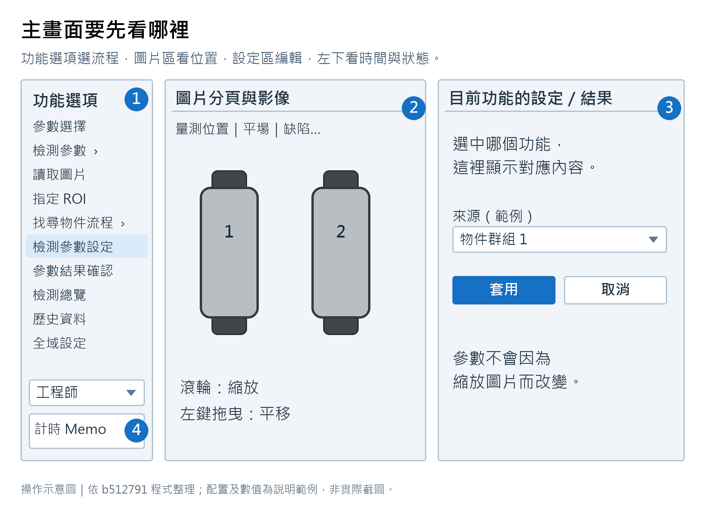

①選功能 ②看圖片位置 ③編輯或查結果 ④看耗時與訊息。

對照章節：2。程式依據：[MainForm.Designer.cs](../IntegratedImageProcessingApp/Forms/MainForm.Designer.cs)、[MainForm.Navigation.cs](../IntegratedImageProcessingApp/Forms/MainForm.Navigation.cs)。

## 2 全域內部參數怎麼設定

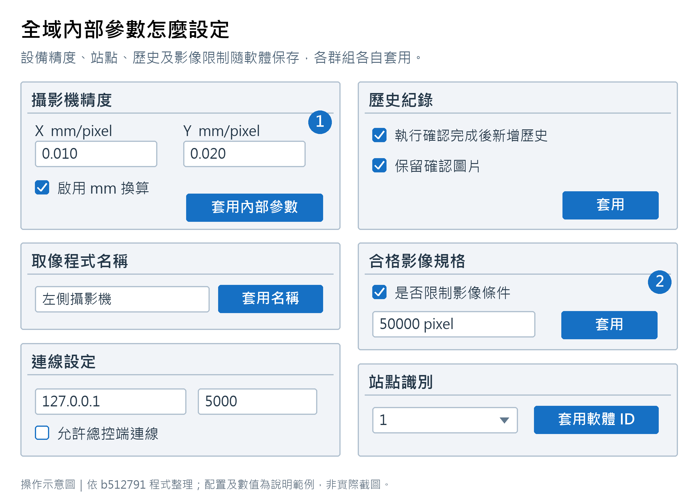

①先用標準件設定精度；示例數值不是推薦值。②目前相機入口檢查 Y 完全相等。

對照章節：3。程式依據：[MainForm.GlobalSettings.cs](../IntegratedImageProcessingApp/Forms/MainForm.GlobalSettings.cs)、[CameraDeviceSettingsIniService.cs](../IntegratedImageProcessingApp/Services/CameraDeviceSettingsIniService.cs)。

## 3 選中 Recipe 後還要套用

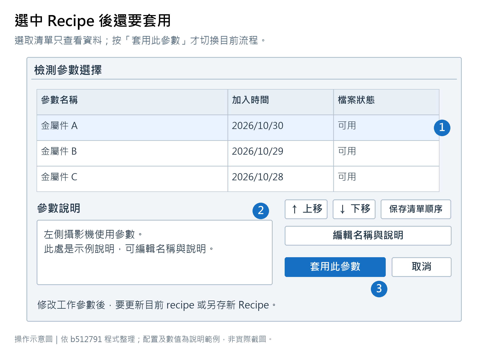

①選列 ②看或編輯說明 ③套用並等待重新處理；清單排序須另外保存。

對照章節：4.3。程式依據：[DetectionRecipeDialogs.cs](../IntegratedImageProcessingApp/Forms/DetectionRecipeDialogs.cs)、[MainForm.DetectionParameter.Recipes.cs](../IntegratedImageProcessingApp/Forms/MainForm.DetectionParameter.Recipes.cs)。

## 4 先找到物件，再建立逐片檢測

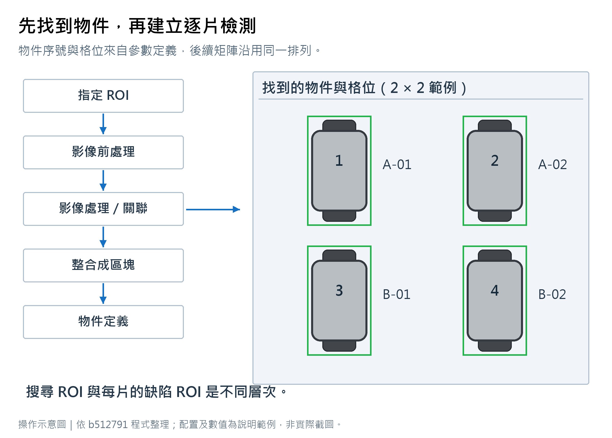

先確認物件數、編號與排列正確，尺寸與缺陷才有一致的物件依據。

對照章節：5.3。程式依據：[MainForm.ObjectDefinition.cs](../IntegratedImageProcessingApp/Forms/MainForm.ObjectDefinition.cs)、[MainForm.FunctionTree.cs](../IntegratedImageProcessingApp/Forms/MainForm.FunctionTree.cs)。

## 5 尺寸量測先選 MASK 再畫線

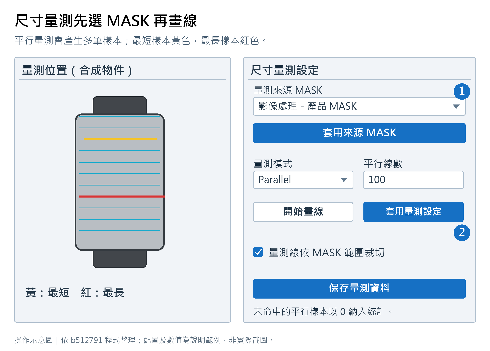

①指定並套用來源 MASK ②建立線位、套用量測設定，再保存量測紀錄。

對照章節：6.1。程式依據：[MainForm.DetectionParameter.MeasurementDrawing.cs](../IntegratedImageProcessingApp/Forms/MainForm.DetectionParameter.MeasurementDrawing.cs)、[MainForm.DetectionParameter.MeasurementCalculation.cs](../IntegratedImageProcessingApp/Forms/MainForm.DetectionParameter.MeasurementCalculation.cs)。

## 6 一片一片判斷 A 規 B 規 NG

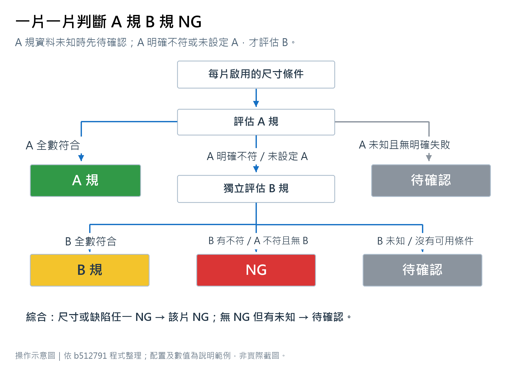

示意圖描述每片的條件流程；A／B 可使用不同計算式與規格。

對照章節：6.3。程式依據：[MainForm.DetectionParameter.ResultReview.GoodJudgement.cs](../IntegratedImageProcessingApp/Forms/MainForm.DetectionParameter.ResultReview.GoodJudgement.cs)、[MainForm.InspectionOverview.cs](../IntegratedImageProcessingApp/Forms/MainForm.InspectionOverview.cs)。

## 7 平場校正與原圖各用在哪裡

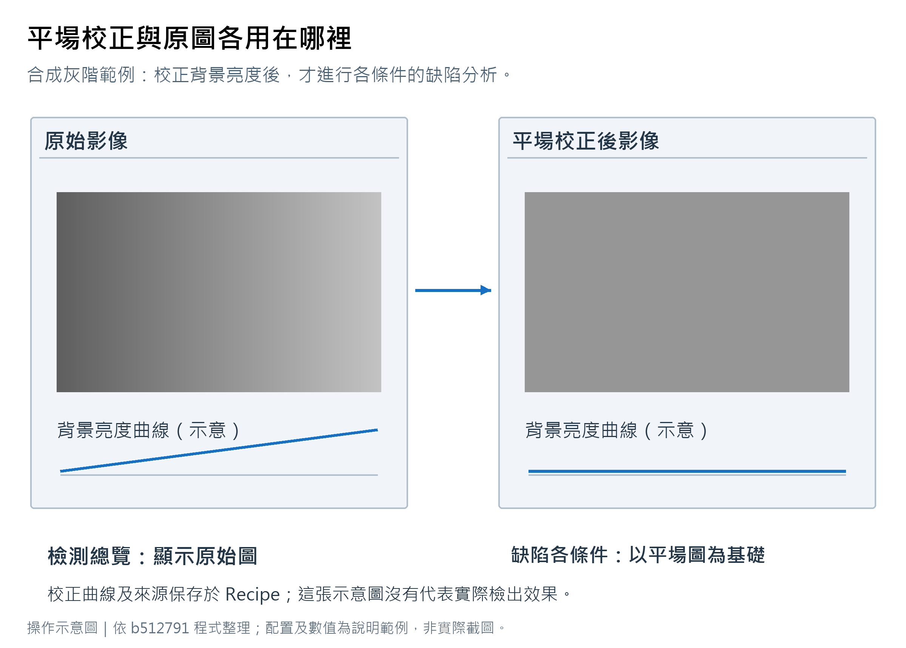

左右是同一張合成示例的概念，並非公司圖片或演算法實測輸出。

對照章節：7。程式依據：[MainForm.FlatFieldCalibration.Correction.cs](../IntegratedImageProcessingApp/Forms/MainForm.FlatFieldCalibration.Correction.cs)、[MainForm.InspectionOverview.cs](../IntegratedImageProcessingApp/Forms/MainForm.InspectionOverview.cs)。

## 8 在代表物件上建立可重用 ROI

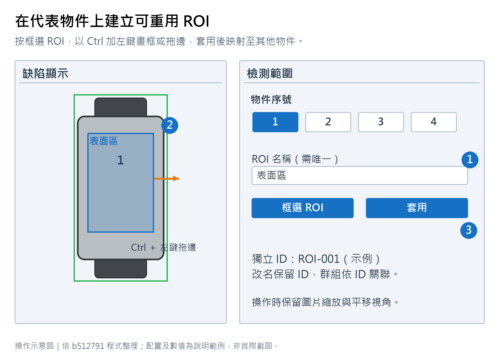

①命名並框選 ②微調邊線 ③套用；同一個定義會使用在所有物件上。

對照章節：8.1。程式依據：[MainForm.DetectionParameter.DefectRegion.cs](../IntegratedImageProcessingApp/Forms/MainForm.DetectionParameter.DefectRegion.cs)。

## 9 多個獨立 ROI 組成檢測範圍組

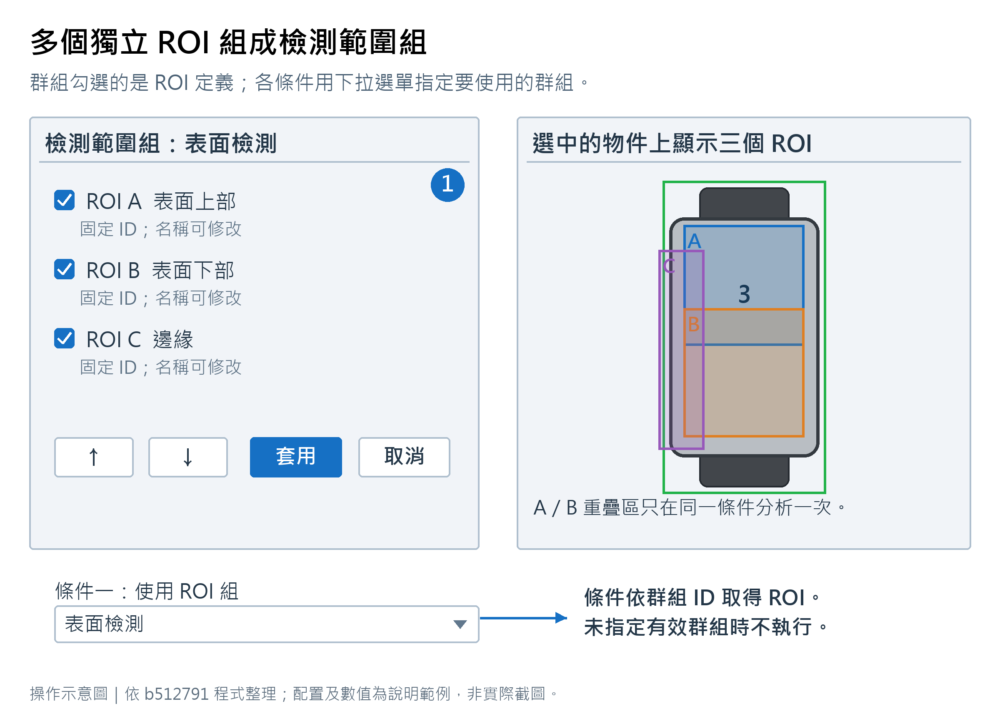

①只點勾選框才改變成員；群組內取聯集，各檢測條件仍分別運算。

對照章節：8.2。程式依據：[MainForm.DetectionParameter.DefectRegion.cs](../IntegratedImageProcessingApp/Forms/MainForm.DetectionParameter.DefectRegion.cs)。

## 10 條件設定完成後按套用看結果

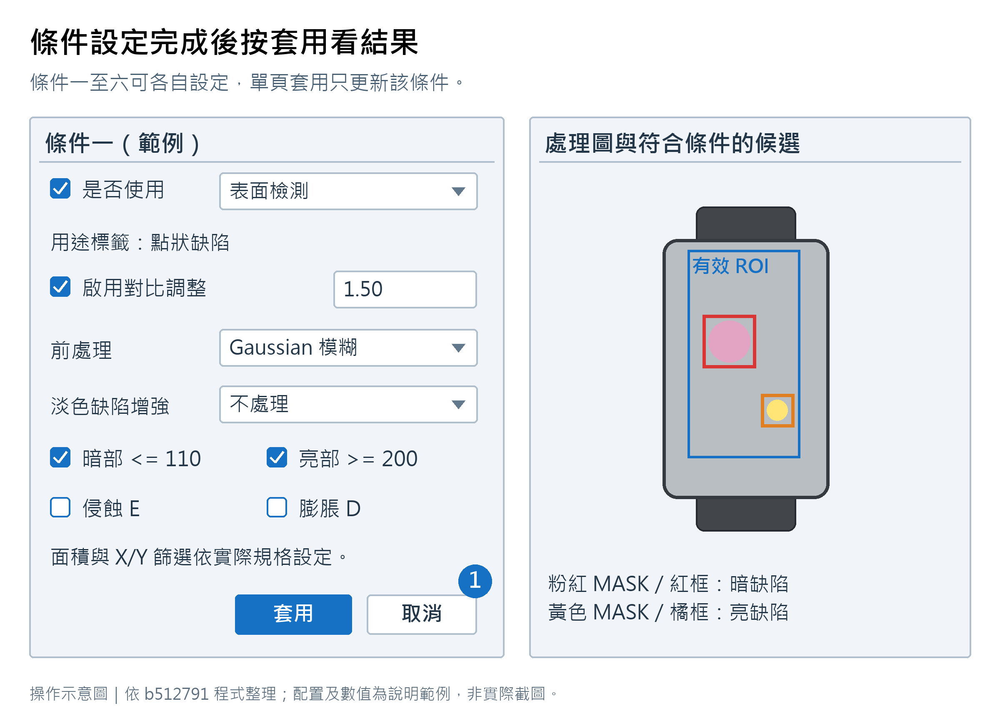

①套用後看對應圖片頁；顯示 MASK 和框的開關不等於啟用判定。

對照章節：8.3。程式依據：[MainForm.DetectionParameter.DefectCores.cs](../IntegratedImageProcessingApp/Forms/MainForm.DetectionParameter.DefectCores.cs)、[MainForm.DetectionParameter.DefectProcessing.cs](../IntegratedImageProcessingApp/Forms/MainForm.DetectionParameter.DefectProcessing.cs)。

## 11 頻域異常頁先選範圍再調掃描

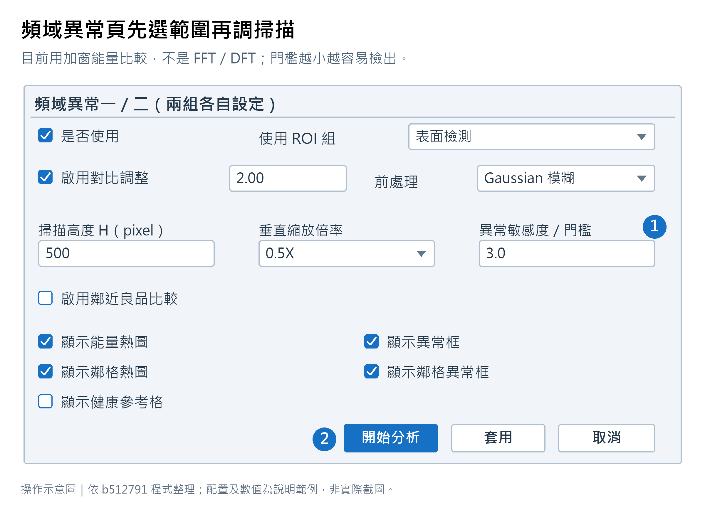

①調整掃描與門檻 ②開始分析；套用保存設定，熱圖與框可分別顯示。

對照章節：9.1。程式依據：[MainForm.DetectionParameter.DefectFrequency.cs](../IntegratedImageProcessingApp/Forms/MainForm.DetectionParameter.DefectFrequency.cs)。

## 12 原圖取樣範圍與計算縮放要分開看

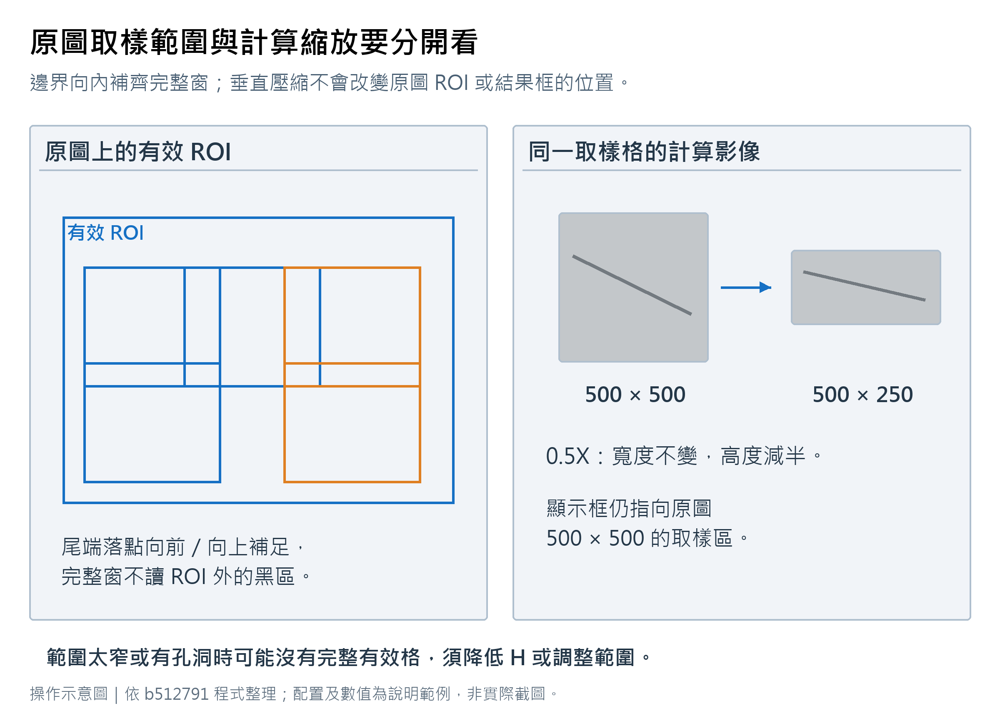

左圖的色框是多個取樣落點示意，不表示以不完整視窗或補黑影像計算。

對照章節：9.2。程式依據：[MainForm.DetectionParameter.DefectFrequency.cs](../IntegratedImageProcessingApp/Forms/MainForm.DetectionParameter.DefectFrequency.cs)。

## 13 雙擊整合結果可聚焦缺陷

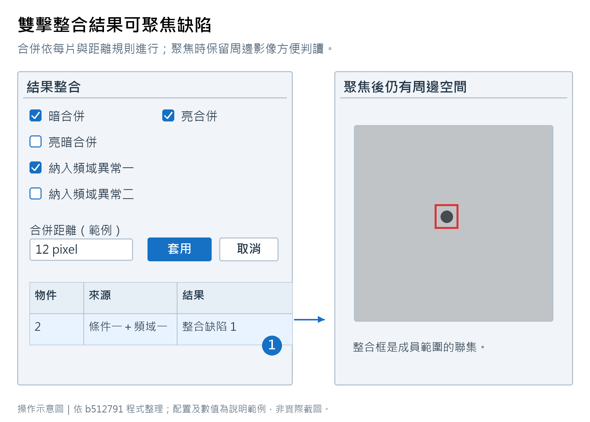

①雙擊一列，聚焦該缺陷；選中的小黑點周圍仍保留背景。

對照章節：9.4。程式依據：[MainForm.DetectionParameter.DefectIntegration.cs](../IntegratedImageProcessingApp/Forms/MainForm.DetectionParameter.DefectIntegration.cs)。

## 14 在參數結果確認追查每一片

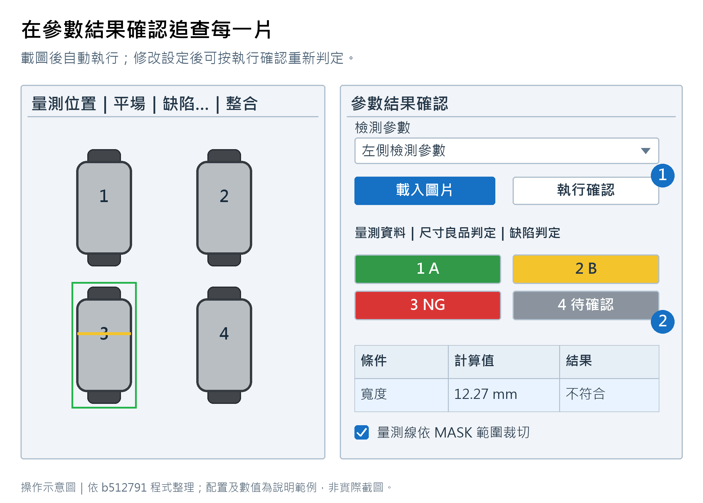

①選參數及圖片 ②選片看明細；再點同一序號取消選取，回到總覽。

對照章節：10.2。程式依據：[MainForm.DetectionParameter.ResultReview.cs](../IntegratedImageProcessingApp/Forms/MainForm.DetectionParameter.ResultReview.cs)、[MainForm.DetectionParameter.ResultReview.GoodJudgement.cs](../IntegratedImageProcessingApp/Forms/MainForm.DetectionParameter.ResultReview.GoodJudgement.cs)。

## 15 檢測總覽把每片三種結果排在一起

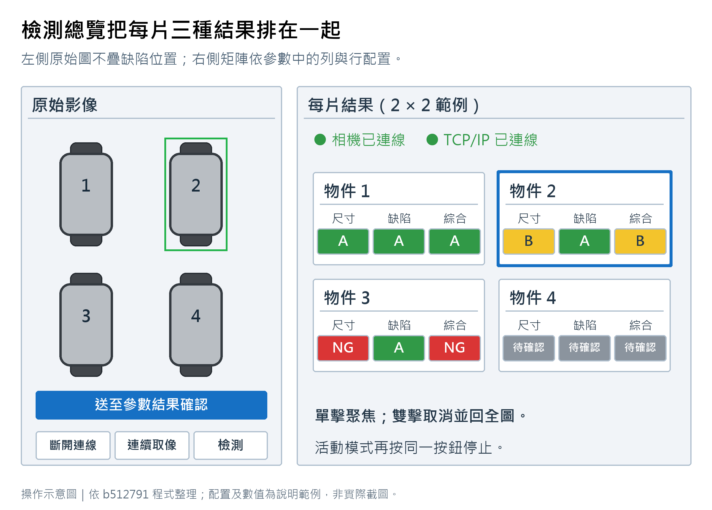

每片各自判定，物件 3 的 NG 不會把物件 1、2 一起改為 NG。

對照章節：11.3。程式依據：[MainForm.InspectionOverview.cs](../IntegratedImageProcessingApp/Forms/MainForm.InspectionOverview.cs)。

## 16 取得影像後事件控制預覽與處理交接

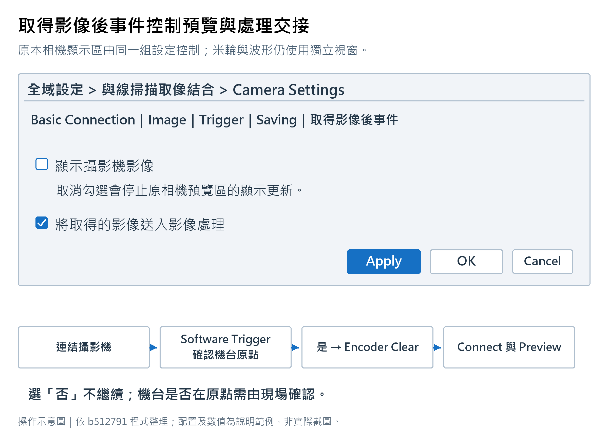

兩個勾選功能互相獨立；連續取像與檢測模式的差異請見檢測總覽。

對照章節：12。程式依據：[CameraSettingsForm.cs](../CameraCaptureModule/Forms/CameraSettingsForm.cs)、[MainForm.InspectionOverview.cs](../IntegratedImageProcessingApp/Forms/MainForm.InspectionOverview.cs)。

## 17 先選日期查詢，再點紀錄看明細

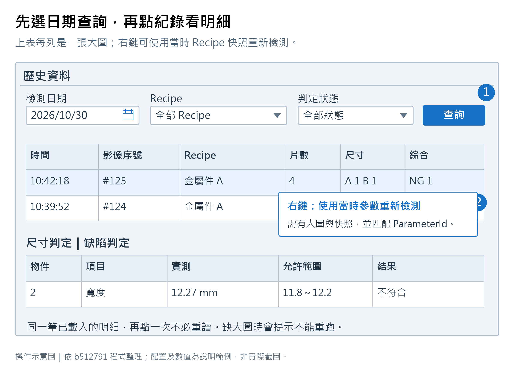

①選日期與篩選後查詢 ②點一列更新下方明細；右鍵開始歷史重跑。

對照章節：13.1。程式依據：[MainForm.InspectionHistory.cs](../IntegratedImageProcessingApp/Forms/MainForm.InspectionHistory.cs)、[InspectionHistoryStore.cs](../IntegratedImageProcessingApp/Services/InspectionHistoryStore.cs)。

## 18 總控收到各站結果與運行狀態

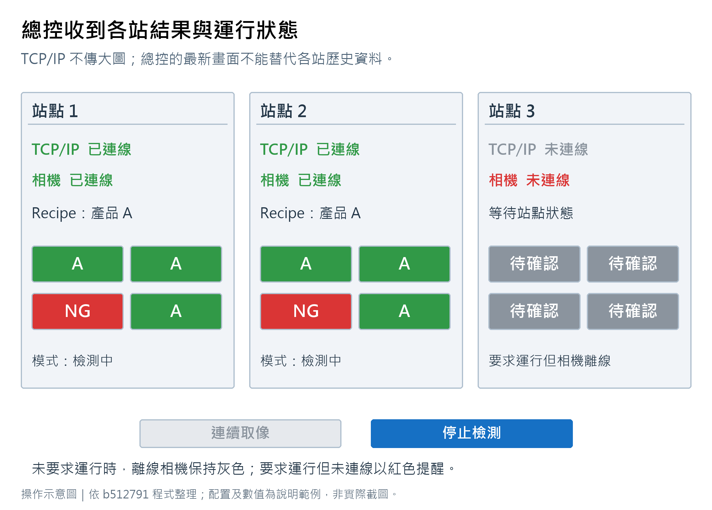

圖為要求檢測時的狀態示例；連續取像與檢測互斥，另一模式會停用。

對照章節：14。程式依據：[MainForm.ConnectionController.cs](../IntegratedImageProcessingApp/Forms/MainForm.ConnectionController.cs)。

## 19 目前架構的主要依賴

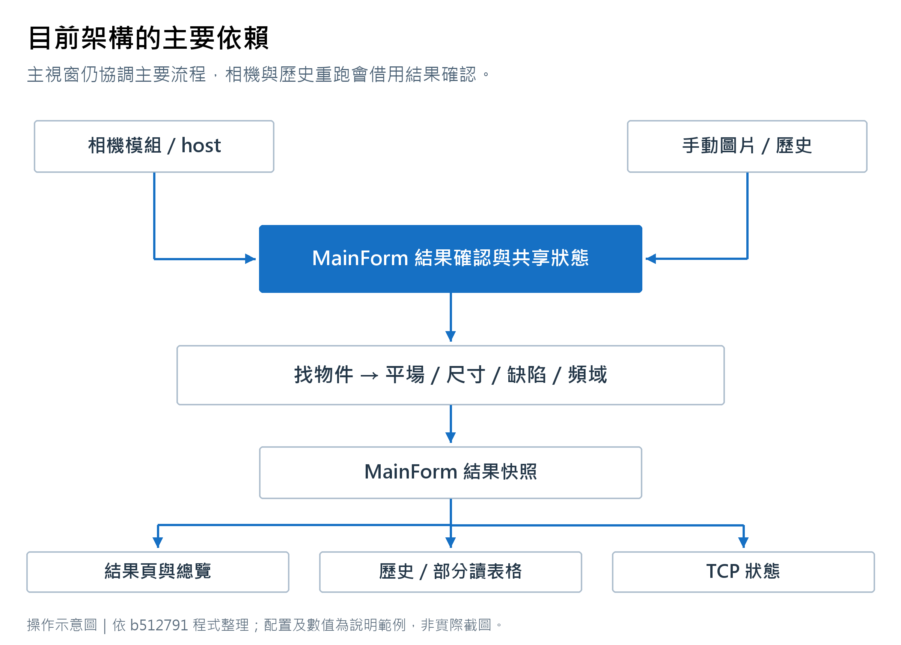

圖示呈現現有依賴，並非重構完成狀態。

對照章節：目前架構。程式依據：[CURRENT_ARCHITECTURE.md](CURRENT_ARCHITECTURE.md)。

## 20 建議目標架構

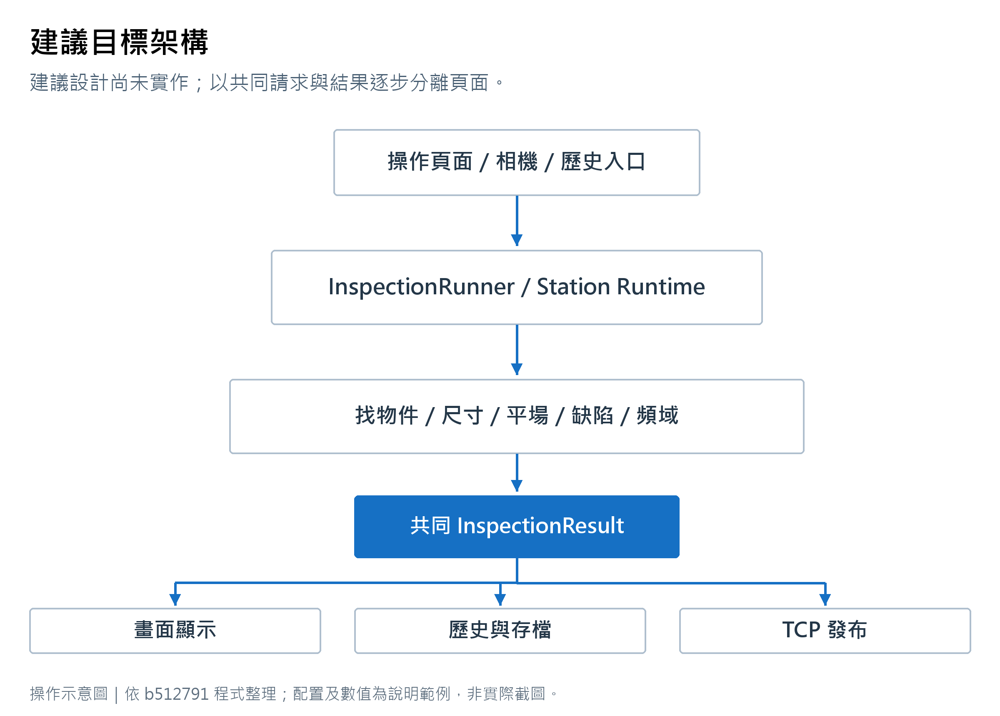

圖中目標類別尚未建立。

對照章節：目標架構。程式依據：[TARGET_ARCHITECTURE.md](TARGET_ARCHITECTURE.md)。
