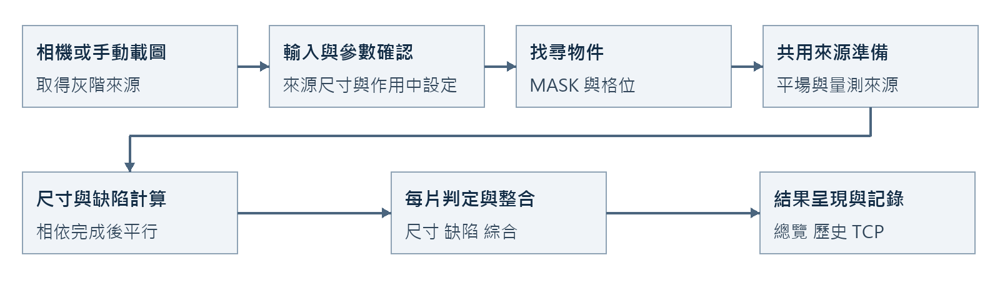
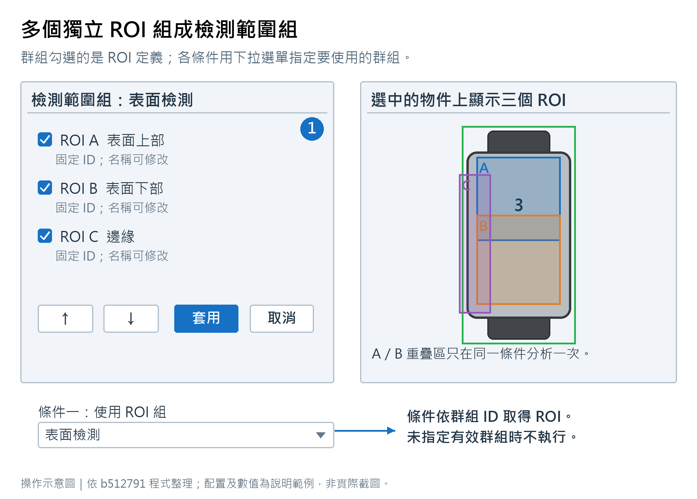
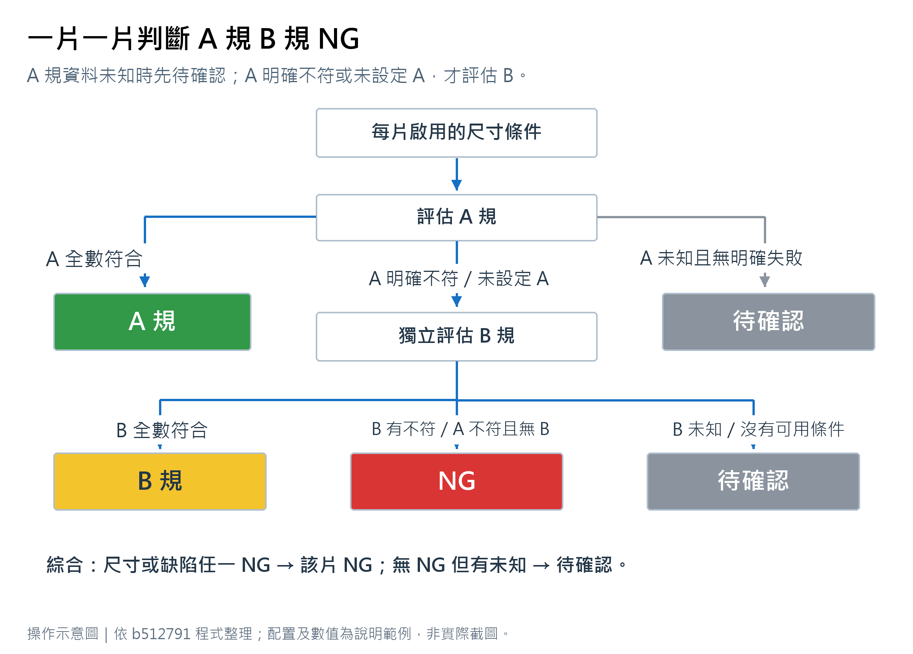
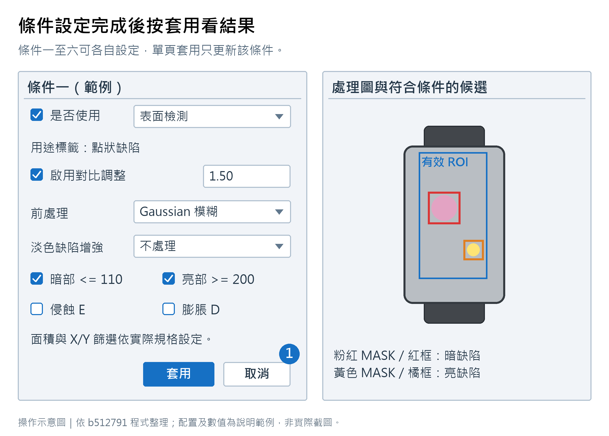
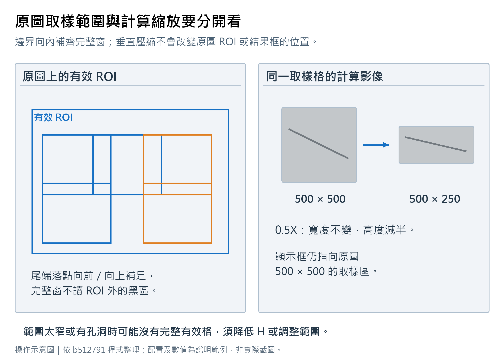
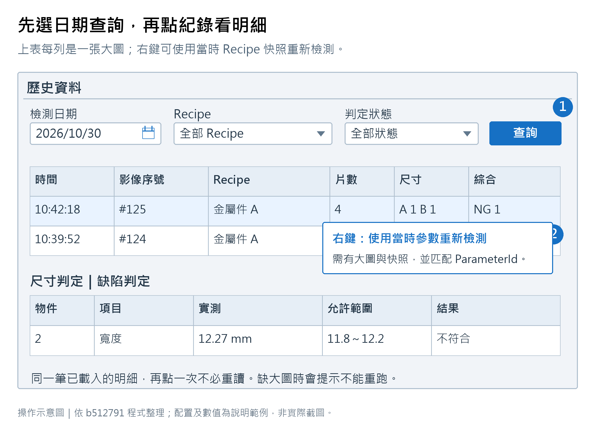
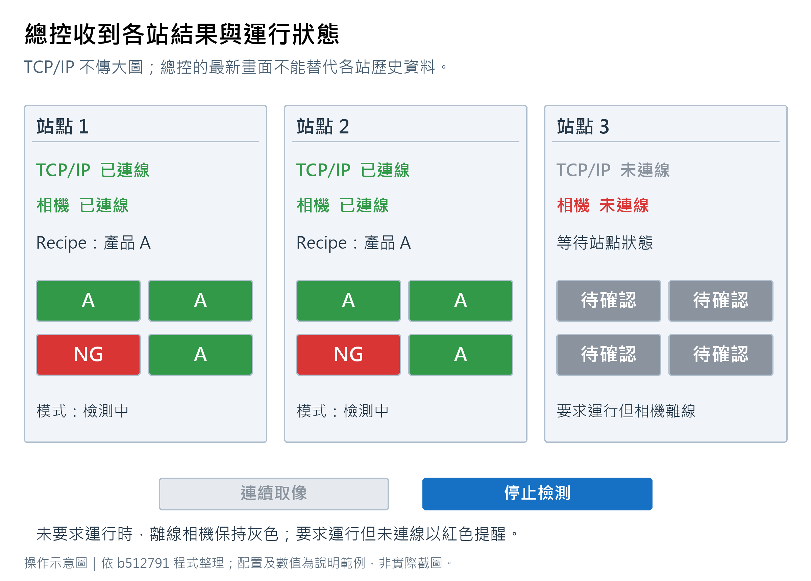

# 整合式影像處理軟體功能規格書

文件版本 1.2　核對日期 2026-11-04　程式基準：目前工作目錄，含未提交修改

本規格記錄目前程式的功能、資料、判定與介面行為，供設備整合、開發及驗收使用。標示為目標的項目尚未實作；實際影像檢出率與設備節拍不由本文件預先保證。

## 1 產品邊界

系統為 Windows WinForms x64 灰階影像檢測應用。單一執行個體控制一台本機線掃描攝影機。總控角色可連接最多 10 個被控站，接收狀態與逐物件判定，並發送取像／檢測命令。

目前包含兩個 .NET Framework 4.7.2 專案。相機與總控尚未分成獨立產品。本機角色切換有密碼；遠端命令 HMAC 可選啟用；逐筆 TCP 結果有持久 ACK／重送。個人帳號、TLS、PLC 互鎖、排料時序、所有訊息的身分驗證及現場通訊可靠度驗收不在現有實作範圍。

## 2 影像輸入與接納

### 2.1 輸入來源

| 來源 | 目前資料形式 | 行為 |
|---|---|---|
| 相機 | CameraGrayscaleFrame，Mono8 buffer、Width、Height、Stride | 由記憶體直接建立來源，不先讀寫 TIFF |
| 手動載圖 | 檔案選擇器列 BMP、JPEG、PNG、TIFF | 實際可解碼性由圖片解碼器與檔案決定 |
| 歷史重跑 | 歷史 ImagePath 與 RecipeSnapshotPath | 圖片與指定參數均需存在 |

灰階相機 buffer 必須寬高為正、Stride 至少為 Width、長度足夠容納 Stride×Height。檔案來源可能經解碼／灰階處理；相機路徑不需要先建立彩色再轉灰階。

目前沒有可對所有格式承諾的無限影像尺寸。大圖支援仍受有效 buffer、解碼器、OpenCV、整數範圍、磁碟與實體記憶體限制。例如 16384×50000 的 Mono8 純像素就需要約 781 MiB，尚未包含 MASK、平場、處理圖與顯示副本。

### 2.2 接納與略過

相機檢測同時只接納一張影像。已有讀圖／影像處理／檢測工作時，後續影格可被略過，不建立待判佇列。保存原圖另行背景執行，不是檢測輸入的必經步驟。

全域合格影像規格目前在相機檢測入口檢查 Y 高度完全相等。不符時不進入後續演算法，保留影像與待確認原因並記錄相機歷史。

手動結果確認目前檢查 Recipe 參考寬高是否相同；不符會拒絕載入。全域 Y 高度限制尚未共用到所有手動入口，不可宣稱所有拒收圖都有歷史紀錄。

## 3 Recipe 與全域設定

### 3.1 Recipe 範圍

Recipe 保存前段處理、來源關聯、區塊與物件定義、檢測參數、量測紀錄與規格、平場資料、共用 ROI、群組、一般條件、頻域與整合設定。Recipe 清單另外保存 ID、名稱、說明與順序。

目前可新建空白、匯入加入、選擇套用、更新目前與另存新 Recipe。套用與單純選中清單不同；套用才切換作用中的流程，取消舊工作並建立新設定。新建參數保留全域設備設定及已載圖片。

工作編輯內容與 Recipe 檔為不同保存對象。修改工作參數後，需要明確更新 Recipe 或另存，才能讓目錄快照跟隨變更。

### 3.2 設備設定預設值

以下是 CameraDeviceSettings 模型缺檔預設，不是校正或驗收後的建議值。舊檔缺少鍵值時由載入邏輯維持對應預設。

| 欄位 | 預設 | 用途 |
|---|---|---|
| XMillimetersPerPixel | 1.0 | X 精度 |
| YMillimetersPerPixel | 1.0 | Y 精度 |
| MillimeterConversionEnabled | false | 尺寸量測是否換算 mm |
| ProgramName | 空白 | 顯示名稱 |
| SoftwareId | 1 | 站點識別，UI 1 至 10 |
| ListenIpAddress | 0.0.0.0 | IPv4 監聽介面 |
| ListenPort | 5000 | TCP 監聽埠 |
| AllowConnections | false | 是否啟動本機監聽 |
| RequireAuthenticatedCommands | false | 是否要求遠端 command 簽章驗證；舊檔維持相容 |
| RemoteCommandSecret | 空白 | 被控端命令驗證金鑰；啟用驗證時須至少 16 字元且不含空白 |
| [Processing] MaxProcessingWorkers | 0 | 應用程式平行迴圈上限；0 自動，1–32 明確指定 |
| RecordResultReviewRuns | false | 手動確認完成後記錄歷史 |
| KeepResultReviewImages | true | 手動確認保留圖片 |
| LimitImageYHeightEnabled | false | 相機輸入高度限制 |
| RequiredImageYHeight | 0 | 啟用限制時須設定有效高度 |
| LastSelectedRole | Operator | 啟動時的介面角色 |

設備設定保存於執行目錄 config/device-settings.ini。建置時只有目的檔不存在才複製初始檔；更新時仍應備份現場 config。更改監聽端點不改 Windows 網卡設定。

### 3.3 總控設定預設值

| 欄位 | 預設 | 用途 |
|---|---|---|
| MonitorCamera | false | 多站監控總開關 |
| ConnectWhenOpened | false | 進總控頁自動連線 |
| AutoReconnect | true | 斷線後重連 |
| ConnectTimeoutSeconds | 5 | 連線等待 |
| ReconnectIntervalSeconds | 3 | 重試間隔 |
| HeartbeatTimeoutSeconds | 10 | 心跳逾時 |
| Stations | 空清單 | 最多 10 個、不重複 ID |

總控每個站點另可設定 `CommandSecret`；對應金鑰須與被控端 `RemoteCommandSecret` 相同。該欄位隨 `config/connection-controller-settings.xml` 保存。

站點含 Enabled、SoftwareId、Name、IpAddress、Port；新站預設未啟用、ID 1、Port 5000。XML 儲存於 config/connection-controller-settings.xml。

## 4 找物件與 ROI

### 4.1 物件搜尋

流程包含原圖 ROI、前處理、處理步驟、影像關聯、區塊整合、物件定義。後者依來源 MASK 建立與篩選連通物件，保存編號、邊界、格位及可選旋轉幾何。

排序與格位由參數決定。後續量測與缺陷使用 ObjectDefinitionId 連結來源；來源改變時相關快取與結果應失效。

### 4.2 缺陷範圍

<!-- illustration:09_roi_group -->

①只點勾選框才改變成員；群組內取聯集，各檢測條件仍分別運算。
<!-- /illustration -->

一個 ROI 定義含穩定 ID、唯一顯示名稱、來源物件定義及物件相對幾何。畫在代表物件上的 ROI 會映射至所有找到的物件；它不是只屬於某片的獨立定義。

群組保存 ROI ID 清單。改名不改 ID；刪除、換來源及舊檔遷移需重新驗證群組。群組內重疊範圍以聯集避免同一條件重複檢測；不同條件仍各自分析相同區域。

每個啟用核心與頻域都必須有有效群組。未指定或已失效時不得默認全片／全圖。顯示 ROI 框開關與選片只影響顯示。

## 5 尺寸量測

### 5.1 幾何與來源

量測紀錄包含來源 MASK、方向、Single／Parallel、線數、量測邏輯與物件相對線位。結果確認可依物件平行處理，且會重用有效 MASK；現有不同快取路徑並非全部已統一。

pixel 長度依 MASK 命中與量測邏輯取得。啟用尺寸 mm 換算時，沿線方向的倍率為：

~~~text
ux = dx / sqrt(dx² + dy²)
uy = dy / sqrt(dx² + dy²)
mm_per_pixel_along_line = sqrt((ux × X精度)² + (uy × Y精度)²)
length_mm = length_pixel × mm_per_pixel_along_line
~~~

此公式處理 X/Y 精度不同的情況。顯示線裁切開關不應改變判定的數值來源。

### 5.2 計算式

支援量測索引 (n)、四則運算、餘數與括號。MIN(n)、AVG(n)、MAX(n) 用於第 n 筆 Parallel 樣本，函式不分大小寫。未命中樣本以 0 參與統計。舊版 min((1)(2)) 及逗號形式保留。

規格以 x 代表計算值，可使用 <、<=、>、>=，一個或兩個比較。例如 11.8<=x<=12.2。程式的設定驗證與執行 parser 尚未共用，因此某些錯誤運算式可能保存後才在執行被拒絕。

### 5.3 尺寸逐片規則

<!-- illustration:06_grading -->

示意圖描述每片的條件流程；A／B 可使用不同計算式與規格。
<!-- /illustration -->

| 情況 | 尺寸結果 |
|---|---|
| 至少有一個 A 設定，所有 A 可評估且通過 | A，B 不執行 |
| A 沒有明確失敗，但有無法計算／資料不足 | 待確認，B 不執行 |
| A 有明確失敗或沒有 A 設定 | 評估有設定且啟用的 B |
| B 至少一項不符合 | NG |
| B 無失敗但有無法判定 | 待確認 |
| 有 B 且全數通過 | B |
| A 不符而沒有 B | NG |
| A、B 都沒有可用設定 | 待確認 |

各片獨立評估。停用條件不參與；B 可使用與 A 不同計算式和規格。

## 6 平場校正

參數包含位置來源 MASK、使用 MASK 模式、取樣位置／高度、目標灰階、平滑方式，以及保存的曲線、寬度和設定簽章。新圖依保存資料建立校正來源，並不是保存一次結果圖就永遠重用。

來源、尺寸、曲線或簽章不相容時，流程可能待確認。平場結果與原圖是不同影像來源；缺陷一般核心和頻域以平場來源為基礎，尺寸仍依量測指定 MASK。

## 7 一般缺陷分析

### 7.1 核心組成

共有七個一般核心：平場校正影像、條件一至六。條件名稱固定，另可填用途標籤。各核心包含 Enabled、RoiGroupId、顯示選項及自己的計算參數。

平場核心的對比倍率固定於原平場基準，UI 不提供條件頁的對比開關。條件一至六可啟用 0.1 至 5 倍的對比調整。

### 7.2 計算順序

<!-- illustration:10_defect_core -->

①套用後看對應圖片頁；顯示 MASK 和框的開關不等於啟用判定。
<!-- /illustration -->

~~~text
平場來源與有效 ROI
  → 可選對比
  → Gaussian／Median／不處理
  → 局部背景差分／CLAHE／不處理
  → 暗／亮門檻各自形成 MASK
  → E 侵蝕後 D 膨脹
  → 再與有效 ROI MASK 相交
  → 連通元件及面積／X／Y 篩選
  → 候選、顯示 patch 與整合輸入
~~~

對比以平場目標灰階 p 為中心：output = gain×input + p×(1−gain)，輸出為 8-bit 飽和結果。局部背景差分用 Gaussian 背景作差，再乘增益並移至目標灰階。CLAHE 為局部直方圖均衡，並不保證只增強缺陷。

暗門檻包含 0 至 Tdark；亮門檻包含 Tbright 至 255。兩者可獨立啟用，重疊門檻可能讓像素同時進入不同極性的候選。

### 7.3 尺寸與顯示

連通面積單位是 px²。X／Y 使用連通元件外接框寬高乘全域 X／Y mm-per-pixel，並非旋轉最小外接矩形的實際長短軸。篩選上下界 0 代表不設該邊界。

缺陷 mm 篩選直接使用設備精度，不跟隨尺寸量測的 mm 啟用開關。精度變更會影響候選，故歷史重跑也需要追溯此設定。

MASK 顯示為亮黃、暗粉紅的半透明層；通過篩選的暗缺陷畫紅框，亮缺陷畫橘框。開關 MASK／框、切頁或填用途標籤不應被當成新增缺陷判定條件。

個別套用更新該核心；完整執行缺陷檢測處理啟用核心及兩組頻域。缺陷平行開關允許工作並行，但不是無限制執行緒數量。

## 8 頻域異常一與二

### 8.1 名稱與公式

目前不執行 FFT／DFT。實作是對有效掃描格作去平均、Hanning 加窗後平方能量，再依本次有效格分布判定異常。

~~~text
mean = 格內平均灰階
E = Σ [ (pixel − mean) × Hann ]² / 有效像素數
M = 所有有效格 E 的中位數
MAD = median(abs(E − M))
scale = max(0.25, 1.4826 × MAD, 0.05 × abs(M))
score = abs(E − M) / scale
異常 = score >= 設定門檻
~~~

這是同次分析格集合的相對統計，既可能找高能量，也可能找低能量。對比若同時放大缺陷與多數背景，正規化後的 score 不一定提高。

### 8.2 掃描與邊界

<!-- illustration:12_frequency_windows -->

左圖的色框是多個取樣落點示意，不表示以不完整視窗或補黑影像計算。
<!-- /illustration -->

原始掃描窗為 H×H，UI H 為 8 至 1000 pixel，步距 max(1,H/2)。最後一格使用 extent−H 補齊尾端；邊界候選可向內搜尋有效完整窗，已使用落點會去重。

視窗必須完整落在有效 ROI MASK。沒有完整有效格會回報不能分析。窄區、孔洞、旋轉與不規則邊界可能留下無法容納整窗的位置，因此不能把「不越界」理解為任何形狀均可逐 pixel 完整覆蓋。

垂直縮放為 25、50、75、100、200、300%，只改計算影像的高度。顯示位置保留原取樣區座標；壓縮插值也會改變能量，不是增加原始資訊。

### 8.3 參數與相依

| 欄位 | 模型預設或 UI 範圍 |
|---|---|
| 頻域一啟用 | true；仍需有效群組與完整條件 |
| 頻域二啟用 | false |
| 掃描高度 | 預設 50；UI 8 至 1000 |
| 垂直縮放 | 預設 100% |
| 異常門檻 | 預設 3.0；UI 1.0 至 10.0 |
| 對比 | 預設啟用、倍率 1.0；UI 0.1 至 5 |
| 前處理 | 預設 None；Gaussian 或 Median 可選 |
| 鄰格比較 | 預設關閉 |
| 參考半徑 | 預設 8；UI 2 至 20 |
| 鄰格門檻 | 預設 3.0；UI 1.0 至 10.0 |

UI 稱敏感度，計算上實際是門檻，數字越高越嚴格。頻域目前沒有一般條件的淡色缺陷增強編輯區；模型仍有歷史相容欄位，不代表 UI 或運算承諾提供該功能。

鄰格比較排除不可當參考的候選後，最多取 24 個鄰近參考格，少於 4 個不評估。使用平均灰階差與較暗子區塊差的正規化分數最大值。若需排除一般缺陷，最終比較等待一般核心完成。

兩組頻域可各自執行。完整結果確認依啟用、整合及相依需求安排工作；最終缺陷判定要納入哪組，仍由結果整合勾選決定。

## 9 整合與最終判定

整合候選以物件為邊界，依暗合併、亮合併、亮暗合併及 pixel 距離連結；可納入頻域一／二。群組外接框為成員範圍聯集，鏈狀相近可能形成一個較大的缺陷群。

缺陷判定先確認有有效範圍、已啟用的分析有必要結果、一般核心有暗或亮門檻。缺資料為待確認；有效整合候選存在為 NG，否則 A。若只有頻域且未納入整合，不應把它視為已完成頻域品級判定。

| 尺寸 | 缺陷 | 綜合 |
|---|---|---|
| 任一 NG | 任意 | NG |
| 任意 | NG | NG |
| 沒有 NG 但任一待確認 | 任意 | 待確認 |
| B | A | B |
| A | A | A |

顏色 A 綠、B 黃、NG 紅、待確認灰。綜合為逐片結果，不以全張任一 NG 覆蓋其他片。

## 10 工作模式與顯示

本機總覽提供連線／斷線、連續取像／停止、檢測／停止。連線後啟動 preview；Software Trigger 確認原點後清除米輪 Encoder。兩種活動模式互斥。

總覽顯示原圖與參數決定的矩陣。單擊物件聚焦，雙擊回全圖；詳細缺陷由參數結果確認查閱。無法判定仍保留相機圖並以待確認呈現。

結果確認載入同規格圖成功後會自動執行；執行確認可再跑當下參數。工作階段快照保存各影像頁視圖與結果，可於主功能切換後還原，關閉程式後不保留。

持續運轉狀態目前散在 MainForm 與 host。離開總覽的轉送風險是已知問題，不能將「畫面按鈕仍是停止」當作檢測確實持續的證據。

## 11 歷史紀錄與保存

### 11.1 記錄入口

| 入口 | 目前記錄條件 |
|---|---|
| 相機檢測 | 符合相機快照的完成／待確認路徑保存 |
| 相機高度或參考尺寸不符 | 保存拒收原因與待確認結果 |
| 手動結果確認 | 開啟記錄選項且 JudgementComplete；可另選保留圖片 |
| 歷史重新檢測 | 不由手動記錄方法再次新增，以免遞迴重複紀錄 |
| 手動圖被拒絕載入 | 不保證產生紀錄，屬入口行為差異 |

### 11.2 檔案配置

| 路徑 | 內容 |
|---|---|
| CameraCapture/yyyyMMdd/camera_frame_時間_序號_GUID.tif | 主檢測相機原始灰階大圖 |
| snapshot/yyyyMMdd | 手動確認影像副本 |
| history/yyyyMMdd.db | 批次及物件記錄，無日期子目錄 |
| history/recipe-snapshots/{SHA256}.ini | 正規化且內容去重的參數快照 |

主檢測相機檔名時間使用本機時間，含毫秒、序號與 GUID。相機模組自己的 Saving 可另存其他影像，命名與格式由其設定控制。

### 11.3 資料內容

Batch 記錄包含 BatchId、CapturedAt、SequenceNumber、RecipeId／Name、RecipeSnapshotPath、ImagePath、ParameterId、判定是否完成、原因、影像寬高、片數、尺寸 A/B/NG/待確認、缺陷 A/NG/待確認、綜合 A/B/NG/待確認及物件清單。

Object 記錄包含編號、格位、外接框、三種品級和尺寸／缺陷明細。明細目前主要是 Title、Measured、Range、Condition、Result、Description 字串；尚不是完整的原始數值運算模型。

每日 SQLite 使用交易寫入批次與各片；Recipe 快照依內容去重，並非每筆永久保存一份相同參數。但目前每次建立快照仍可能經 INI 暫存、讀回與雜湊。

圖片保存與 DB 寫入不在同一交易。判定先完成時，圖片可能仍在背景保存或最終失敗。現有資料缺少明確的每筆存圖狀態、完整階段時間、當時全域精度與程式版本；不可宣稱具備完整設備追溯紀錄。

### 11.4 歷史重跑

<!-- illustration:17_history -->

①選日期與篩選後查詢 ②點一列更新下方明細；右鍵開始歷史重跑。
<!-- /illustration -->

先檢查圖片與快照，再以 ParameterId 選定參數。缺 ID 的舊快照只有一筆參數才可推定。多參數不猜選。正式 Recipe 原檔與歷史原紀錄不覆寫。

目前全域設備精度仍取現在值，所以「使用當時 Recipe」不等於已還原全部當時設備條件。補保存與套用標定快照是目標架構工作。

## 12 TCP/IP 介面

### 12.1 傳輸與識別

<!-- illustration:18_controller -->

圖為要求檢測時的狀態示例；連續取像與檢測互斥，另一模式會停用。
<!-- /illustration -->

使用 TCP IPv4、UTF-8 無 BOM，以一行一個 JSON 訊息傳輸。內部使用 DataContractJsonSerializer；JSON 欄位保留下面 PascalCase 名稱。讀到超過約 4 MiB 的單行後關閉該讀取路徑；目前不是完整的串流大小保護設計。

StationId 為 1 至 10，總控設定 ID 與對方回報 ID 不符會斷線並提示。IPAddress 127.0.0.1 可本機測試；0.0.0.0 用於監聽所有介面，不能作為其他電腦可連線的實際站點位址。

### 12.2 訊息類型

| MessageType | 用途 |
|---|---|
| hello | 建立站點互認並取得本機最新狀態 |
| heartbeat | 保活與 LastReceived 更新 |
| station-status | 相機、模式、Recipe 與最新逐物件結果 |
| command | 取像／檢測命令 |
| command-ack | CommandId 對應的接受狀態 |
| inspection-result | 有 ResultId 的逐次檢測結果，用於持久重送 |
| result-ack | 確認 ResultId 已由接收端寫入本地 inbox |

Command 支援 start-capture、stop-capture、inspect、start-inspection、stop-inspection。命令 ACK 表示命令接受／處理狀態，不代表全部後續影格判定已完成。

### 12.3 訊息欄位

| 欄位群 | 欄位 |
|---|---|
| 訊息與命令 | MessageType、MessageId、CommandId、Command、TargetStationId、CommandSignature、SentAtUtc |
| 站點 | StationId、StationName、Status、Accepted |
| 硬體與模式 | CameraConnected、IsCapturing、IsInspecting |
| 判定與 Recipe | JudgementComplete、RecipeId、RecipeName、ResultAtUtc、ResultId、AcknowledgedResultId、SupportsReliableResults、CameraSequence |
| 統計 | ObjectCount、ACount、BCount、NgCount、PendingCount |
| 逐片 Objects | Number、Row、Column、SizeGrade、DefectGrade、CombinedGrade |

品級字串使用 A、B、NG、Pending；缺陷無 B。傳輸不包含原始影像、MASK、完整缺陷座標、全部尺寸明細或 Recipe 檔。MessageId 是訊息識別，不是具備完整追溯語意的穩定檢測 RunId。

### 12.4 更新與可靠性

連線、命令、模式及結果等事件可發布 station-status，非強制發布有一秒節流；新連線的 hello 會取得最新狀態。heartbeat 主要做保活，不代表重送每筆歷史結果。

Transport 心跳 timer 目前每兩秒執行，依總控設定套用逾時。重連受監控開關、自動重連及頁面協調邏輯影響，不能宣稱斷線瞬間必定完成恢復。

逐筆檢測結果採 `inspection-result` 傳送並帶 ResultId。發送端先保存 `tcp-results/outbox`，總控端先將收到的結果寫入 `tcp-results/inbox/yyyyMMdd`，保存成功才回 `result-ack`；發送端收到 ACK 後刪除 outbox 項目，尚未 ACK 的結果會於支援可靠結果的 peer 連線後重送。接收端以 ResultId 去重；延遲到達的舊結果仍保存並 ACK，但不覆蓋總控端已顯示的較新結果。此 ACK 證明接收端已寫入本地 inbox，不代表已寫入整合程式的正式資料庫或已備份。TCP 佇列目前沒有自動清理／保留期限；多個總控 peer 共用同一 sender outbox，未提供每 peer 各自確認的佇列語意。

命令簽章是 opt-in。被控端 `[Network] RequireAuthenticatedCommands=true` 後，總控端必須在對應站點設定相同的 `CommandSecret`。金鑰至少 16 字元且不可含空白；簽章使用 HMAC-SHA256，涵蓋 CommandId、Command、來源 StationId、目標 TargetStationId 與 SentAtUtc。時間戳與接收端 UTC 相差需在 ±2 分鐘內，接受過的命令 ID 會持久記錄於 `tcp-results/accepted-commands/yyyyMMdd`，以拒絕重播。設定缺漏的舊站預設不要求簽章，以保留相容性。啟用後未簽章、錯誤簽章、目標 ID 不符、逾時或重複 ID 均會拒絕執行。

命令驗證金鑰以明文保存於 `config/device-settings.ini` 或 `config/connection-controller-settings.xml`。HMAC 只驗證被控端收到的 command，不提供加密，也不驗證 hello、station-status、inspection-result 或 result-ack 的來源；目前沒有 TLS、協定版本或正式裝置身分管理。需限制網路可達範圍並同步站點時鐘。TCP 連線成功與接收端 inbox 已落盤，是不同狀態。

## 13 計時與效能

結果確認 Memo 將讀圖、前段影像處理、尺寸計算、缺陷計算、並行牆鐘、尺寸顯示與缺陷顯示分開。畫面中的影像處理總時間以已記錄前段與並行階段組成；顯示處理總時間把讀圖與顯示階段相加。

每核心／ROI 累計是多項工作的工作量，不是並行等待的牆鐘。頻域亦分來源準備、掃描、統計、鄰格與預覽累計；應連同格數解讀。

### 13.1 應用程式平行工作上限

全域設定 > 內部參數 > 影像處理資源提供「最大並行工作數」，可設 1–32；0 代表自動，預設不高於邏輯處理器數且最多 8。此值套用在應用程式自有的 `Parallel.For` 工作：前處理、尺寸物件、一般缺陷核心／ROI、頻域 ROI 及結果確認物件。巢狀迴圈由目前 worker 依序執行，以避免每層另外擴張執行緒。

這不是整個程序的 CPU 或記憶體硬上限。OpenCV 原生平行化、相機 TIFF 背景保存、其他 Task／UI 工作、影像來源和預覽快取均未納入同一個資源預算。調高上限可能增加 RAM／CPU 競爭，不承諾加速；必須用固定影像、Recipe、設備及 Release 組態量測牆鐘、CPU、峰值 RAM 與 P95。

目前不承諾固定每秒片數、毫秒上限或無限執行緒。驗收須附影像、Recipe、物件數、ROI、視窗格數、電腦、Release 設定、冷／熱執行及記憶體，另量來源可用至結果發布的整體時間。

## 14 目前限制與後續目標

已知限制包括頁面與運行模式耦合、歷史標定未快照、部分歷史資料讀自 Grid、程序級 CPU／RAM 預算不足、角色未使用個人帳號，以及手動／相機影像拒收規則未完全一致。TCP peer 清理現已比對 peer 實例；逐筆結果也有 outbox／inbox／ACK／重送，但兩者仍需現場重連驗收。TCP 缺 TLS，命令 HMAC 為選用且只保護 command。

紋理異常、自動方向線條分析與 DFT 頁已移除，不列為現有功能。自動保留天數／清理、完整歷史匯出、正式帳密管理、設備互鎖和完整可靠通訊是後續需求，需另定義規格及驗收。

目前與目標架構、驗收案例及程式來源位置請參閱同目錄的架構文件、驗收與已知限制、程式對照表。
