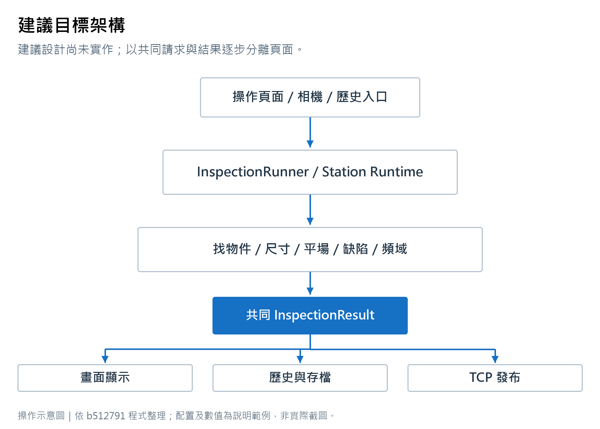

# 整合式影像處理軟體目標架構與遷移計畫

文件版本 1.2　核對日期 2026-11-04　程式基準：目前工作目錄，含未提交修改

建議保持現有 WinForms 與單攝影機部署方式，逐步讓檢測流程獨立於頁面，再讓計算、存檔與通訊使用明確資料。以下類別是建議設計，尚未實作。拆分的目的為縮小修改範圍；效能提升需要另外量測。

## 1 必須保留的行為

相機灰階影像由記憶體直接進入判定，存圖可同時進行。單次只接納一張檢測影像，忙碌新影格略過且不排隊。每片獨立判定，尺寸 A 不符後可進行獨立 B 判定。

Recipe 與全域設備設定繼續分開。ROI 名稱可修改，但關聯依穩定 ID；共用 ROI 定義套用各片，群組內重疊區域不重複檢測。一般條件套用只更新該條件，完整執行才依完整設定重新計算。

既有 INI 鍵名、Recipe ID、量測運算式與歷史資料需維持相容；角色切換、頁面顯示與取像運行狀態則應各自管理。

## 2 建議責任分層

<!-- illustration:20_target_architecture -->

圖中目標類別尚未建立。
<!-- /illustration -->

~~~mermaid
flowchart TD
    UI[各頁 UserControl 與主視窗導覽] --> App[InspectionRunner 與 StationInspectionRuntime]
    Manual[手動確認與歷史重跑入口] --> App
    Camera[相機影格入口] --> App
    App --> Domain[物件 尺寸 平場 缺陷 頻域 整合計算]
    App --> Result[InspectionResult 與 DisplayAssets]
    Infra[Recipe 設備設定 影像來源 硬體介面] --> App
    Result --> UI
    Result --> Record[HistoryRecorder 與圖片保存 worker]
    Result --> Publish[StationStatusPublisher 與 TCP transport]
~~~

| 層次 | 建議責任 | 禁止形成的依賴 |
|---|---|---|
| 介面 | 輸入草稿、顯示、選片、縮放和平移 | 演算法讀取 Label／Grid |
| 流程 | 固定輸入、排程、取消、版本檢查、結果發布 | 依當前頁面決定是否接收影像 |
| 計算 | 數值、幾何、MASK 與判定 | 在 analyzer 中切頁或保存 Recipe |
| 基礎服務 | SDK、檔案、資料庫、TCP、快取 | 向上查詢 UI 的選中列 |

第一輪可在原主專案新增資料夾及獨立類別。等相依穩定後才評估類別庫分離，不需同時更換框架。

## 3 共同資料契約

InspectionRequest 應固定一次執行的 RunId、FrameId、取像時間、唯讀灰階影像 lease、Recipe ID／revision、ParameterId、設備精度快照及記錄選項。執行途中改參數，只影響下一次 Request。

InspectionResult 應回傳完成、待確認、取消、失敗或規格不符及原因，並包含逐片格位、邊界、數值量測、各條件結果、尺寸／缺陷／綜合等級、整合候選與各階段計時。歷史與 TCP 由這份結果轉換。

InspectionDisplayAssets 管理原圖、平場、處理圖、MASK 等需釋放的影像資產。ReviewViewState 另外保存分頁、選片、顯示開關與視角；數值結果不持有 WinForms 控制項。

### 設定版本

分開管理 CalculationRevision 與 ViewState。門檻、前處理、幾何或標定變更會使計算失效；只開關熱圖或選片不應重新計算。建立集中式 snapshot factory 與 cache key，避免手寫 clone、reflection 與 INI 往返各自定義不同簽章。

## 4 執行階段與資源

StationInspectionRuntime 應擁有 Idle、ContinuousCapture、ContinuousInspection、Stopping、Faulted 等明確狀態。PageVisible 只控制顯示訂閱，不決定 runtime 的影格接收。停止檢測先關閉新工作接納，既有工作完成後進入 Idle；相機連線狀態另行管理。

共用前段完成後，尺寸、一般缺陷、頻域可依同一資源預算平行。鄰格最終比較等待一般缺陷排除資訊。取消與過期結果由 Request 的 generation／revision 判定，不能寫入新工作階段。

應用程式自有 `Parallel.For` 已有共同 worker 上限，且巢狀迴圈 inline。目標架構仍需把 OpenCV 原生平行化、背景存圖、影像副本／快取和關閉排空納入程序級資源預算；圖片保存應有容量上限並記錄 Pending、Saved、Failed，滿載策略由設備節拍與追溯需求決定。檢測忙碌略過影格與圖片保存策略是兩件不同的規則。

影像來源 lease 明確表達擁有權，唯讀 MASK view 和可修改 clone 使用不同 API。結束工作階段時集中釋放，關閉程式需等待或明確報告未完成保存，避免靜默遺失。

## 5 逐步遷移

| 階段 | 工作 | 完成條件 |
|---|---|---|
| 0 | 驗證總覽跨頁轉送，確認 TCP peer 實例清理 | 切頁仍連續檢測；同站快速重連不移除新連線（程式防護已加入，需實機驗收） |
| 1 | 抽出尺寸統計、運算式 parser、規格 evaluator | 設定驗證與執行使用同一 parser；舊語法結果一致 |
| 2 | 抽出 ROI resolver、ObjectCoordinateFrame | 旋轉、比例、邊界與群組聯集和原版一致 |
| 3 | 抽出一般缺陷與頻域 analyzer／workspace／result | 固定測例的候選、能量、MASK 與框位一致 |
| 4 | 建立 InspectionRequest／Result／Runner | 手動、相機、歷史皆用同一執行入口且無 UI 相依 |
| 5 | 分離歷史、保存與 TCP runtime | 結果不從 Grid 取值；背景工作有狀態及結束處理 |
| 6 | 各頁改為 UserControl 與固定導覽 ID | 相同項目不重建；角色／換 Recipe 不錯接頁面 |
| 7 | 相機與顯示核心再整理 | 具備實機、效能及影像顯示回歸證據 |

每階段獨立提交、可回退。演算法搬移與改判定公式應分開進行，才能知道差異來自哪個修改。

## 6 具體拆分建議

尺寸部分先抽 MeasurementStatistics、MeasurementExpressionParser、SpecificationEvaluator，頁面保留輸入和錯誤顯示。這組依賴較少，適合建立第一個可獨立驗證的邊界。

頻域檔分為 FrequencyAnalysisSettings／Result、FrequencyScanWorkspace、FrequencyAnomalyAnalyzer、NeighborReferenceAnalyzer 和頁面呈現。第一輪保留所有掃描落點、完整 MASK 要求、垂直縮放、加窗能量及門檻尺度。

一般缺陷分為 DefectPreprocessor、DefectCoreAnalyzer、DefectCoreResult。參數模型再依物件搜尋、ROI、量測、缺陷分檔，由 codec 保留既有 INI 格式；頻域一與二內部改用相同型別，舊鍵名透過 adapter 轉換。

歷史分為 HistoryRecordMapper、HistoryRecorder、HistoryReplayCoordinator、HistoryPageControl。重跑以歷史 Request 執行，不暫時替換編輯中的 systemParameters。歷史記錄需補 DeviceCalibrationSnapshot，以免變更精度後產生不同的 mm 判定。

相機後期才拆 SaperaFeatureGateway、診斷輸出、AcquisitionSession 與米輪觸發協調。兩份 LargeImageSource 先清楚列出能力和擁有權，再評估共用基礎核心。

## 7 遷移驗證

固定保存一套良品、尺寸 A/B/NG、暗／亮缺陷、淡色線、ROI 邊界、多片與無法判定影像，以及對應 Recipe。搬移前後比較物件數、排序、量測原始值、MASK、候選位置、頻域格能量與逐片等級。

整數／邏輯結果要求相同；浮點容許誤差由實際標定精度決定並事先記錄。效能採相同電腦、同一組影像、相同 Release 設定，分冷啟動與穩態，記錄中位數、P95、最大值及峰值記憶體。

測量不能只比較各工作累計時間相加。應記錄來源已可用至結果發布的牆鐘時間，另列讀圖、計算、顯示與保存完成時間。只有具備前後同條件證據時，才宣稱加速。
