# 整合式影像處理軟體操作手冊

文件版本 1.2　核對日期 2026-11-04　程式基準：目前工作目錄，含未提交修改

本手冊說明單台線掃描攝影機的參數建立、影像檢測、結果查閱、歷史重跑及多站總控操作。操作人員可先閱讀第 1、2、10、11、13 章；建立產品檢測設定時，依第 3 至 9 章進行。

手冊依目前程式實作整理。攝影機 feature 是否可用取決於實機、CCF、驅動與 SDK。第 15 章列出目前限制；設備正式運行前，須依驗收清單確認。

本版另附 18 張操作圖解，涵蓋畫面配置與操作順序。圖中位置、產品及數值為說明範例；按鈕名稱依目前程式，圖面並非實際軟體截圖。圖內數字對應旁邊的步驟說明。

## 1 開始使用

### 1.1 執行環境

在具備 .NET Framework 4.7.2、相符的 x64 相機／米輪驅動與必要原生 DLL 的 Windows 電腦執行 IntegratedImageProcessingApp.exe。完整部署需包含相依 DLL、config、Recipe 及設備設定，不能只複製單一 EXE。

執行檔目錄應可寫入設定、歷史資料與大圖。資料夾路徑在本手冊中均相對於執行檔所在目錄，並非 Visual Studio 原始碼根目錄。

### 1.2 第一次啟用的順序

1. 在全域設定確認攝影機精度、站點 ID、影像高度限制與歷史選項。
2. 在與線掃描取像結合頁確認相機、觸發與米輪設定。
3. 選擇已有 Recipe，或載入代表圖片建立新參數。
4. 先執行參數結果確認，逐片檢查數值、框位及判定。
5. 到檢測總覽連線相機，先用連續取像確認影像，再啟動檢測。
6. 在歷史資料確認判定、圖片路徑及參數快照可以追查。

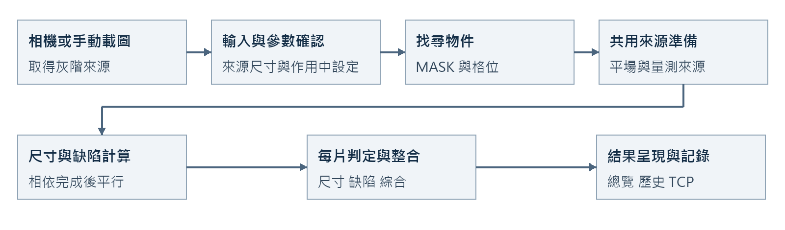

缺少有效設定、圖片不符或運算未完成時，灰色「待確認」代表沒有完整判定，不能視為合格。

### 1.3 角色下拉選單

左側功能選項下方、計時 Memo 上方，可選擇操作員、工程師、管理者、總監控模式。選擇會保存到 config/device-settings.ini，下次開啟沿用。

| 角色 | 現在的頁面範圍 |
|---|---|
| 操作員 | 可使用本機功能，隱藏連線總控角色 |
| 工程師 | 與操作員同樣隱藏連線總控角色 |
| 管理者 | 可使用本機功能與連線總控角色 |
| 總監控模式 | 僅顯示連線總控角色 |

目前沒有密碼或登入驗證，也沒有對操作員／工程師分別鎖定參數編輯權限。角色是介面切換機制。

## 2 功能選項與基本操作

<!-- illustration:01_workspace -->
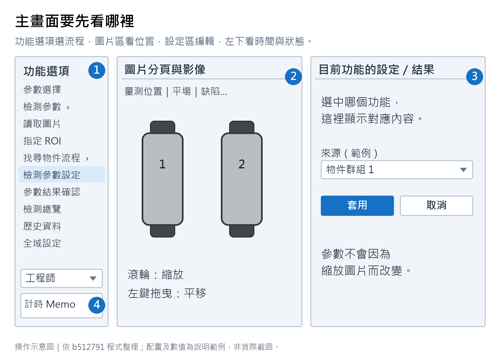

①選功能 ②看圖片位置 ③編輯或查結果 ④看耗時與訊息。
<!-- /illustration -->

左側「參數選擇」是獨立入口。「檢測參數」和「找尋物件流程」可點擊展開或收合。後者包含影像前處理、影像處理、影像關聯、整合成區塊、物件定義。

主要工作頁包括讀取圖片、指定 ROI、檢測參數設定、參數結果確認、檢測總覽、歷史資料、全域設定。管理者另可進入連線總控角色。

圖片以滑鼠滾輪縮放，一般檢視時以左鍵拖曳平移。進入畫框或畫線模式後，滑鼠用途依頁面提示改變。編輯 ROI 邊線時按 Ctrl 加左鍵拖曳；離開編輯操作後仍可平移。設視圖可讓圖片回到適合畫面的範圍。

左下角 Memo 顯示計時與狀態；底部狀態文字顯示目前操作結果。重複點選同一功能通常不應重新運算；換圖、改參數或重新執行則可能使舊結果失效。

## 3 全域設定

<!-- illustration:02_global -->
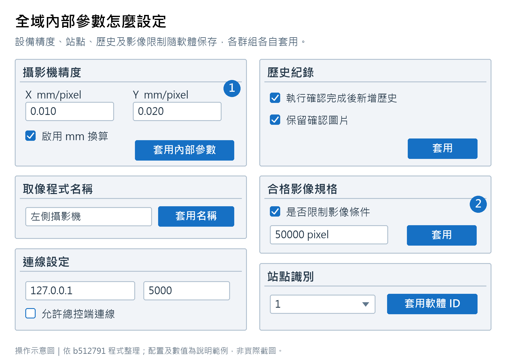

①先用標準件設定精度；示例數值不是推薦值。②目前相機入口檢查 Y 完全相等。
<!-- /illustration -->

### 3.1 攝影機精度

進入全域設定 > 內部參數 > 攝影機精度，輸入 X、Y 的 mm/pixel，按套用內部參數。X 與 Y 可不同。

勾選「啟用 mm 換算」後，尺寸量測依量測線方向換算；未勾選時，尺寸量測使用 pixel。斜線會同時考慮 X、Y 精度。

缺少設備設定時，X、Y 初始值皆為 1，換算預設關閉。初始值不是實際標定值。缺陷物件篩選中的 X／Y mm 條件會直接使用全域精度，並不跟隨尺寸量測換算開關；使用 mm 篩選前務必先確認精度。

### 3.2 程式名稱與站點

在取像程式名稱輸入站點名稱後套用，上方原本「影像處理介面框架」會改為自訂文字；留白則顯示預設名稱。

站點識別可選軟體 ID 1 至 10 並套用。多站環境中，各站 ID 應唯一；總控站點清單需填相同 ID。

### 3.3 本機連線設定

設定監聽 IPv4、Port 及「允許總控端連線」，按套用本機連線設定。此操作保存程式監聽端點，不會修改 Windows 網卡 IP。

127.0.0.1 用於同一電腦測試；0.0.0.0 表示本機所有 IPv4 介面；總控連線目標則應填被控電腦實際可達的 IP。多個執行個體在同一電腦測試時，監聽 Port 需避免衝突。

需要限制遠端控制命令時，可勾選「要求遠端命令驗證」，輸入至少 16 字元且不含空白的金鑰並套用。再到總控端的連線總控參數，為該被控站輸入完全相同的命令金鑰並保存。兩端系統時間需同步，命令時間差需在兩分鐘內；舊站預設不強制驗證。金鑰會以明文存入設備設定檔；此功能只簽署控制命令，不加密網路，也不驗證狀態／結果訊息，不能取代 TLS 或網路隔離。

### 3.4 影像處理資源

在全域設定 > 內部參數 > 影像處理資源設定「最大並行工作數」後按套用。1–32 為上限，0 為自動（不高於邏輯處理器數，最多 8）。降低上限可限制應用程式自有影像處理迴圈同時執行的工作；巢狀迴圈會使用目前工作依序處理。

此設定不是整個程式的 CPU／記憶體上限，不涵蓋 OpenCV 原生執行緒、相機背景存圖或影像快取。數值調大不一定更快，也可能增加記憶體使用；正式設定請用代表性大圖量測。

### 3.5 歷史紀錄

「參數結果確認執行完成後，新增一筆歷史資料」控制手動執行確認是否記錄。「保留參數結果確認的圖片」另行控制是否保存供歷史重跑的圖片副本。修改後按此群組的套用。

不保留圖片仍可保存判定明細，但原圖不可用時無法歷史重跑。相機檢測的記錄路徑另有自動保存流程。

### 3.6 合格影像規格

勾選「是否限制影像條件」，輸入允許的 Y 高度並套用。收到圖片的高度必須完全等於設定值；此功能不是高度範圍，也不限制 X 寬度。

相機輸入不符合時略過後續影像處理與判定，以待確認原因記錄歷史。手動結果確認目前另依參數參考寬高檢查，尚未共用這項全域限制；拒絕載入也不保證建立歷史。正式啟用前，先確認相機 Length、滾動取像的輸出高度與產品規格。

## 4 Recipe 管理

### 4.1 Recipe 和檢測參數

Recipe 是一份完整設定包，可含找物件流程及一筆或同群組的多筆檢測參數。一次作用中的 Recipe 只有一份。修改目前工作內容後，若要更新 Recipe 檔，使用「更新目前recipe」；另開版本則使用「另存為新的Recipe」。

### 4.2 新建與加入

展開檢測參數，選新建參數。程式會提示這項操作立即保存且無法自動還原；需要保留目前內容時先另存。新建會重設工作檢測設定，保留全域內部參數及目前圖片。

參數讀取與加入會把選取的參數包加入 recipe 目錄。單純加入清單不代表立刻替換目前作用中的設定。

### 4.3 選擇與套用

<!-- illustration:03_recipe -->
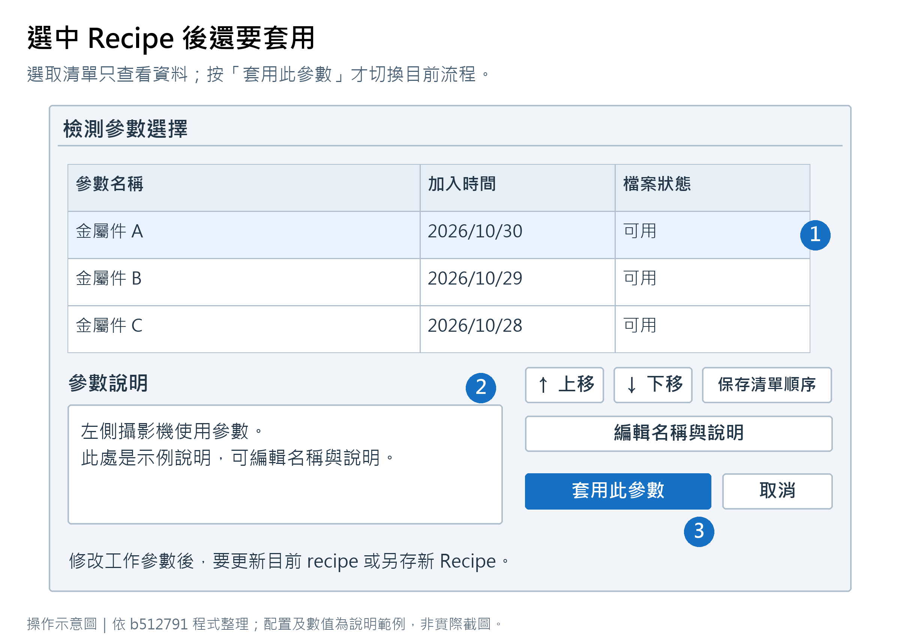

①選列 ②看或編輯說明 ③套用並等待重新處理；清單排序須另外保存。
<!-- /illustration -->

1. 開啟左側獨立的參數選擇。
2. 選取清單中的 Recipe，查看名稱與說明。
3. 按套用並確認切換。
4. 等待舊工作取消、來源與結果重建，觀察流程完成或失敗原因。

套用新 Recipe 會使用快照更新流程，保留目前圖片並嘗試重新處理至啟用的缺陷功能。不要只憑顯示名稱認定已完成全部處理。

清單可編輯說明，使用上／下箭頭調整順序後按保存清單順序。右鍵刪除會再次確認，正在使用的 Recipe 不能刪除。

### 4.4 檢測參數分組

檢測參數設定可包含多筆參數。選取兩筆以上後右鍵分組；群組保存會包含群組中的參數。這是檢測參數的分組，與缺陷 ROI 範圍組不同。

名稱是顯示用，關聯主要依 ID。複製、重新加入或切換舊 Recipe 後，仍應確認來源物件定義、MASK 及各條件的群組選擇。

## 5 讀圖與找尋物件

### 5.1 讀取圖片及影像 ROI

讀取代表性圖片後，在指定 ROI 設定搜尋範圍。同尺寸新圖會盡可能保留原有 ROI；不同尺寸要重新確認幾何與參數相容性。

搜尋影像 ROI 與缺陷檢測 ROI 是不同層次。前者限制找物件的流程，後者限制每片物件的缺陷處理。

### 5.2 建立搜尋流程

依產品需要設定影像前處理、影像處理步驟、來源關聯及整合成區塊，再在物件定義中選擇來源、篩選物件與排列格位。

各階段的 MASK 可被後續量測或平場位置引用。修改前段時，要檢查下游是否仍引用正確來源。物件數量、排序與預期格位應在進行量測前確認。

### 5.3 物件定義

<!-- illustration:04_objects -->
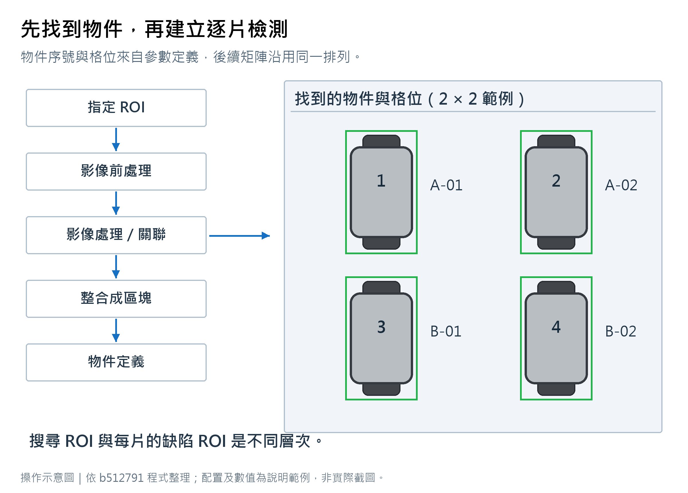

先確認物件數、編號與排列正確，尺寸與缺陷才有一致的物件依據。
<!-- /illustration -->

依來源 MASK 建立連通物件，使用面積、尺寸及處理條件保留產品。必要時使用旋轉分析，讓後續物件相對座標跟隨物件幾何。

確認編號與實際產品的位置一致。後續各頁的物件矩陣依參數定義的排列呈現，不是固定每列三片。

## 6 尺寸量測與良品條件

### 6.1 建立量測紀錄

<!-- illustration:05_measurement -->
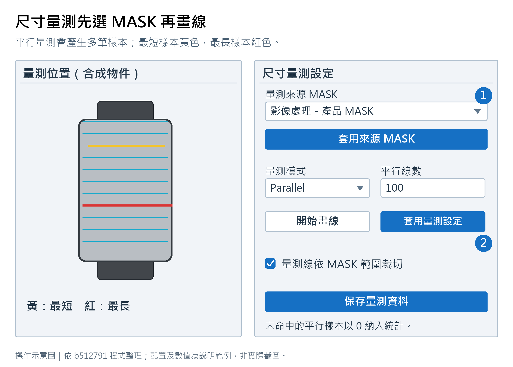

①指定並套用來源 MASK ②建立線位、套用量測設定，再保存量測紀錄。
<!-- /illustration -->

1. 在檢測參數設定選擇關聯的物件定義。
2. 到尺寸量測設定，點物件序號聚焦代表物件。
3. 選擇真正需要量測的來源 MASK，按套用來源 MASK。
4. 設定名稱、方向、Single／Parallel、平行線數與量測邏輯。
5. 開始畫線，依畫面提示放置量測位置，再套用量測設定。
6. 在量測資料紀錄確認名稱、模式與來源，按保存量測資料。

平行線會在設定區域內形成多次量測。線數越多，取樣工作越多，不代表一定越準；應依產品精度與節拍驗證。

「量測線依 MASK 範圍裁切」影響顯示範圍。參數結果確認頁也有獨立的同類顯示開關。點量測資料可查看來源 MASK、線段與最小／最大樣本的不同顏色。

### 6.2 尺寸判定語法

在尺寸良品判斷條件新增名稱、啟用狀態、A 規計算式／規格、B 規計算式／規格，保存判定條件。

| 寫法 | 意義 |
|---|---|
| (1) | 第 1 筆量測紀錄的數值 |
| MIN(1) | 第 1 筆 Parallel 紀錄所有樣本的最小值 |
| AVG(1) | 第 1 筆 Parallel 紀錄所有樣本的平均值 |
| MAX(1) | 第 1 筆 Parallel 紀錄所有樣本的最大值 |
| MAX(1)-MIN(1) | 第 1 筆平行量測的長度差 |
| 11.8<=x<=12.2 | 計算結果包含上下界的允許範圍示例 |

MIN／AVG／MAX 不分大小寫，單一編號形式僅適用 Parallel。Single 使用 (n)。未命中 MASK 的平行樣本以 0 納入統計，MIN 過低時應先檢查線位和 MASK。

計算式可用 +、-、*、/、% 及括號；舊版 min((1)(2)) 等聚合語法仍保留。範例數值只是語法示例，不是產品規格。

### 6.3 每片的 A B NG

<!-- illustration:06_grading -->
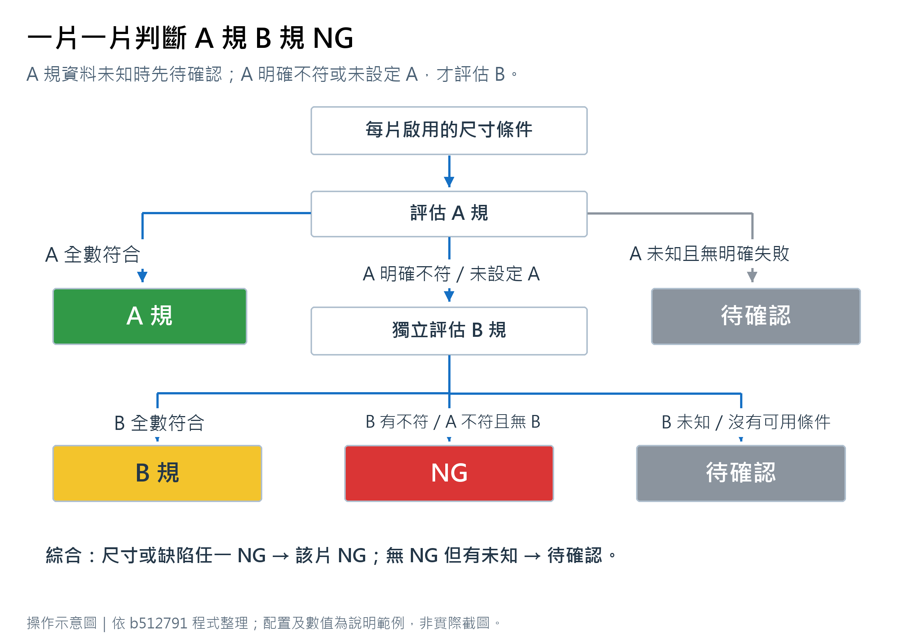

示意圖描述每片的條件流程；A／B 可使用不同計算式與規格。
<!-- /illustration -->

每片分別評估啟用條件：A 規全部符合即 A；A 有明確不符合時，評估有設定的 B 規。B 全符合為 B；B 任一不符合為 NG。A 有資料不足或計算錯誤且沒有明確不符合時，為待確認，不直接進 B。

B 可以獨立設定。沒有可評估的條件為待確認；A 不符且沒有 B 時為 NG。設定接受不代表計算式一定可執行，仍要用執行確認檢查結果。

## 7 平場校正

<!-- illustration:07_flatfield -->
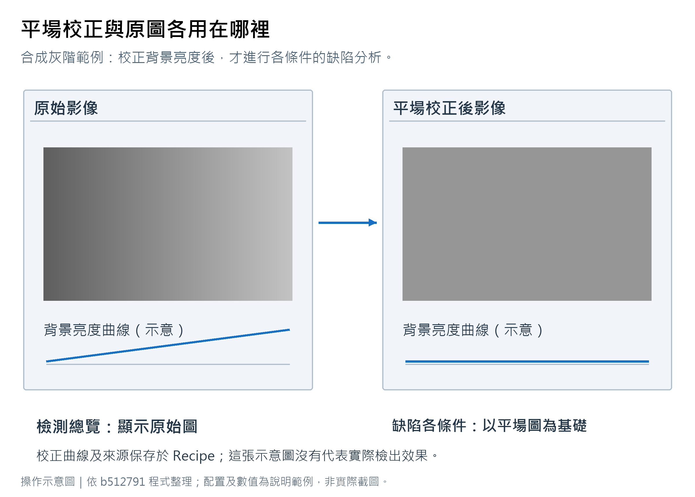

左右是同一張合成示例的概念，並非公司圖片或演算法實測輸出。
<!-- /illustration -->

到平場校正設定選擇位置來源、MASK 使用方式、目標灰階與平滑設定，套用位置 MASK，再完成曲線與校正。確認平場校正圖上的亮度符合預期。

Recipe 保存的是相關校正設定與曲線資料，新圖會依這些資料建立校正結果。尺寸或來源不相容、保存曲線缺失、MASK 無法解析時，需看錯誤原因並重新確認；不應用其他 Recipe 的結果代替。

缺陷頁的「平場校正影像」指以平場後的圖片作為一般缺陷核心的來源，不是原始相機圖。檢測總覽則顯示原始圖。

## 8 缺陷範圍與一般條件

### 8.1 建立共用 ROI 定義

<!-- illustration:08_roi_edit -->
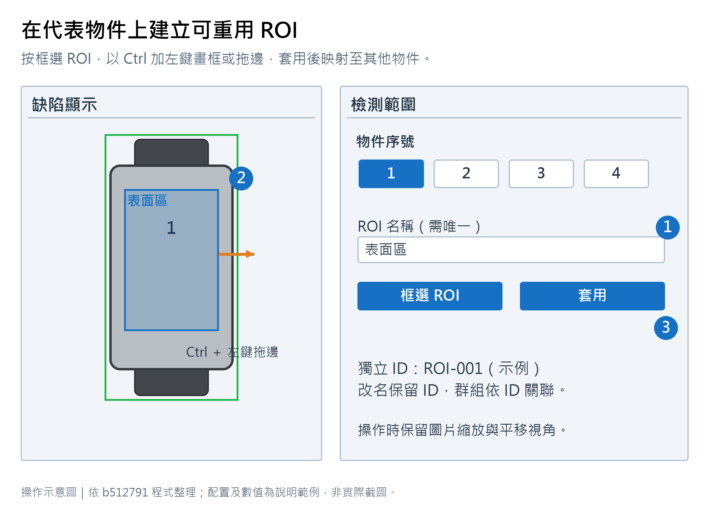

①命名並框選 ②微調邊線 ③套用；同一個定義會使用在所有物件上。
<!-- /illustration -->

1. 在缺陷量測設定選擇代表物件序號。
2. 在檢測範圍填入唯一 ROI 名稱。
3. 按框選 ROI，在缺陷顯示圖依提示以 Ctrl 加左鍵框選。
4. 微調邊線後按套用。
5. 重複建立需要的其他 ROI。

一個定義會依各物件的相對座標套用到所有已找到的物件，不需要每片重畫。改名保留 ID；不要把名稱當成群組的唯一連結依據。選取既有 ROI 可編輯或清除。

### 8.2 建立檢測範圍組

<!-- illustration:09_roi_group -->
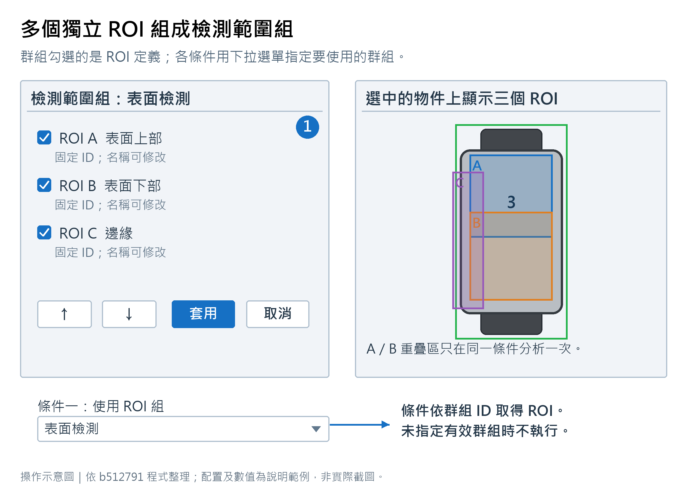

①只點勾選框才改變成員；群組內取聯集，各檢測條件仍分別運算。
<!-- /illustration -->

新增組並命名，在清單中勾選要納入的 ROI，再套用。只有點到勾選框才改變成員狀態；點名稱用於選取，旁邊上／下箭頭調整順序。

一組可含多個 ROI，群組內重疊部分以聯集處理，避免重複檢測。各檢測核心與頻域一／二可選不同群組。啟用條件沒有有效 ROI 組時，不會自行改成全圖檢測。

勾選「顯示檢測範圍的 ROI 框」控制框的可見性。點物件序號時，應顯示該物件上目前群組的全部 ROI；隱藏框不等於停用檢測。

### 8.3 平場核心與條件一至六

<!-- illustration:10_defect_core -->
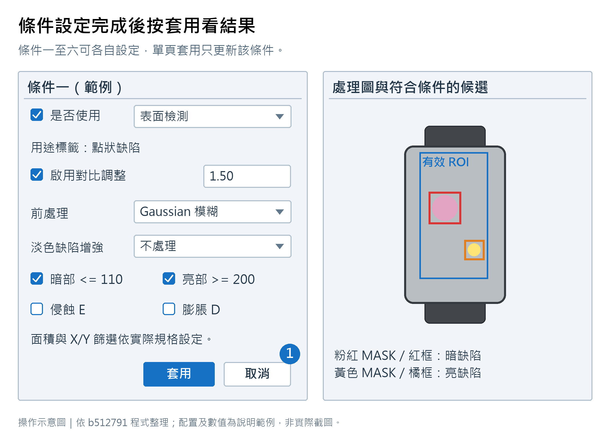

①套用後看對應圖片頁；顯示 MASK 和框的開關不等於啟用判定。
<!-- /illustration -->

每頁上方「是否使用」控制啟用狀態，下面「使用 ROI 組」指定處理範圍。條件一至六可填用途標籤，留白也可使用；分頁名稱仍保持固定。

| 設定區 | 操作意義 |
|---|---|
| 影像來源與對比 | 條件一至六有對比開關；平場核心的倍率欄位不可調整 |
| 前處理 | 不處理、Gaussian 模糊或 Median 模糊 |
| 淡色缺陷增強 | 不處理、局部背景差分或 CLAHE |
| 暗部／亮部門檻 | 分別勾選；暗部為灰階小於等於，亮部為大於等於 |
| MASK 侵蝕與膨脹 | 個別開關、核心與迭代；順序為 E 後 D |
| 物件篩選 | 最小面積 px²、X/Y 最小與最大 mm，右側顯示換算 pixel |
| 顯示 | MASK、紅框暗檢出、橘框亮檢出 |

Gaussian 可調核心寬高與 Sigma；Sigma 0 為自動估算。Median 使用核心大小。對比過高、CLAHE 或局部增強也可能放大背景，應同時觀察良品誤檢。

白色亮缺陷 MASK 以半透明黃色呈現，黑色暗缺陷以半透明粉紅色呈現；符合缺陷篩選條件的暗／亮候選才畫對應框。顯示開關用於檢視，不是判定門檻。

### 8.4 套用與完整執行

單頁套用只更新該條件的設定與結果。取消回復該頁草稿；關閉其他頁面的顯示不會替代重新運算。

上方「執行缺陷檢測」會處理已啟用的一般條件與兩組頻域。開啟平行運算後，相關工作可同時排程；相依資料準備仍需先完成。

停用條件的圖片分頁會隱藏。需要看某頁但沒有出現時，先確認是否使用，再確認套用與執行狀態。

## 9 頻域異常與結果整合

### 9.1 頻域一與二

<!-- illustration:11_frequency_ui -->
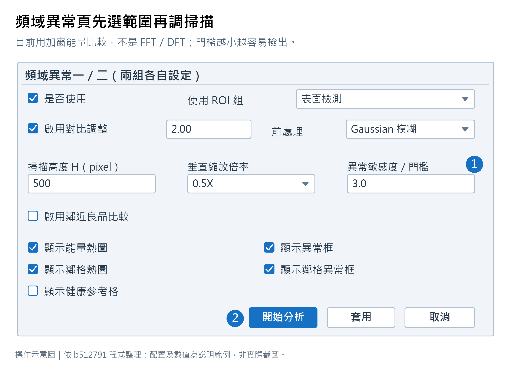

①調整掃描與門檻 ②開始分析；套用保存設定，熱圖與框可分別顯示。
<!-- /illustration -->

兩頁各自設定是否使用、ROI 組、對比、前處理、掃描高度、垂直縮放、一般異常門檻與鄰近良品比較。按套用保存，開始分析更新該頁結果。

目前「頻域異常」使用加窗後的灰階變動能量，並非 FFT／DFT。它會把每個有效格與本次有效格的主要分布比較，找出能量偏高或偏低的位置。

### 9.2 掃描設定

<!-- illustration:12_frequency_windows -->
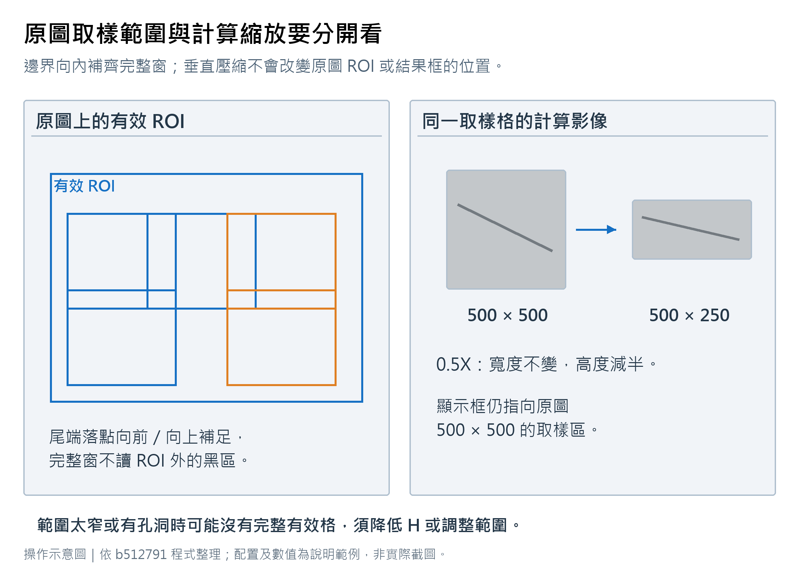

左圖的色框是多個取樣落點示意，不表示以不完整視窗或補黑影像計算。
<!-- /illustration -->

掃描高度 H 決定原始取樣窗 H×H，UI 範圍 8 至 1000 pixel。間距約 H/2，自動處理尾端落點。最後不足一格時向前補齊完整格，不以外側黑色填滿。

垂直縮放可選 0.25X、0.5X、0.75X、1X、2X、3X，只在能量計算前壓縮或拉伸取樣格的高度。例如 500×500 在 0.5X 時計算影像為 500×250，原圖框位仍對應 500×500。這項設定不改變檢測 ROI。

目前異常敏感度實際作為分數門檻：數值越小越容易檢出，越大越嚴格。調整對比、模糊或縮放後要重新評估門檻；不能保證縮放一定提高目標缺陷的分數。

掃描格必須完整位於有效 MASK。範圍太窄或靠不規則邊界時，可能找不到完整格；這時應減小掃描高度或重新定義 ROI。不要把沒有有效格視為通過。

### 9.3 鄰近良品基準比較

啟用後，程式從附近可作參考的格比較平均灰階及較暗區塊。一般缺陷、能量異常等排除條件會影響參考格；參考不足時該格不能完成鄰格比較。

畫面可獨立顯示能量熱圖、異常框、鄰格熱圖、鄰格異常框與健康參考格。熱圖是相對分數，不能直接當成缺陷尺寸或最終品級。

### 9.4 結果整合

<!-- illustration:13_integration -->
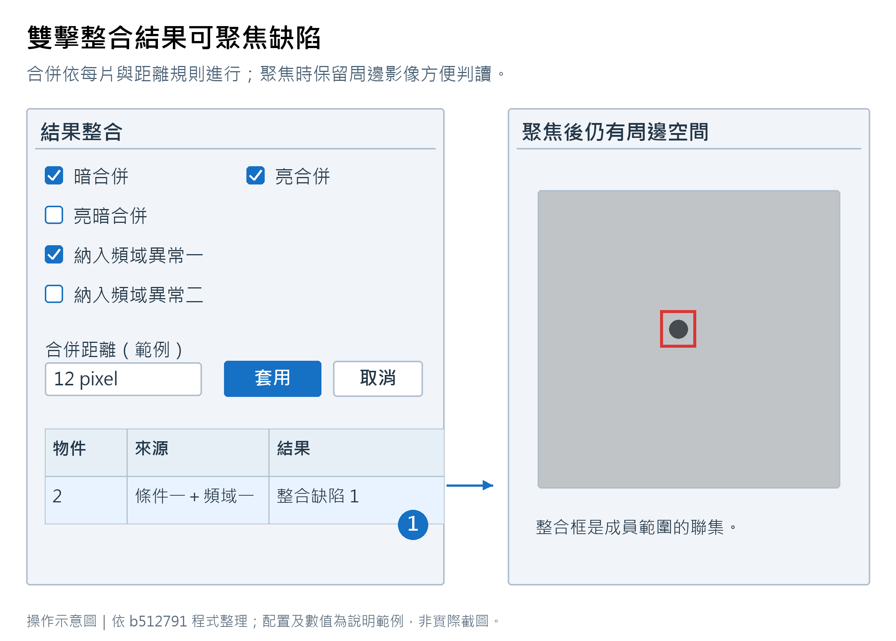

①雙擊一列，聚焦該缺陷；選中的小黑點周圍仍保留背景。
<!-- /illustration -->

選擇暗合併、亮合併、亮暗合併，設定附近合併距離 px；可分別勾選納入頻域異常一、二，再套用。

整合以每片為範圍彙整候選。相鄰或重疊且符合合併規則的候選可成為同一項，鏈狀接近也可能合併成較大的群組。

綜合缺陷圖以平場圖作底圖，疊加已納入的結果。雙擊 ROI 整合結果表的一列可聚焦缺陷並留周邊空間。單獨頻域圖與綜合圖的框位應一致；若不同，依第 15 章記錄問題。

## 10 參數結果確認

### 10.1 執行確認

1. 開啟參數結果確認。
2. 選擇本次要使用的檢測參數。
3. 載入與產品設定相符的影像。
4. 圖片成功載入後會自動執行；需要重新判定時按執行確認，等待找物件、平場、尺寸、缺陷與整合完成。
5. 查看底部原因及逐片表格，確認有無待確認項目。

執行時會使用當下參數重新處理，不依賴前面頁面曾經留下的顯示結果。上一筆結果有工作階段快照可供切頁還原，但改參數、換圖或來源失效後需要重新執行。

### 10.2 查看逐片結果

<!-- illustration:14_review -->
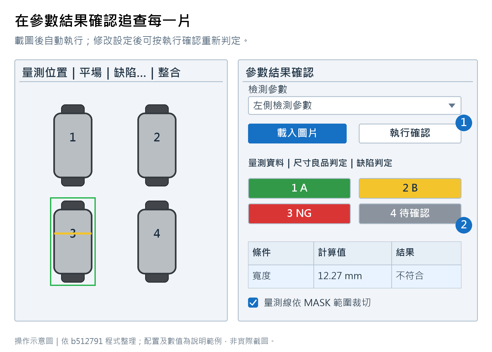

①選參數及圖片 ②選片看明細；再點同一序號取消選取，回到總覽。
<!-- /illustration -->

尺寸良品與缺陷判定表上方都有依產品排列的序號按鈕。點一下選取物件並查看條件結果；再點同序號取消，回到總覽。尺寸 A 綠色、B 黃色、NG 紅色、待確認灰色；缺陷沒有 B 規。

未選取片時，不應把掃描 ROI 框全部疊在圖片上。點量測列可顯示對應 MASK 與量測位置；勾選量測線依 MASK 範圍裁切可縮短顯示的線段。

### 10.3 時間欄位

左下角 Memo 分列讀取圖片、影像處理、尺寸量測計算、缺陷檢測計算、尺寸／缺陷並行牆鐘與顯示處理。平行工作的個別時間不可相加當成實際等待時間。

影像處理總時間是程式定義的前段影像處理加上尺寸／缺陷並行階段。它不是包含攝影機曝光、傳輸、所有存圖及網路送達的設備完整週期。讀取圖片顯示尚未讀取時，表示本次未記錄相應讀圖階段。

## 11 檢測總覽與攝影機

### 11.1 連線

先確認全域相機設定，進入檢測總覽按連結攝影機。程式會準備相機模組、Connect 後啟動 Start Preview；已連線時按鈕改為斷開連線。

Software Trigger 下會詢問機台是否在原點。選是後執行米輪 Encoder Clear 再繼續；選否不繼續連線流程。機台位置應由現場確認。

### 11.2 連續取像與檢測

連續取像只更新原始圖，不進入判定；再按停止取像才停止。檢測則持續接收後續影格進行判定，按停止檢測後不再接納新判定，已開始的工作仍需結束。

同一時間只處理一張影像。忙碌收到新圖會略過，不建立待判影像佇列；可從狀態訊息追查略過原因。連續取像與檢測兩種模式互斥。

目前切離總覽可能使本機影格轉送中斷，雖然模式旗標仍保留。正式修正並驗證前，連續設備測試請保持總覽頁並記錄實際收到／處理／略過影格數。

### 11.3 判定矩陣

<!-- illustration:15_overview -->
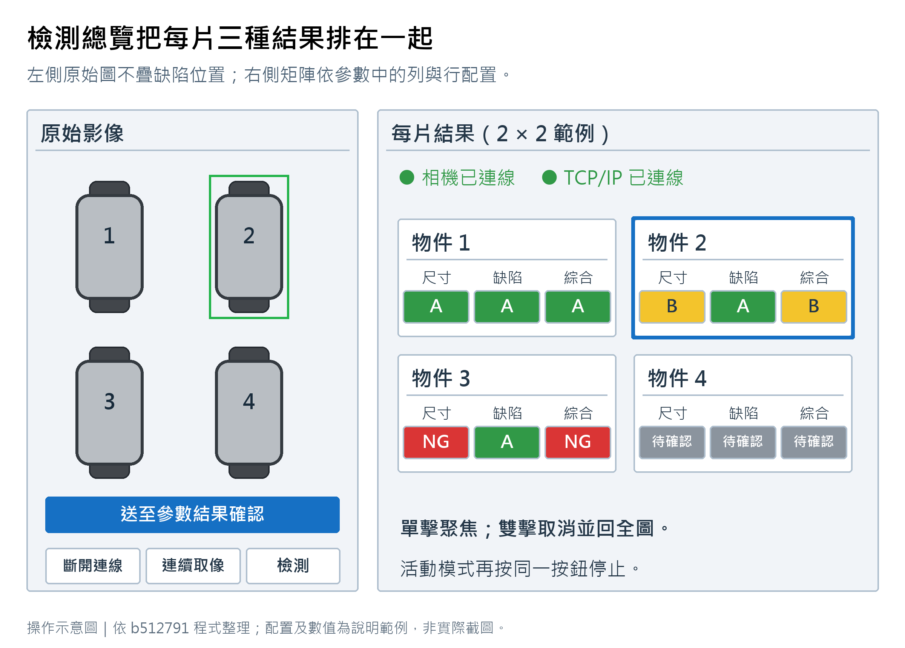

每片各自判定，物件 3 的 NG 不會把物件 1、2 一起改為 NG。
<!-- /illustration -->

總覽顯示原始大圖，矩陣排列依檢測參數定義。每片依序顯示尺寸、缺陷與綜合狀態，可篩選全部、NG、待確認。

單擊一片聚焦對應位置；雙擊取消選取、移除聚焦框並回到全圖。畫面下方顯示該片三種判定；一片 NG 不會把其他片全部改成 NG。

「送至參數結果確認」可把當下圖片交給確認流程追查。總覽不疊加每項缺陷位置，詳細位置由確認頁查閱。

## 12 相機設定與輔助視窗

<!-- illustration:16_camera -->
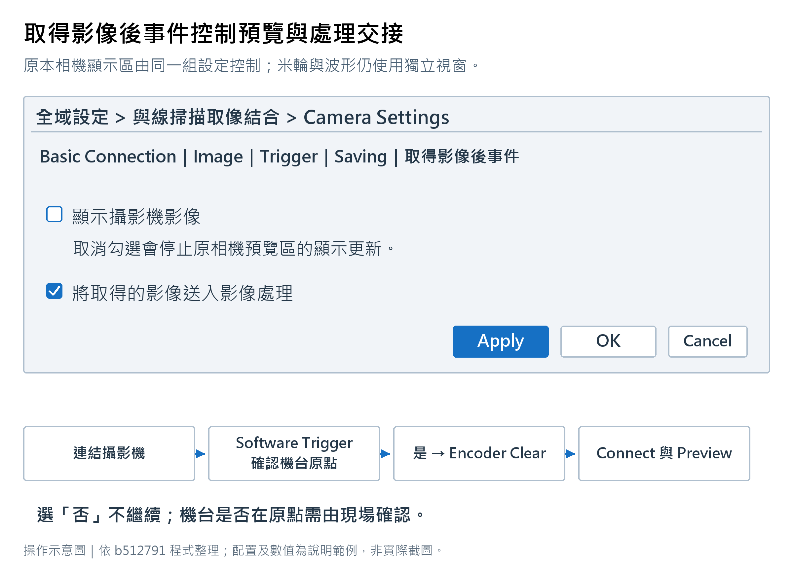

兩個勾選功能互相獨立；連續取像與檢測模式的差異請見檢測總覽。
<!-- /illustration -->

全域設定 > 與線掃描取像結合保留原相機操作介面。以下控制是否成功依實際 Sapera 裝置支援而定。

| 相機功能 | 使用方式 |
|---|---|
| Camera Settings 的 Basic Connection | 設定 Server Name、Resource Index、CCF 來源與開機自動連線 |
| 設定載入與診斷 | Load From Sapera、Read CCF To Fields、Load Features、Live Features、Acq Params 用於讀入及確認裝置資訊 |
| Image | 設定曝光、Gain、Length、Internal Line Rate，及滾動式拍照的持續張數／方向 |
| Trigger | 設定 Software／External 等模式及單幀外部觸發相關動作 |
| Saving | 設定圖片格式與 Software／External Trigger 完成後的自動保存 |
| 取得影像後事件 | 控制原相機預覽是否顯示，以及影像是否接入處理 |
| Meter Wheel Control | 連線卡片，查看／清除／設定 Encoder、Compare、Increment、倍率、方向與脈波寬度 |
| Extension | 使用米輪延伸比較設定，內容依卡片功能確認 |
| 灰階波形與影像檢視 | 依提示停止預覽後選取位置，開啟波形、確認或大圖檢視視窗 |

相機原本需要獨立視窗的設定、波形與米輪功能會繼續彈出視窗。按 Apply 保存設定後，再以狀態或讀回值確認硬體是否接受。

取消顯示相機影像會停止原預覽區的顯示更新，並不代表所有錄圖／預覽緩衝都不配置。相機自動存圖與主程式檢測 TIFF 保存是不同路徑，需分別確認容量。

## 13 歷史資料

### 13.1 查詢與明細

<!-- illustration:17_history -->
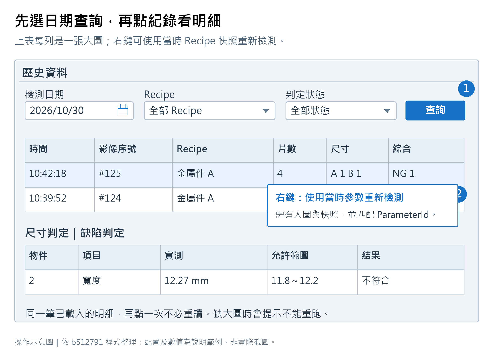

①選日期與篩選後查詢 ②點一列更新下方明細；右鍵開始歷史重跑。
<!-- /illustration -->

進入歷史資料，使用日期控制項的日曆選日期，也可前／後一天，再選 Recipe、判定狀態並查詢。摘要顯示筆數、物件數、尺寸通過、缺陷通過、綜合通過。

上表一筆代表一次完整大圖檢測，包含各類通過、NG、待確認數量。點一列，下方更新尺寸判定及缺陷判定兩頁；重複點同筆已載入資料不應重複查詢明細。此頁不顯示圖片預覽。

### 13.2 使用當時參數重新檢測

右鍵紀錄選「使用當時參數重新檢測」。系統檢查原始大圖與 Recipe 快照，再依紀錄的 ParameterId 選中當時檢測參數，進入參數結果確認執行。歷史參數以歷史名稱區分，不覆蓋正式 Recipe 原檔。

沒有保留大圖、路徑失效或快照不存在時，會顯示原因而不能重跑。舊紀錄缺少 ParameterId 時，只有快照恰有一個參數才能推定，多參數不會猜選。

目前歷史快照沒有保存當時全域相機精度。若後來改過 X/Y 精度，歷史重跑的 mm 數值或缺陷尺寸篩選可能與原次不同；原始歷史明細應保留作對照。

### 13.3 保存位置

每日資料庫為 history/yyyyMMdd.db，不另套一層日期資料夾。Recipe 快照放 history/recipe-snapshots，以內容雜湊去重。相機原圖放 CameraCapture/yyyyMMdd，手動確認副本放 snapshot/yyyyMMdd。

資料庫保存圖片與快照的關聯路徑。備份時應一起保留 DB、Recipe 快照與圖片目錄；只搬 DB 不能保證能重新檢測。

## 14 連線總控

<!-- illustration:18_controller -->
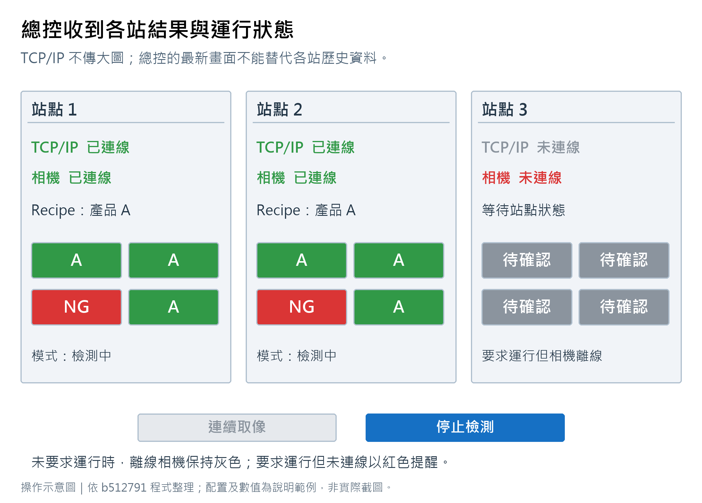

圖為要求檢測時的狀態示例；連續取像與檢測互斥，另一模式會停用。
<!-- /illustration -->

使用管理者或總監控模式，到全域設定 > 連線總控參數。啟用是否監控攝影機，設定進入頁面自動連線、斷線重連、連線逾時、重連間隔與心跳逾時。

新增最多 10 個被控站點，填啟用、唯一 ID、名稱、IP、Port，按保存。各被控軟體需啟用允許總控端連線，且防火牆允許對應端點。

進入連線總控角色後，每站顯示相機／TCP 狀態、Recipe、最新結果、物件矩陣與統計。收到的是數值與狀態，不是影像。

按連續取像或檢測會對已連線站發送命令；活動期間按鈕變為停止，另一模式停用。未啟動模式時離線相機為灰色；要求運行但站點未連線時以紅色提示。

站點狀態在連線、模式、命令與結果等事件更新，新連線可取得最新狀態；心跳主要用於確認存活。檢測結果另以 ResultId 進入持久待送佇列，相容總控端保存到本機 inbox 後回 ACK；發送端收到 ACK 才刪除待送結果，斷線期間會保留並重送。這不取代各站每日歷史紀錄，亦尚未在跨電腦斷線／重啟情境驗收。多個總控端目前共用待送佇列，尚未對每個 peer 個別確認；未設定 TLS 時網路內容不加密。

## 15 常見問題與目前限制

### 15.1 找不到框或結果

依序確認是否使用、ROI 組是否有效、來源物件是否找到、顯示框開關及物件選取。一般條件確認暗／亮門檻有啟用，篩選上下界沒有排除候選。頻域確認存在完整有效格，並記得門檻越大越嚴格。

### 15.2 不能開始下一張

查看左下角狀態是否仍在找物件、平場、尺寸、缺陷、顯示或取消。略過新圖是忙碌策略的一部分；若長時間不結束，保存影像尺寸、Recipe、最後階段文字與例外訊息，供工程人員追查。

### 15.3 切頁或換 Recipe 後異常

先確認目前 Recipe／檢測參數名稱、物件來源及執行完成狀態。切頁結果快照只在本次程式工作階段有效。總覽持續取像／檢測的切頁生命週期及 TCP 快速重連仍需在目標設備驗收；遠端命令驗證失敗時，確認兩端命令金鑰完全相同、時間同步且目標站點 ID 正確。

### 15.4 保存與重跑失敗

確認磁碟空間、目錄可寫入、大圖是否存在及參數快照是否仍保留。存圖與檢測同時執行，判定完成不表示 TIFF 已完成保存。資料夾目前沒有完整的自動保留天數與清理管理。

### 15.5 問題回報資料

記錄程式提交或版本、時間、站點 ID、Recipe 名稱與 ParameterId、影像尺寸、操作順序、最後訊息及預期結果。公司圖片不便外傳時，可先提供遮蔽後的設定欄位、計時和能重現的最小示例。
